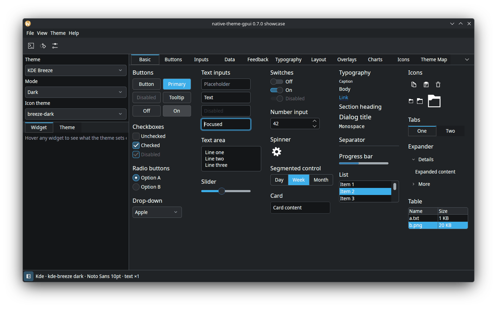
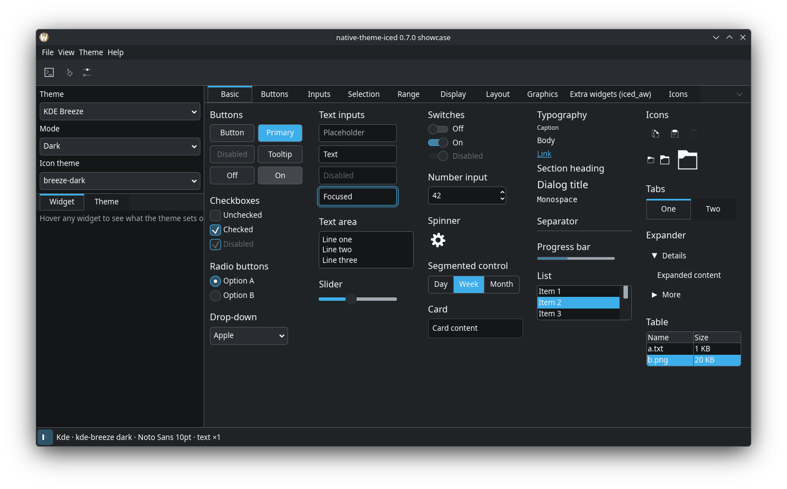
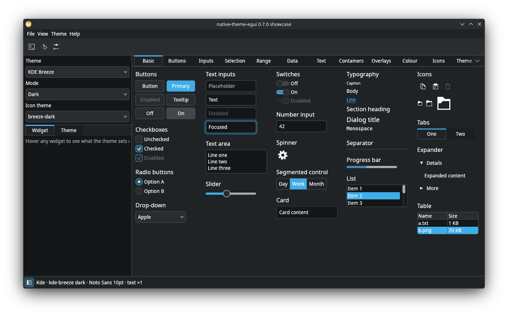
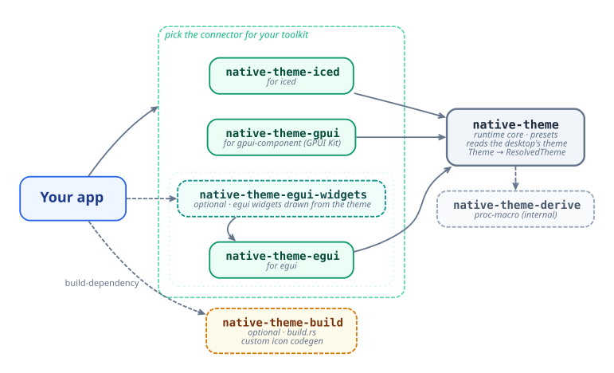

# native-theme

[](https://crates.io/crates/native-theme)
[](https://docs.rs/native-theme)
[](https://github.com/tiborgats/native-theme/actions/workflows/ci.yml)
[](#license)
[](https://blog.rust-lang.org/2025/06/26/Rust-1.88.0/)

Cross-platform native theme loading for Rust GUI applications. Reads OS themes
on Linux (KDE, GNOME), macOS, and Windows, or loads any of 17 bundled presets
(the platforms' own, such as `kde-breeze`, `adwaita`, `windows-11`,
`macos-tahoe` and `material-3`, and colour schemes such as Catppuccin, Nord,
Dracula and Tokyo Night), and hands your UI code a fully populated
`ResolvedTheme`.

**gpui**



**iced**



**egui**



## Pick your path

| Your GUI framework | Add this crate |
|---|---|
| [gpui](https://www.gpui.rs) | [`native-theme-gpui`](connectors/native-theme-gpui/) |
| [iced](https://iced.rs) | [`native-theme-iced`](connectors/native-theme-iced/) |
| [egui](https://www.egui.rs) | [`native-theme-egui`](connectors/native-theme-egui/) |
| egui, plus widgets drawn from the theme where egui's own cannot follow it (switch, segmented control, slider, …) | [`native-theme-egui-widgets`](connectors/native-theme-egui-widgets/), beside `native-theme-egui` |
| Writing a new framework connector | [`native-theme`](native-theme/) directly |

The connectors pull `native-theme` in transitively, so you only add one
dependency for the common case. The core crates and the iced connector build
with Rust 1.88; the gpui, egui and egui-widgets crates need Rust 1.95.

The OS readers cover KDE Plasma and GNOME (Budgie too) on Linux, macOS and
Windows. Any other Linux desktop gets the `adwaita` preset in the OS's light or
dark mode.

## Quick start

Add the connector for your framework. Reading the OS theme needs its `native`
feature; the bundled presets need none:

```toml
[dependencies]
native-theme-iced = { version = "0.8", features = ["native"] }
```

Then follow that crate's Quick start, which installs the theme in a running
application: [gpui](connectors/native-theme-gpui/README.md#quick-start),
[iced](connectors/native-theme-iced/README.md#quick-start),
[egui](connectors/native-theme-egui/README.md#quick-start). Without `native`,
`from_system()` gives the platform preset on Linux and an error on macOS and
Windows.

## How the 7 crates fit together



## Core concepts

- **`Theme`** — the sparse, TOML-shaped definition a preset or file loads. Fields are `Option<T>` because presets may omit almost anything.
- **`ResolvedTheme`** — the resolved variant (`.variant` of what `Theme::resolve(mode)` returns). Your UI code reads from this. Every font has a value, and so does every colour and size the model requires. The rest are `Option`s, which a theme, a bundled preset included, may leave `None`:
  - 34 colours, most of them state shades such as `checkbox.hover_background`;
  - the sizes the model treats as optional (padding sides, menu and list row heights, the list header height, toolbar height and item gap, tab item gap and active-indicator width, combobox arrow width, expander arrow gap and content indent, the checkbox's radio indicator width, radio dot diameter and check-mark stroke width, the switch's unchecked thumb diameter), the tooltip show delay, the dialog entrance, the expander's arrow side and frame, and the tab's active-indicator side: where one is `None`, the toolkit's own value applies;
  - `tab.active_outward_corner_radius`: where it is `None`, the selected tab's feet are square;
  - the switch's track and thumb outlines, their colours (five of the 34) and widths: where they are `None`, no outline is drawn, and a disabled track outline's colour left `None` takes the enabled one.
- **Preset** — a named, bundled theme (e.g. `catppuccin-mocha`, `kde-breeze`, `macos-monterey`). Load with `Theme::preset("name")`.
- **Connector** — a small crate that maps `ResolvedTheme` onto a GUI framework's native theming system. You depend on one of these.

## See it in action

- **gpui** — full widget gallery with live theme switching
  - Run: `cargo run -p native-theme-gpui --example showcase-gpui`; add `--features watch` to have it follow the OS theme's changes
  - Screenshots: [`native-theme-gpui/README.md`](connectors/native-theme-gpui/README.md#gallery)
- **iced** — full widget gallery with live theme switching
  - Run: `cargo run -p native-theme-iced --example showcase-iced`; add `--features watch` to have it follow the OS theme's changes
  - Screenshots: [`native-theme-iced/README.md`](connectors/native-theme-iced/README.md#gallery)
- **egui** — the gpui showcase's application in egui, with live theme switching
  - Run: `cargo run -p native-theme-egui --example showcase-egui`; add `--features watch` to have it follow the OS theme's changes
  - Screenshots: [`native-theme-egui/README.md`](connectors/native-theme-egui/README.md#gallery)

## Icon sets

**Material spinner**


**Lucide spinner**


Semantic icon roles (like `StatusBusy` or `DialogSuccess`) map to platform-appropriate glyphs:

- **Material Symbols** and **Lucide** bundled for offline use
- **freedesktop** on Linux — reads the active icon theme (Breeze, Adwaita, …)
- **SF Symbols** on macOS, **Segoe Fluent Icons** on Windows (platform lookups)
- Animated indicators respect the OS `prefers-reduced-motion` preference

See [`native-theme` crate docs](native-theme/) for the icon-loading API.

## Project docs

- [CHANGELOG](CHANGELOG.md) — release notes per version
- [CONTRIBUTING](CONTRIBUTING.md) — dev setup, commit conventions, PR workflow
- [SECURITY](SECURITY.md) — vulnerability reporting policy
- [ROADMAP](ROADMAP.md) — what's planned next

## License

Licensed under any of

- [Apache License, Version 2.0](http://www.apache.org/licenses/LICENSE-2.0)
- [MIT License](http://opensource.org/licenses/MIT)
- [0BSD License](https://opensource.org/license/0bsd)

at your option.

Unless you explicitly state otherwise, any contribution intentionally submitted
for inclusion in the work by you, as defined in the Apache-2.0 license, shall
be triple licensed as above, without any additional terms or conditions.
