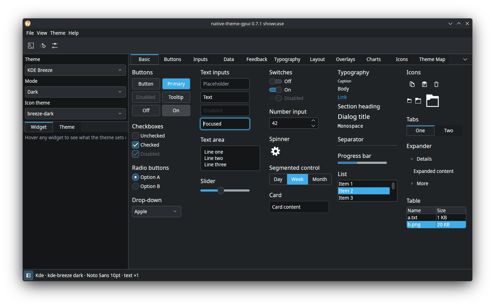
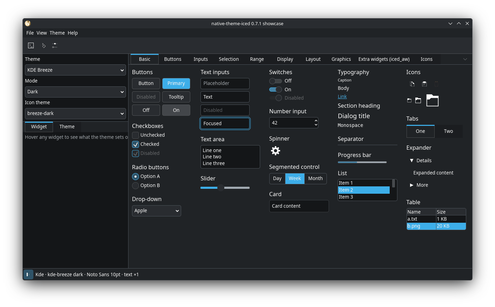
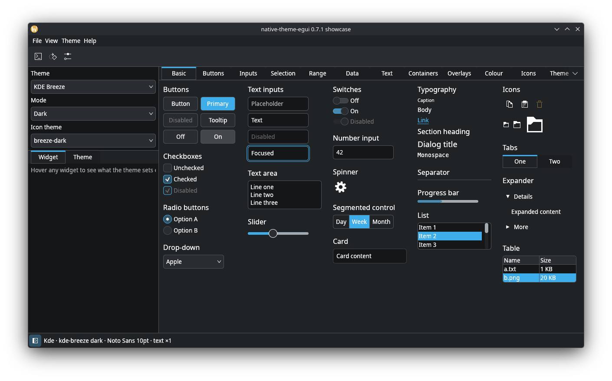
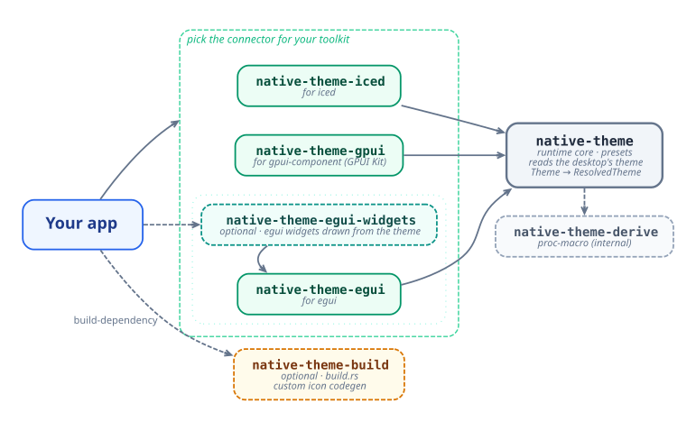

# native-theme

[](https://crates.io/crates/native-theme)
[](https://docs.rs/native-theme)
[](https://github.com/tiborgats/native-theme/actions/workflows/ci.yml)
[%20AND%20Apache--2.0%20AND%20MIT-blue.svg)](#license)
[](https://blog.rust-lang.org/2025/06/26/Rust-1.88.0/)

Cross-platform native themes for Rust GUI applications. A theme is a bundled
platform preset, generated from the platform's verified facts, with the
application's layers over it; resolved for a window, it gives the style of
each part of each widget, which a connector hands its toolkit.

0.8.0, the model described here, is being built: eight platform presets are
bundled (`adwaita`, `kde-breeze`, `macos-tahoe`, `macos-monterey`,
`windows-11`, `material-3`, `ios-26`, `ios-13`), the button is its one typed
widget so far, the OS readers are back, and the connectors return to it in a
later step.

**gpui**



**iced**



**egui**



## Pick your path

| Your GUI framework | Add this crate |
|---|---|
| [gpui](https://www.gpui.rs) | [`native-theme-gpui`](connectors/native-theme-gpui/) |
| [iced](https://iced.rs) | [`native-theme-iced`](connectors/native-theme-iced/) |
| [egui](https://www.egui.rs) | [`native-theme-egui`](connectors/native-theme-egui/) |
| egui, plus widgets drawn from the theme where egui's own cannot follow it (switch, segmented control, slider, …) | [`native-theme-egui-widgets`](connectors/native-theme-egui-widgets/), beside `native-theme-egui` |
| Writing a new framework connector | [`native-theme`](native-theme/) directly |

The connectors pull `native-theme` in transitively, so you only add one
dependency for the common case. The core crates and the iced connector build
with Rust 1.88; the gpui, egui and egui-widgets crates need Rust 1.95.

In 0.8.0 a theme is a bundled preset, the OS reader's layer
(`native_theme::Theme::from_system`) and the application's layers.

## Quick start

Add the connector for your framework. Reading the OS theme needs its `native`
feature; the bundled presets need none:

```toml
[dependencies]
native-theme-iced = { version = "0.8", features = ["native"] }
```

Then follow that crate's Quick start, which installs the theme in a running
application: [gpui](connectors/native-theme-gpui/README.md#quick-start),
[iced](connectors/native-theme-iced/README.md#quick-start),
[egui](connectors/native-theme-egui/README.md#quick-start). Without `native`,
`from_system()` gives the platform preset on Linux and an error on macOS and
Windows.

## How the 7 crates fit together



## Core concepts

- **`Theme`** — the one owner of the stack: a bundled preset, the application's layers, the accent and the application's conditions. Every change validates the whole stack and is refused whole where it does not hold.
- **Preset** — a platform's look as a bundled TOML file (`PresetId`), generated from the platform's verified facts: `adwaita` (GNOME's libadwaita) and `macos-tahoe` (macOS 26) today.
- **`Layer`** — an application's changes, in the presets' TOML format (`Layer::from_toml`) or built in Rust: bases, and rules that set values where their selector holds (a state, a variant, the scheme, a window condition, …).
- **`ResolvedTheme`** — the theme resolved for one window (`Theme::resolve`). The connector queries it: the style of each widget part (`style`), a widget's own values, the tokens and the colour roles; a query answers the style, or why there is nothing to draw.
- **Connector** — a small crate that maps `ResolvedTheme` onto a GUI framework's native theming system. You depend on one of these.

## See it in action

- **gpui** — full widget gallery with live theme switching
  - Run: `cargo run -p native-theme-gpui --example showcase-gpui`; add `--features watch` to have it follow the OS theme's changes
  - Screenshots: [`native-theme-gpui/README.md`](connectors/native-theme-gpui/README.md#gallery)
- **iced** — full widget gallery with live theme switching
  - Run: `cargo run -p native-theme-iced --example showcase-iced`; add `--features watch` to have it follow the OS theme's changes
  - Screenshots: [`native-theme-iced/README.md`](connectors/native-theme-iced/README.md#gallery)
- **egui** — the gpui showcase's application in egui, with live theme switching
  - Run: `cargo run -p native-theme-egui --example showcase-egui`; add `--features watch` to have it follow the OS theme's changes
  - Screenshots: [`native-theme-egui/README.md`](connectors/native-theme-egui/README.md#gallery)

## Icon sets

Semantic icon roles (like `StatusBusy` or `DialogSuccess`) map to platform-appropriate glyphs:

- **Material Symbols** and **Lucide** bundled for offline use
- **freedesktop** on Linux — reads the active icon theme (Breeze, Adwaita, …)
- **SF Symbols** on macOS, **Segoe Fluent Icons** on Windows (platform lookups)

See [`native-theme` crate docs](native-theme/) for the icon-loading API.

## Project docs

- [CHANGELOG](CHANGELOG.md) — release notes per version
- [CONTRIBUTING](CONTRIBUTING.md) — dev setup, commit conventions, PR workflow
- [SECURITY](SECURITY.md) — vulnerability reporting policy
- [ROADMAP](ROADMAP.md) — what's planned next

## License

Licensed under any of

- [Apache License, Version 2.0](http://www.apache.org/licenses/LICENSE-2.0)
- [MIT License](http://opensource.org/licenses/MIT)
- [0BSD License](https://opensource.org/license/0bsd)

at your option.

Four files are not: `native-theme/src/ripple.rs` and
`native-theme/src/platform/android_non_linear.rs` port code of the Android Open
Source Project and `native-theme/src/platform/m3_role.rs` code of Google's
material-color-utilities; these three stay under the
[Apache License, Version 2.0](http://www.apache.org/licenses/LICENSE-2.0) with
their copyright notices, whichever licence you pick for the rest;
`native-theme/src/platform/win_ui.rs` ports Microsoft's microsoft-ui-xaml
(WinUI's text-size curve) and stays under the MIT License with its notice. The
`native-theme` crate's licence is therefore
`(MIT OR Apache-2.0 OR 0BSD) AND Apache-2.0 AND MIT`, and the crate ships the
licence and the ports' notices (`native-theme/LICENSE-APACHE`,
`native-theme/NOTICE`).

Unless you explicitly state otherwise, any contribution intentionally submitted
for inclusion in the work by you, as defined in the Apache-2.0 license, shall
be triple licensed as above, without any additional terms or conditions.
