# native-theme-egui

`native-theme-egui` themes an [egui](https://github.com/emilk/egui)
application from a [`native-theme`](https://crates.io/crates/native-theme)
theme: the OS's own, read at run time, or one of native-theme's bundled
presets. One call gives every widget the theme's colours, strokes, radii,
spacing and text sizes with no further code. The values that belong to one
kind of widget — an input's border, a checkbox's checked fill, a menu's
items — reach the widgets the application puts in that widget's role scope:
egui's `Style` holds one set of widget visuals per interaction state
(inactive, hovered, active, …), shared by every kind of widget, so one global
`Style` cannot hold them all.

The companion crate
[`native-theme-egui-widgets`](../native-theme-egui-widgets/README.md) draws
the widgets no `Style` can make look native. The versions this crate
requires are in [Compatibility](#compatibility); to start, see
[Quick start](#quick-start).

## What it does

A `ThemeAtlas` compiles a `native_theme` theme, once per theme change, into
egui's own types, and hands them to egui through egui's own seams:

1. **The base style.** `ThemeAtlas::install` writes a base `egui::Style` into
   both `egui::Theme`s with `Context::set_style_of`. Every widget reads it with
   no application code: colours, strokes, radii, spacing, text styles, the
   scrollbar, the shadows. A later install replaces the earlier one.
2. **Role styles.** One `Arc<egui::Style>` per `Role` and `RoleVariant`, reached
   where the application asks for it: `ui.native_scope(role, variant, ..)` or
   `ui.native_set_style(role, variant)` from the `NativeThemeUiExt` trait, and
   `ThemeAtlas::role_modifier`, or `role_modifier(ui, role, variant)` from a
   `Ui`, for a popup or a menu; `ThemeAtlas::menu_bar_modifier`, or
   `menu_bar_modifier(ui)`, for a `MenuBar`'s titles: the `Role::Menu` style
   with the theme's menu-bar title fills, text colour and padding. A
   `TextEdit` in a `Role::Input` scope takes the input's borders, corner
   radius, text colours and padding; a plain single-line field takes one
   padding per axis, the mean of the two sides where a theme states different
   ones (windows-11), and the accessors are the exact route, each side its
   own; a multi-line field's route is `text_area_margin` and
   `text_area_frame`. A checked box in `Role::Checkbox` with
   `RoleVariant::Selected` takes the checked fill, and a button in
   `Role::Button` or a drop-down in `Role::ComboBox` its own font size. Inside a `Role::List` scope egui's
   non-interactive stroke, which draws a separator and a group's frame, is
   `list.grid_color` at `list.border.line_width`; no `Surface` is a list's, so
   a list's own outline is a `Frame` the application builds from
   `list.border`'s colour, width and corner radius (`convert::to_stroke`,
   `convert::to_corner_radius`).
3. **Surface frames.** One `egui::Frame` per `Surface` — window, title bar,
   dialog, popover, tooltip, card, side and central panels — from
   `ui.native_frame(surface)` or `ThemeAtlas::surface_frame`.

What the base style carries, among others:

| From the theme | Into egui's `Style` |
|---|---|
| the window background, `defaults.background_color` | `visuals.panel_fill` |
| the menu background | `visuals.window_fill` |
| the text and muted text colours | `visuals.widgets.*.fg_stroke`, `visuals.weak_text_color` |
| the button's fills, border, corner radius, padding and minimum height | `visuals.widgets.{inactive,hovered,active,open}`, `spacing.button_padding`, `spacing.interact_size.y` — shared by every interactive widget |
| the selection, link, warning and error colours | `visuals.selection`, `hyperlink_color`, `warn_fg_color`, `error_fg_color` |
| the window border, the window and menu corners, the shadows | `visuals.window_stroke`, `window_corner_radius`, `menu_corner_radius`, `window_shadow`, `popup_shadow` |
| a text field's fill, its caret and the caret's blink | `visuals.text_edit_bg_color`, `visuals.text_cursor` |
| the scroll bar | `spacing.scroll`, the thumb fills in `visuals.widgets` |
| the widget gap, the slider rail, the check box, the combo box width | `spacing.item_spacing`, `slider_rail_height`, `icon_width`, `icon_spacing`, `combo_width` |
| the tooltip's delay and width | `interaction.tooltip_delay`, `spacing.tooltip_width` |
| the body, monospace, caption and section-heading sizes | `text_styles` `Body`, `Monospace`, `Small`, `Heading` |
| reduced motion | `animation_time`, `scroll_animation` |

egui's own frames for every `Window`, `Modal`, menu, popup, tooltip and
`ComboBox` list fill from `visuals.window_fill` (`Frame::window`,
`Frame::menu`, `Frame::popup`), so each of them takes the menu background.
To give a window the window colour, `window.background_color`, hand it
`Window::frame(ui.native_frame(Surface::Window))`, or
`ThemeAtlas::surface_frame(theme, Surface::Window)` where no `Ui` is at hand.

The complete list, one row per native leaf with the egui field it reaches or
why it reaches none, is the mapping document in the API reference, rendered
from [`mapping.toml`](mapping.toml).

The install also registers a plugin that paints the platform's focus ring
around the widget with keyboard focus (where the theme says the platform shows
it for keyboard focus only, `defaults.focus_ring_keyboard_only`, only after a
key press) and, where the platform integration
reports no colour scheme (Linux), tells egui the OS one when the atlas carries
it (`from_system`, `to_egui_atlas`, `from_preset`, `Builder::os_mode`). A
widget whose ring is not a rounded rectangle round its own rect, such as a
switch's track beside its label, tells the plugin its outline with
`register_focus_shape`. The
values no `Style` field carries — the info colours, the warning text colour,
the text-scale roles, a `TextEdit`'s margin and frame, the dialog button
order, icon sizes — are free functions of the crate root and of `icons`.

## How it fits

Depend on this crate; it re-exports `egui` and `native_theme`, so your
`Cargo.toml` need not add a second dependency on either, whose version could
drift from the connector's.

It ships no `egui::Widget`, no image decoder, no font database of its own and
no fork of any egui type. System-font lookup is native-theme's
(`native_theme::fonts`, feature `system-fonts`), and icons are decoded by the
image loaders the application installs with `egui_extras`.

The widgets egui lacks, or draws from values no `Style` holds, are in
[`native-theme-egui-widgets`](../native-theme-egui-widgets/README.md): a
switch, a segmented control, and a slider, spinner, links, drop-down, radio
button, progress bar and expander drawn as the theme states them. They read
the atlas this crate installs; add that crate beside this one.

## Compatibility

**Required** — the floors this crate's own `Cargo.toml` states:

| Crate | Required |
|---|---|
| `egui` | 0.37.0 |
| `skrifa` | 0.44.0 |
| `eframe` (dev-dependency: the showcase) | 0.37.0 |
| `egui_extras` (dev-dependency: the showcase) | 0.37.0 |
| `egui_kittest` (dev-dependency: the showcase's tests) | 0.37.0 |
| `rust-version` | 1.95 |

`egui = "0.37.0"` is a caret requirement, `>=0.37.0, <0.38.0`: it accepts
later 0.37 patch releases and rejects 0.38. The floor is 0.37.0 because it is
the only 0.37 release. An exact `=0.37.0` pin would reject patch fixes, and a
wider range is impossible: your `egui::Style` must be this crate's `egui::Style`, and cargo
cannot unify two semver-incompatible egui versions in one build.

Each is a floor and nothing more, and deliberately not an open-ended range: a
*patch* release of an upstream crate has broken a connector in this repository
before, when gpui-component 0.6.2 removed a theme field the published
native-theme-gpui 0.5.8 wrote and 0.5.8 stopped compiling.

**Verified** — the versions `scripts/update_compatibility.sh run` last resolved and ran
this connector's tests, in all three feature configurations, clippy, docs in both
the default and all features, and the widget-coverage script against. The script
writes the line; a hand-edited one fails a test:

<!-- compat:begin -->
Verified against ecolor 0.37.0, eframe 0.37.0, egui 0.37.0, egui-wgpu 0.37.0, egui-winit 0.37.0, egui_extras 0.37.0, egui_kittest 0.37.0, emath 0.37.0, epaint 0.37.0, epaint_default_fonts 0.37.0 and kittest 0.5.0 on 2026-11-21.
<!-- compat:end -->

## Quick start

Add the crate to your `Cargo.toml`, with the OS readers (`native`):

```toml
[dependencies]
eframe = "0.37.0"
native-theme-egui = { version = "0.7", features = ["native"] }
```

The examples name egui through the connector's re-export,
`native_theme_egui::egui`: the egui its `Style`s and frames are built for, as
[How it fits](#how-it-fits) says. With these two dependencies cargo resolves
one egui, so `eframe::egui` is the same crate.

Install the OS theme once, where eframe hands you the `Context`, and let egui
follow the OS light/dark preference:

```rust,no_run
use native_theme_egui::egui;
use native_theme_egui::from_system;

struct MyApp;

impl eframe::App for MyApp {
    fn ui(&mut self, ui: &mut egui::Ui, _frame: &mut eframe::Frame) {
        ui.label("Hello");
    }
}

fn main() -> eframe::Result {
    eframe::run_native(
        "my-app",
        eframe::NativeOptions::default(),
        Box::new(|cc| {
            if let Ok(loaded) = from_system() {
                loaded.atlas.install(&cc.egui_ctx);
            }
            cc.egui_ctx.set_theme(egui::ThemePreference::System);
            Ok(Box::new(MyApp))
        }),
    )
}
```

Or a bundled preset with a bundled palette laid over it, in the 0.8.0 model
(`native_theme::next`): the preset's geometry and fonts in the palette's
colours. A palette locks both schemes to its own (`catppuccin-mocha` is dark),
so both scheme slots resolve dark; each slot is resolved for an active and an
inactive window, and `next::to_theme` builds one atlas of the four. That atlas
carries no OS colour mode, so this recipe pins the scheme:

```rust,no_run
use native_theme_egui::egui::{self, ThemePreference};
use native_theme_egui::native_theme::next::{Palette, Preset, Theme, ThemeContext};

fn install_preset(ctx: &egui::Context) -> Result<(), Box<dyn std::error::Error>> {
    let palette = Palette::from_name("catppuccin-mocha").ok_or("not a bundled palette")?;
    let theme = Theme::preset(Preset::Material3).with_palette(palette);
    let [light, light_inactive, dark, dark_inactive] = [
        ThemeContext::light(),
        ThemeContext::light().with_window_active(false),
        ThemeContext::dark(),
        ThemeContext::dark().with_window_active(false),
    ]
    .map(|context| theme.resolve(&context));
    native_theme_egui::next::to_theme(&light, &light_inactive, &dark, &dark_inactive)?
        .install(ctx);
    ctx.set_theme(ThemePreference::Dark);
    Ok(())
}
```

`ThemeAtlas::builder` takes every input one by one — the two variants, the
layout, the accessibility preferences, a font plan, the OS colour mode, the icon
set and theme, and a `style_patch` applied after the mapping.

## Window background

eframe paints `App::clear_color` behind every panel: its root `Ui` has no
margin or background colour (eframe `src/epi.rs:173`), and the default clear
colour is a translucent near-black, `rgba(12, 12, 12, 180)` (`:248-252`). A
panel fill the theme states translucent or transparent — `windows-11`'s
sidebar, WinUI's docked `NavigationView` pane over the window backdrop — lies
over that colour, so return the base style's `panel_fill`, the theme's
`defaults.background_color`, as the showcase does:

```rust,no_run
use native_theme_egui::egui;

struct MyApp;

impl eframe::App for MyApp {
    fn ui(&mut self, ui: &mut egui::Ui, _frame: &mut eframe::Frame) {
        ui.label("Hello");
    }

    fn clear_color(&self, visuals: &egui::Visuals) -> [f32; 4] {
        visuals.panel_fill.to_normalized_gamma_f32()
    }
}
```

## Core concepts

- **`Role`** names what a region of the interface is — a button, an input, a
  menu, a sidebar, a toolbar — and **`RoleVariant`** its state: `Normal`,
  `Selected`, `Disabled` or `SelectedDisabled` (a checked box that is
  disabled). Each pair is one pre-built style.
- **`Surface`** names a container's chrome; `Surface::Panel(PanelSide)` takes
  the side the panel is anchored to.
- **Containers built on `egui::Area`** — `Window`, `Modal`, `Popup`, tooltips,
  menus and `ComboBox` popups — build their content from the `Context`'s style,
  so a scope wrapped *around* one does not reach it. Give a popup or a menu
  `ThemeAtlas::role_modifier` (`role_modifier(ui, ..)` with a `Ui` at hand),
  and a menu bar `ThemeAtlas::menu_bar_modifier` (`menu_bar_modifier(ui)`);
  give a `Window` or a `Modal` its frame from
  `native_frame`, and make `ui.native_set_style(role, variant)` the first
  statement *inside* its closure for the body.
- **Without an atlas** every call degrades to egui's own behaviour; none
  panics. `role_modifier(ui, ..)` returns `None` then: pass the popup or the
  menu no style, and it keeps egui's own.

## Per-widget geometry

```rust,no_run
use native_theme_egui::egui;
use native_theme_egui::{NativeThemeUiExt, ResolvedTheme, Role, RoleVariant, Surface};

fn form(ui: &mut egui::Ui, t: &ResolvedTheme, name: &mut String) {
    ui.native_frame(Surface::Card).show(ui, |ui| {
        let id = egui::Id::unique("name");
        ui.native_scope(Role::Input, RoleVariant::Normal, |ui| {
            let frame = native_theme_egui::input_frame(ui, id, t);
            ui.add(egui::TextEdit::singleline(name).id(id).frame(frame));
        });
        ui.native_scope(Role::Button, RoleVariant::Normal, |ui| {
            let _ = ui.button("Save");
        });
    });
}
```

The free accessors cover what no `Style` field holds: `input_margin` and
`input_frame` for a `TextEdit`, `text_area_margin` and `text_area_frame` for
a multi-line one, `expander_icon` for a `CollapsingHeader`'s
arrow, `text_role_font` and `text_role_line_height` for the caption, heading,
dialog-title and display roles, `window_title_bar_font` and
`window_title_bar_text_color`, `dialog_button_order`, `list_header_height`
for `TableBuilder::header`, `toolbar_button_checked_background` and
`toolbar_button_checked_border_color` for a checked toolbar button's fill and
line, `default_button` for a dialog's default button
(`Some` where the theme states `button.default_button_background`, `None`
where the default button is the primary one: draw it then as a selected
button in the `Role::Button` scope, which takes `button.primary_background`
and `primary_text_color`; since egui's `Button::fill` and `Button::stroke`
override every on-hover effect, the application picks the look from the
button's previous response: at rest `fill`, `text` and `stroke`, hovered
`hover_stroke`, focused and not pressed `focus_stroke`, pressed `hover_stroke`
and no fill or label colour, so that egui draws the plain button's pressed
fill and label), `icons::icon_size`, and the colours egui has no
slot for (`info_color`, `warning_text_color`, …). `tooltip_show_delay` is the
delay the atlas writes into `Style::interaction.tooltip_delay`, as a
`Duration`, for a tooltip the application times itself.
`selection_inactive_text_color` is the text over
`selection_inactive_background`, the selection of a view without the focus
(egui has one selection pair), and `list_header_hover_background` and
`list_header_active_background` are the fills of a hovered and a pressed
column-header section where the theme states them (`None` otherwise), for a
header the application paints, since egui_extras' header row has no hover. A
leaf that needs no conversion is read from the `ResolvedTheme` itself
(`ThemeAtlas::resolved_for`). A button in the toolbar
role is a flat tool button: the role colours its hover and press and leaves its rest
to the button. Make it flat with `Button::frame_when_inactive(false)`, or in a scope
whose resting fill and border colour are transparent; both keep its size.

## Fonts

With the `system-fonts` feature (on by default) `from_preset`, `from_system`
and `to_egui_atlas` attach `fonts::FontPlan::from_system`, which asks
native-theme for the faces of the theme's font families and installs them as
the head of egui's `Proportional` and `Monospace` families. Without a base of
the application's own, the plan's base is `FontDefinitions::default()` under
the application's egui features: egui 0.37 adds its two emoji faces,
`NotoEmoji-Regular` and `emoji-icon-font`, only under its
`monochrome_emoji_fonts` feature, and `default_fonts`, which an eframe
application with eframe's default features has, still gives Ubuntu-Light,
Hack and `egui-icons`, the face of `egui::special_emojis`
(`epaint-0.37.0/src/text/font_definitions.rs`). An
application with fonts of its own passes them as the plan's base. On the OS
theme, `SystemThemeExt::to_egui_builder` is the builder `to_egui_atlas` builds,
before its `build()`, so every OS input stays and the second `fonts` call
replaces the first:

```rust,no_run
use native_theme_egui::egui;
use native_theme_egui::fonts::FontPlan;
use native_theme_egui::native_theme::SystemTheme;
use native_theme_egui::{SystemThemeExt, ThemeAtlas};

fn atlas(defs: egui::FontDefinitions) -> native_theme_egui::Result<ThemeAtlas> {
    let sys = SystemTheme::from_system()?;
    Ok(sys
        .to_egui_builder()
        .fonts(FontPlan::from_system(&sys.light).with_base(defs))
        .build())
}
```

A `Builder::style_patch` of the application's own goes on the same builder,
and `ThemeAtlas::builder` takes the same plan for any other theme.
Installing the installed atlas again (the one `ThemeAtlas::from_ctx` returns)
keeps the fonts and icons the application added since, restoring only the base
styles, its own `TextStyle::Name` keys kept; `ThemeAtlas::clear` then `install`
brings back the atlas's fonts. This crate never emits a `FontFamily::Name`. A
family the platform does not have is drawn in the family the platform draws in
its place (`native_theme::fonts::substitute_family_cached`: fontconfig's best
match on Linux, what every native application there gets, asked once per family
per process; none yet on macOS and Windows)
and is reported in `ThemeAtlas::notes` as `Note::FontFamilyUnavailable`, whose
`substitute` names it. A family with no substitute the platform has a face of,
or a face epaint could not read, leaves egui's own and is reported too
(`Note::FontFamilyUnavailable` with no `substitute`, `Note::FontDataInvalid`).

## Icons

Install `egui_extras`' image loaders with its `svg` feature
(`egui_extras::install_image_loaders`). An SVG icon's URI is the hash of its
final bytes, so it changes whenever the pixels do: the tint is baked into a
bundled monochrome icon's bytes, and a freedesktop icon that leaves its colour
to `currentColor` is drawn in the key's tint, else the theme's text colour. An
icon no theme holds is `None`; nothing is substituted. Installing another
atlas, and `ThemeAtlas::clear`, release the icons this crate cached
(`icons::forget_icons`) and leave the application's own images alone; a raster
icon's texture is freed then, so call `to_image_source` in each pass rather
than keeping its result (the texture is cached, a pass uploads nothing new).
`icons::custom_icon_to_image_source` keeps the icon a provider's name loads,
per icon theme, size and colour, until then, so a freedesktop icon is read from
disk once, not in every pass.
Installing the installed atlas again restores its base styles and does nothing
else: it sets no fonts, forgets no icon and requests no repaint.

## Features

| Feature | Default | Effect |
|---|---|---|
| `material-icons` | on | the bundled Material icon set |
| `lucide-icons` | on | the bundled Lucide icon set |
| `system-icons` | on | the system icon lookup: freedesktop icon themes, SF Symbols and Windows' Segoe Fluent glyphs (native-theme's feature also turns `material-icons` on) |
| `system-fonts` | on | `FontPlan::from_system`, and the system typeface in `from_preset`, `from_system` and `to_egui_atlas` |
| `svg-rasterize` | off | native-theme's in-process SVG rasteriser, whose output `icons::to_color_image` converts |
| `native` | off | the OS readers, so `from_system`, `native_theme_egui::native_theme::SystemTheme::from_system` and `ThemeWatcher::system_rebuild` read the OS theme |
| `watch` | off | `ThemeWatcher`, which follows the OS theme's changes |

Each forwards to the `native-theme` feature of the same name. With
`default-features = false` and only the features you use, the build is
smaller. The OS readers are the `native` feature, off by default as in
native-theme (a `native-theme` dependency of your own can name its finer
`kde`, `portal`, `macos` and `windows` instead, one platform each); without
one, `from_system()` is the platform preset on Linux and an error on macOS
and Windows. `watch` needs a reader feature too.

## Accessibility

`Builder::accessibility` — and `from_preset`'s `prefs`, `from_system` and
`to_egui_atlas` with the OS's own preferences — carries the text-scaling factor
and reduced motion into the atlas. Every text size the atlas installs is
multiplied by the factor; geometry is not: paddings, radii, widths and icon
sizes keep the theme's values. Reduced motion sets egui's animation time to
zero and turns scroll animation off. The accessors that return a text size
take the same preferences, and `scaled_text_size` scales a size read from the
`ResolvedTheme` directly.
`Context::set_zoom_factor` is the user's zoom, and this crate never touches it.

## Common recipes

### Apply user overrides to the OS theme

An overlay states only what it changes, in both variants: the atlas holds
both, and egui draws the one of its colour scheme, so an overlay of
`[light.defaults]` alone changes nothing on screen under a dark scheme.

```rust,no_run
use native_theme_egui::SystemThemeExt;
use native_theme_egui::egui;
use native_theme_egui::native_theme::{SystemTheme, Theme};

fn install_customised(ctx: &egui::Context) -> native_theme_egui::Result<()> {
    let sys = SystemTheme::from_system()?;
    let overlay = Theme::from_toml(r##"
[light.defaults]
accent_color = "#ff6600"

[dark.defaults]
accent_color = "#ff6600"
"##)?;
    let customised = sys.with_overlay(&overlay)?;
    customised.to_egui_atlas().install(ctx);
    ctx.set_theme(egui::ThemePreference::System);
    Ok(())
}
```

### Runtime theme change

With the `watch` feature and a reader feature (`native`),
`ThemeWatcher::start(ctx, rebuild)` rebuilds the atlas on the watcher thread on
every OS theme change and wakes egui; the UI thread installs it:

```rust,no_run
use native_theme_egui::egui;
use native_theme_egui::ThemeWatcher;

struct MyApp {
    watcher: Option<ThemeWatcher>,
}

impl MyApp {
    fn new(cc: &eframe::CreationContext<'_>) -> Self {
        let watcher = ThemeWatcher::start(&cc.egui_ctx, ThemeWatcher::system_rebuild).ok();
        Self { watcher }
    }
}

impl eframe::App for MyApp {
    fn logic(&mut self, ctx: &egui::Context, _frame: &mut eframe::Frame) {
        if let Some(atlas) = self.watcher.as_ref().and_then(ThemeWatcher::take) {
            atlas.install(ctx);
        }
    }

    fn ui(&mut self, ui: &mut egui::Ui, _frame: &mut eframe::Frame) {
        ui.label("Hello");
    }
}
```

`system_rebuild` is the rebuild for an application on the OS theme; one that
built its atlas with inputs of its own passes a closure that builds the same
again: with fonts or a `style_patch` of its own, which `system_rebuild` would
drop, it adds them to `SystemThemeExt::to_egui_builder`, as in [Fonts](#fonts).
`system_rebuild` reads with `from_system()`, which picks the running OS
version's preset, so an application that pinned a preset with
`native_theme_egui::native_theme::SystemTheme::from_system_with_preset(name)`
passes a closure that reads with it again:
`native_theme_egui::native_theme::detect::invalidate_caches()`, then
`from_system_with_preset(name)` and `SystemThemeExt::to_egui_atlas` (or
`to_egui_builder`). A failed rebuild keeps the installed theme, reports its
message through `last_error` and requests a repaint, as a successful one does.
Dropping the watcher stops it. KDE Plasma, GNOME and Budgie, macOS and Windows
are watched; another Linux desktop returns an error from `start`.

### Custom icons

For app-specific icons generated via [`native-theme-build`](https://crates.io/crates/native-theme-build).
The code it generates names native-theme's paths through the crate path it is
given, so give it the re-exported source crate, and the connector stays the
one dependency: `IconGenerator::new().crate_path("native_theme_egui::native_theme")`.
An `IconKey` names the icon by the provider's own name for the set, where it
has one, which is also its alt text:

```rust,no_run
use native_theme_egui::egui;
use native_theme_egui::icons::{IconContext, IconKey, custom_icon_to_image, icon_size};
use native_theme_egui::{IconProvider, ThemeAtlas};
# use std::borrow::Cow;
# use native_theme_egui::IconSet;
# #[derive(Debug)]
# enum AppIcon { PlayPause }
# impl IconProvider for AppIcon {
#     fn icon_name(&self, _: IconSet) -> Option<&str> { None }
#     fn icon_svg(&self, _: IconSet) -> Option<Cow<'static, [u8]>> { None }
# }

fn play_pause_icon(ui: &mut egui::Ui) {
    let Some(atlas) = ThemeAtlas::from_ctx(ui.ctx()) else {
        return;
    };
    let scheme = ui.ctx().theme();
    let Some(theme) = atlas.resolved_for(scheme) else {
        return;
    };
    let set = atlas.icon_set();
    let side = icon_size(theme, IconContext::Toolbar);
    let icon = AppIcon::PlayPause;
    let mut key = IconKey::name(icon.icon_name(set).unwrap_or("play-pause"), set)
        .size(side)
        .tint(ui.visuals().text_color());
    if let Some(name) = atlas.icon_theme(scheme) {
        key = key.icon_theme(name);
    }
    if let Some(image) = custom_icon_to_image(ui.ctx(), &icon, &key) {
        ui.add(image.fit_to_exact_size(egui::Vec2::splat(side)));
    }
}
```

### Role icons

An icon by its role, in the installed theme's icon set and a tint:

```rust,no_run
use native_theme_egui::egui;
use native_theme_egui::icons::{IconContext, IconKey, custom_icon_to_image, icon_size};
use native_theme_egui::{IconRole, ThemeAtlas};

fn warning_icon(ui: &mut egui::Ui) {
    let Some(atlas) = ThemeAtlas::from_ctx(ui.ctx()) else {
        return;
    };
    let scheme = ui.ctx().theme();
    let Some(theme) = atlas.resolved_for(scheme) else {
        return;
    };
    let role = IconRole::DialogWarning;
    let side = icon_size(theme, IconContext::Toolbar);
    let mut key = IconKey::role(role, atlas.icon_set())
        .size(side)
        .tint(ui.visuals().warn_fg_color);
    if let Some(name) = atlas.icon_theme(scheme) {
        key = key.icon_theme(name);
    }
    if let Some(image) = custom_icon_to_image(ui.ctx(), &role, &key) {
        ui.add(image.fit_to_exact_size(egui::Vec2::splat(side)));
    }
}
```

The icon comes from the installed theme's icon set (`ThemeAtlas::icon_set`) and,
for a freedesktop set, its icon theme for the scheme egui draws
(`ThemeAtlas::icon_theme`), at the theme's size. An `IconRole` is an
`IconProvider`, so `icons::custom_icon_to_image` (and
`custom_icon_to_image_source`, its `ImageSource`) load a role as they load an
application's own icon; `icons::to_image` takes icon data the application
loaded itself.

### Animated spinners

`native_theme_egui_widgets::spinner::Spinner`, of the widgets crate, draws the
icon set's indicator itself. To draw one of your own, load the indicator of
the atlas's set once per installed atlas, and draw its frame for the moment
through `icons::to_image` under one key, coloured as that set is coloured:

```rust,no_run
use native_theme_egui::egui;
use native_theme_egui::icons::{IconKey, animated_frame_index, spin_angle, to_image};
use native_theme_egui::native_theme::icons::load_icon_indicator;
use native_theme_egui::{AnimatedIcon, ThemeAtlas};

// Once per installed atlas, kept with the application's state.
fn load_indicator(atlas: &ThemeAtlas, scheme: egui::Theme) -> Option<AnimatedIcon> {
    load_icon_indicator(atlas.icon_set(), atlas.icon_theme(scheme))
}

fn spinner(ui: &mut egui::Ui, anim: &AnimatedIcon) {
    let Some(atlas) = ThemeAtlas::from_ctx(ui.ctx()) else {
        return;
    };
    let scheme = ui.ctx().theme();
    let Some(theme) = atlas.resolved_for(scheme) else {
        return;
    };
    let side = theme.spinner.diameter;
    let reduce_motion = atlas.accessibility().reduce_motion;
    // The text colour: a Material or Lucide frame is tinted it, and a
    // freedesktop frame's `currentColor` takes it where the frame sets no
    // colour of its own.
    let mut key = IconKey::name("indicator", atlas.icon_set())
        .size(side)
        .tint(ui.visuals().text_color());
    if let Some(name) = atlas.icon_theme(scheme) {
        key = key.icon_theme(name);
    }
    // The frame of the moment, or the first one, standing still, under
    // reduced motion; a turning icon has one frame and an angle.
    let frame = animated_frame_index(ui.ctx(), anim, reduce_motion)
        .and_then(|i| anim.frame_list()?.get(i))
        .unwrap_or_else(|| anim.first_frame());
    if let Some(mut image) = to_image(ui.ctx(), &key, frame) {
        if let Some(angle) = spin_angle(ui.ctx(), anim, reduce_motion) {
            image = image.rotate(angle, egui::Vec2::splat(0.5));
        }
        ui.add(image.fit_to_exact_size(egui::Vec2::splat(side)));
    }
}
```

`animated_frame_index` and `spin_angle` schedule egui's next repaint
themselves, and return `None` under reduced motion.

## Limits

egui 0.37.0 cannot show everything a platform theme states: some leaves have
no `Style` field — an accent colour, a text colour per role, a stated-size unit
beside `FontId::size` — and some parts egui draws in a way no style changes: a
`Window` or `Modal` only fades in (`Area::fade_in`,
`egui-0.37.0/src/containers/area.rs`), with no scaling or rising entrance, and
a `Slider` draws no tick marks. Each such leaf is a `mapping.toml` row marked
`unmappable`, with the reason, and the mapping document in the API reference
lists them all.

egui's `MenuButton` draws a menu-bar title from the pointer alone
(`egui-0.37.0/src/containers/menu.rs`): only a `SubMenuButton` draws its
`open` look while its menu shows. So `menu_bar_modifier`'s open fill
(`menu.bar_open_background`, Breeze's focus colour) reaches a bar title only
where the application swaps the style's `widgets.open` in while that title's
menu is open, as the showcase's menu bar does.

egui draws a pressed menu item in `widgets.active`, which is also the look of
the item the keyboard focuses (`egui-0.37.0/src/widget_style/mod.rs`), and
the arrow keys move that focus along a menu's items
(`egui-0.37.0/src/containers/menu.rs`): Breeze's pressed look
(`menu.active_background`, `active_text_color`) would stay on every
keyboard-selected item, where Breeze draws the hover look. So a pressed menu
item keeps the hover look, its outline included.

egui pads a menu item's text by one `button_padding.x` on both sides, so the
item takes `menu.border.padding.left` on both where the theme states it: the
shortcut text, which egui lays out flush right in the padding
(`Button::shortcut_text`), and a submenu's arrow end that far from the right
edge, 14 px under kde-breeze where Breeze's shortcut and arrow end 27 px
from it.

A hovered row's outline (`list.hover_border_color`) is drawn by the
application where it paints its rows, as the showcase's list and command
palette do. egui_extras' `TableBuilder` fills a hovered row cell by cell with
`widgets.hovered.bg_fill` and draws no line round it
(`egui_extras-0.37.0/src/layout.rs`); its column line runs through header and
body alike in `noninteractive.bg_stroke` (`egui_extras-0.37.0/src/table.rs`),
so the header's section line (`list.header_separator_color`) is drawn where the
application paints its header, as the showcase's Basic table does.

egui's own `Slider` strokes its handle in `fg_stroke`, the colour that also
letters its value (`egui-0.37.0/src/widgets/slider_core.rs`,
`egui-0.37.0/src/style.rs`), so the knob's outline
(`slider.thumb_border_color`, `thumb_border_line_width`,
`thumb_hover_border_color`, `thumb_focus_border_color`) is drawn by
native-theme-egui-widgets' `Slider`.

A submenu opens egui's 2.0 points from its menu's frame
(`MenuConfig::submenu_gap`, `egui-0.37.0/src/containers/menu.rs`): a field of
the menu's configuration, not of the `Style`, with no theme value, as
native-theme's model states no such gap.

One egui colour, `visuals.extreme_bg_color`, fills the scroll-bar groove, a
`ProgressBar`'s track and `Frame::canvas`. The base style puts the theme's
scroll-bar track there; a `ProgressBar` inside `Role::ProgressBar` takes
`progress_bar.track_color`. Where the scroll bar is an overlay one with a fully
transparent track (macOS), the groove's opacities are 0 and the slot takes the
input background instead. A solid scroll bar's groove is painted at full
opacity, so its track stays in the slot even when the theme states it
transparent, as `windows-11` and `kde-breeze` do: there a canvas frame and a
progress bar outside its role have no fill.

egui paints a scroll bar's handle at rest with `visuals.widgets.inactive.bg_fill`,
so the base style puts `scrollbar.thumb_color` there; egui has no slot of its own
for it. The same slot fills an unscoped slider's rail and handle, a check box and a
radio button. Where the handle is pale, as Breeze's grey is (`kde-breeze`, #cbcdcd /
#46494b), an unscoped slider's rail all but disappears on the window (1.4:1 /
1.7:1). A slider inside `Role::Slider` takes `slider.track_color`.

### What the 0.8.0 model states that egui cannot draw

The `next` module maps the 0.8.0 model (`native_theme::next`), which states
more than 0.7.2 did: `next::to_theme` builds the same `ThemeAtlas` from it,
and each crate-root accessor has a twin there. Where egui has a receiver,
`next` wires the value through; where it has none, the value is dropped as
listed here, and a value the theme leaves unstated is egui's own
(docs/v0.8.0-spec.md §10, rule 0).

- **The focus ring's kind.** The install plugin strokes one ring round
  the focused widget's rect grown by the ring's offset, outward from that
  line (src/plugin.rs, `paint_focus_ring`; `Painter::rect_stroke` with
  `StrokeKind::Outside`, `egui-0.37.0/src/painter.rs`), in
  `focus_ring.stroke`'s colour and width, shown as `focus_ring.trigger`
  says; a second ring is drawn inward from the same line where the theme
  states `inner_stroke` (a second `rect_stroke`, `StrokeKind::Inside`), as
  the model places a ring (spec §2, `FocusIndicator`). The line's corners
  are the widget's grown by the offset, or `focus_ring.corners` where the
  theme states them; each ring's far edge is concentric. A `kind` of
  `Fill` or `Underline` is no ring: `next::to_theme` returns
  `Unmapped("focus_ring.kind")` for it; a second ring stated per side is
  `Unmapped`, and so are concentric corners, which need the container's
  radius. A ring stated per side is no ring, with no error and no note.
- **A part's own focus ring.** Where the part a role's cell reads its fill
  and stroke from states a ring of its own (`PartStyle.focus`, spec §2
  `FocusIndicator`), the plugin strokes that ring in place of
  `focus_ring` round a widget in the role's scope (`native_scope`,
  `native_set_style`), on the same geometry, shown as its own `trigger`
  says; where the part states none, no ring; where it states nothing, the
  global ring. The part is asked at `FOCUS_VISIBLE` for a focus that
  followed a key press, else at `FOCUSED`, a checked check box's
  (`RoleVariant::Selected`) with `CHECKED`:

  | Role | Part |
  |---|---|
  | `Button` | `button.body` |
  | `Input` | `input.field` |
  | `Checkbox` | `checkbox.indicator` |
  | `Slider` | `slider.thumb` |
  | `Tab` | `tab.tab` |
  | `Switch` | `switch.track` |
  | `ComboBox` | `combo_box.field` |
  | `SegmentedControl` | `segmented_control.segment` |
  | `Expander` | `expander.header` |
  | `Menu` | `menu.item` |
  | `List` | `list.row` |
  | `Toolbar` | `toolbar.button` |
  | `Sidebar` | `sidebar.item` |

  A widget in no scope takes the base style's look, `button.body`'s, and
  so `button.body`'s own ring. Every other role, and a scope
  `native_set_style_with_ring` styled, takes the global ring. egui has no radio role: a `RadioButton` in a
  `Role::Checkbox` scope takes `checkbox.indicator`'s ring, and
  `radio.indicator`'s own is not drawn, reported as a `Note::Unmapped` at
  `radio.indicator(FOCUSED).focus` or `radio.indicator(FOCUS_VISIBLE).focus`
  where the theme states one. A part's ring egui cannot draw (a
  fill, an underline, a stroke stated per side, concentric corners) is
  none, reported as a `Note::Unmapped` at its home in `ThemeAtlas::notes`
  (`button.body(FOCUSED).focus.kind`, ...).
- **A stroke per side.** egui strokes a rect with one `Stroke`, one width
  and colour on all four sides (`epaint-0.37.0/src/shapes/rect_shape.rs`,
  `RectShape::stroke`). Where the theme states a part's stroke per side
  (`Stroke::Complex`), the part keeps egui's own stroke, as if the theme
  stated none, and the part reads (`next::stroke_color_of`,
  `next::stroke_width_of`) return `None`; the atlas reports each such stroke
  it meets as a `Note::Unmapped` at its home in `ThemeAtlas::notes`.
- **Corners.** egui rounds a rect with four circular radii, each a whole
  point up to 255 (`epaint-0.37.0/src/corner_radius.rs`, `CornerRadius`),
  and the atlas rounds each part by one radius (`next::radius_of`). A
  continuous corner (`CornerCurve::Continuous`, Apple's) is drawn as the
  circular corner of the stated radius (docs/v0.8.0-spec.md §10, rule 2),
  and Widget Info marks its value `(drawn circular)`; per-corner radii
  that are one are drawn as that radius, and a pill as 255, which epaint
  clamps to half the rect's shorter side (`epaint-0.37.0`
  `src/rounded_rect.rs`, `RoundedRect::new`), so a part whose shorter side
  passes 510 points is rounded by 255 only. Where the theme states a
  part's radii per corner and they differ, or states them concentric with
  a container, the part keeps egui's own radius, and the atlas (and
  `next::text_area_frame`, for the multi-line field) reports it as a
  `Note::Unmapped` at the corners' home. Per-corner radii that differ are
  a limit of this connector, not of egui, whose `CornerRadius` holds one
  radius per corner: the atlas carries one radius per part (one `f32`). A
  concentric radius is the container's radius less an inset, which the
  atlas does not know.
- **Shadows beyond one outset layer.** egui's `Shadow` is one outset
  shadow: an offset in whole points (`[i8; 2]`), a blur and a spread in
  whole points (`u8`), and a colour (`epaint-0.37.0/src/shadow.rs`), one
  per frame (`Frame::shadow`, `egui-0.37.0/src/containers/frame.rs`) and
  one each for windows and popups (`Visuals::window_shadow`,
  `popup_shadow`). The atlas draws the first outset layer a surface states
  (docs/v0.8.0-spec.md §10, rule 2): the window frame's into
  `window_shadow`, the menu panel's (else the popover panel's) into
  `popup_shadow`, and each dialog's, popover's, tooltip's, card's and
  panel's into its frame, its lengths rounded to whole points. An inset layer and every layer after the
  first are not drawn: `Shadow` has no inset form and a frame takes one
  shadow. A widget's own shadow (a button's, a field's) is not drawn:
  egui's `WidgetVisuals` has no shadow (`egui-0.37.0/src/style.rs`).
- **Gradients and layered fills.** egui fills a shape with one `Color32`
  (`epaint-0.37.0/src/shapes/rect_shape.rs`, `RectShape::fill`). A fill the
  theme states as layers (`Paint::Complex`, a gradient among them) is drawn
  in the one colour the model gives in its place, its fallback colour
  (docs/v0.8.0-spec.md §10, rule 2), and as egui's own fill where it gives
  none, layers that are all gradients. The fill readers `next::fill_of` and
  `next::state_fill_of` take the fill's home and return those layers as
  `Unmapped` at it (rule 4), not as the `None` of a fill the theme leaves
  unstated; the companion crate `native-theme-egui-widgets` reports each
  such fill its widgets read as a `Note::Unmapped` (`next_fills_unmapped`),
  its widgets drawing egui's own there.
- **Where a translucent stroke lies.** egui ends a rect's fill at the
  stroke's inner edge (`epaint-0.37.0/src/tessellator.rs`,
  `stroke_and_fill_path`), so a stroke the theme lays `Outside` the part is
  drawn as stated. One it lays `Inside`, over the fill, is handed to egui
  composited over the fill the state paints, which looks the same; one
  `Center`ed on the edge is composited over that fill at half its alpha, so
  the whole band is drawn in the band's mean colour where the platform shows
  the fill under its inner half only (src/style/line.rs). An opaque stroke
  is drawn exactly in every alignment.
- **A flat button's narrower hovered or pressed outline.** egui lays a
  button out at the inner margin `button_padding + expansion −
  bg_stroke.width` of its state (`egui-0.37.0/src/theme/default_style.rs`,
  `src/containers/frame.rs`), with one `button_padding` for every state,
  and `expansion` grows the painted rect too, so egui has no per-state room
  to keep a button's box when a state's outline is narrower than the
  resting one. A flat button's hovered or pressed outline stated as no
  width is drawn as a transparent one of the resting width, which keeps the
  box; one stated between none and the resting width is drawn at its
  stated width, and the button grows by the difference in that state
  (src/style/variants.rs, `flat_cell`; docs/v0.8.0-spec.md §10, rule 4).
  No bundled preset states such a width.

## Semver

1. The crate version equals the workspace version.
2. One egui minor per release line of this crate; an egui minor bump is a
   **breaking change** for this crate.
3. **The numeric contents of a produced `egui::Style` are not covered.** A
   mapping fix — electing a different base owner, correcting a sink, closing a
   `Note` — is never a breaking change.
4. Every public enum is `#[non_exhaustive]` except `PanelSide`, so a new `Role`,
   `Surface`, `RoleVariant`, `Note`, `TextRole`, `IconContext` or `FontBytes`
   variant is additive; each of `Note`'s struct variants carries its own
   `#[non_exhaustive]`, so enriching one stays additive too.
5. Adding a free accessor is additive.
6. `ThemeAtlas`, `Builder`, `FontPlan`, `IconKey` and — behind feature `watch` —
   `ThemeWatcher` are opaque, and `NativeThemeUiExt` and `SystemThemeExt` are
   sealed, so adding a method to any of them is additive.

`Surface::Panel` and both `FontBytes` tuple variants are deliberately
exhaustive: on a tuple variant the attribute would make the variant impossible
to construct outside this crate, and constructing them is the documented call
shape. For `NativeThemeUiExt`, clause 6 holds only for a method name that
exists on neither `egui::Ui` nor `egui::Context`, which is the rule every
method added to it follows.

### When egui bumps

The compile-time tripwires catch a `Style` field added or removed, and the
assignment site catches a field whose type changes. Nothing catches a field
whose meaning changes with no change of signature, so moving to a new egui
release means reading the doc-comment diff of every field this crate writes,
not only the field list.

## Showcase

```sh
cargo run -p native-theme-egui --example showcase-egui
# following the OS theme's changes, through `ThemeWatcher`:
cargo run -p native-theme-egui --example showcase-egui --features watch
```

The gpui showcase's application built from egui's own containers, with
per-instance Widget Info for every widget on screen. It opens on the Basic
page, the controls all three showcases draw — buttons, checkboxes, radio
buttons, text, text fields, a drop-down, a slider and a progress bar — in
the same order and states, packed onto one screen, so the three showcases'
captures compare control by control. The side panel's theme settings are
Theme, Palette, Mode and Icon theme, as the gpui showcase's. Theme offers
`default`, the desktop's own theme, and the platform presets meant for the
platform it runs on (`kde-breeze` on KDE Plasma, `adwaita` on Linux,
`windows-11` on Windows, `macos-monterey`, `macos-tahoe` and `ios-13` on
macOS, and `material-3` everywhere); Palette lays one of the bundled
palettes (`Palette::BUNDLED_NAMES`) over it, or `none`, the preset's own
colours, and locks both schemes to the palette's. The installed egui styles
and frames are built from the 0.8.0 theme of that choice
(`ThemeAtlas::next_builder`), and the showcase's own refinements on the
pages and the chrome read the same theme, as the Palette row's hover text
says.
Its flags `--theme`, `--palette`, `--variant`, `--icon-set`, `--tab` and
`--screenshot` start it on a given preset, palette, variant, icon set and
tab, or capture the window with its title bar to a PNG (macOS and Windows;
on Linux the capture scripts take it). The window
opens at 1280 × 720; with `--screenshot`, or `--capture` for a capture
taken by another tool, it opens at that size whatever size the desktop
remembers for it. `--pointer X,Y` holds the pointer at that point of the
window (logical pixels) and `--press` holds the primary button down there,
so a capture shows the control under it hovered or pressed where nothing
can move the real pointer, as in a nested compositor; the gpui and iced
showcases take the same flags. The elements the three showcases share
are listed once, in `docs/showcase-elements.toml`: `--dump-layout FILE`
writes their rectangles for `scripts/check_showcase_parity.py`, and
`--open-menu theme` opens the Theme menu before the first settled frame,
so the capture and the dump hold its popup and rows (any title of the
menu bar, without case, opens its menu, and an unknown one is reported and
ignored; on macOS, where the menus are the system menu bar's, every one is).

The release screenshots (`.github/workflows/screenshots.yml`) and
`scripts/generate_screenshots_egui.sh` build the showcase with
`--all-features`, so every feature-gated section is in the captures: over the
default features that adds `svg-rasterize`, `native` and `watch`. A captured or
dumped window (`--capture`, `--screenshot`, `--dump-layout`) does not follow
the OS theme, so it shows the theme the run started with, as the gpui and iced
showcases' captures do.

## Gallery

**Theme switching**

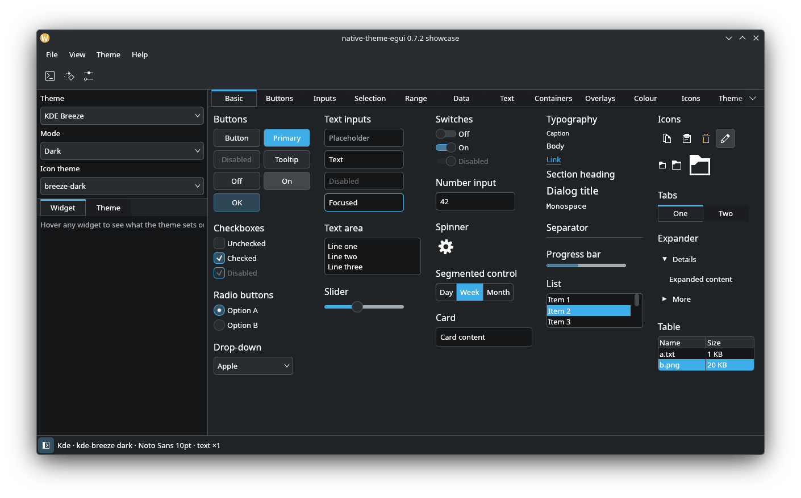

### Linux

**KDE Breeze, dark**

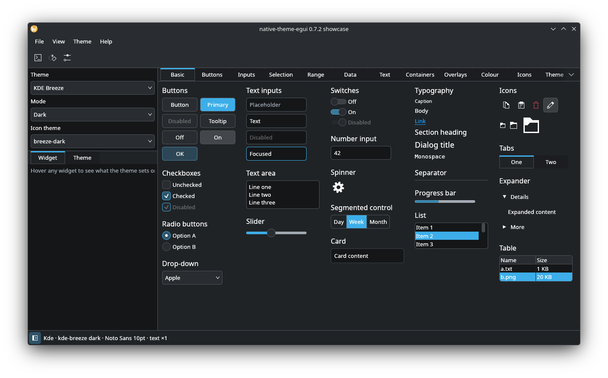

**KDE Breeze, light**

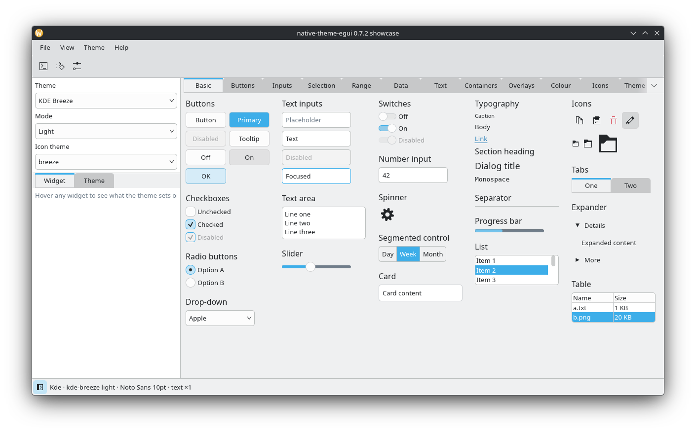

**Material, dark**

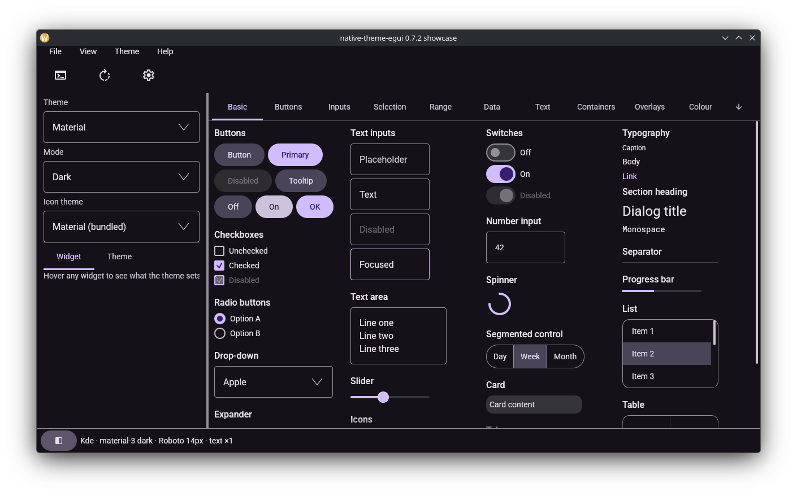

**Material, light**

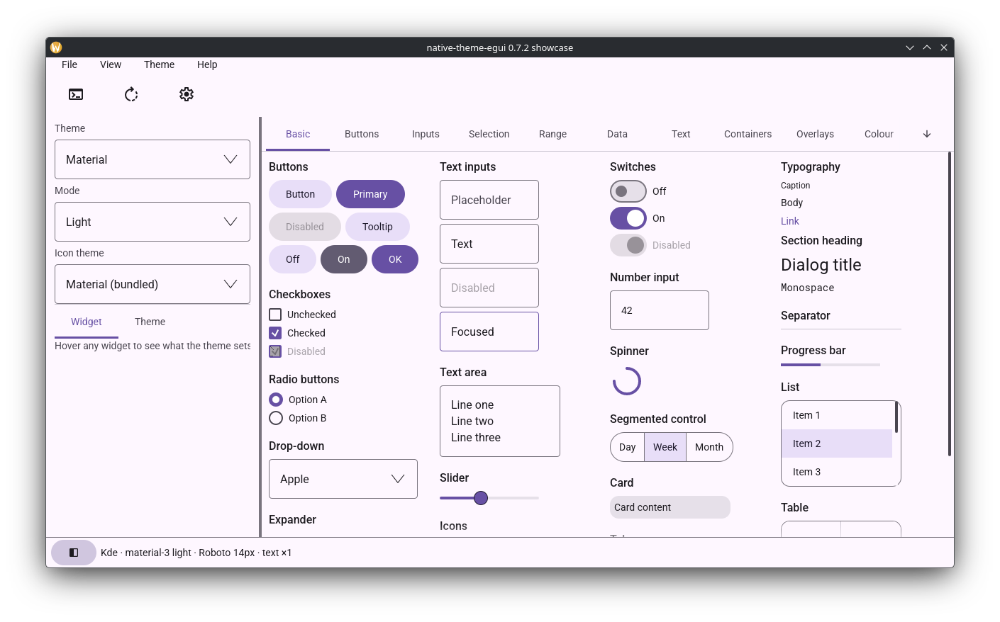

**Catppuccin Mocha, dark**

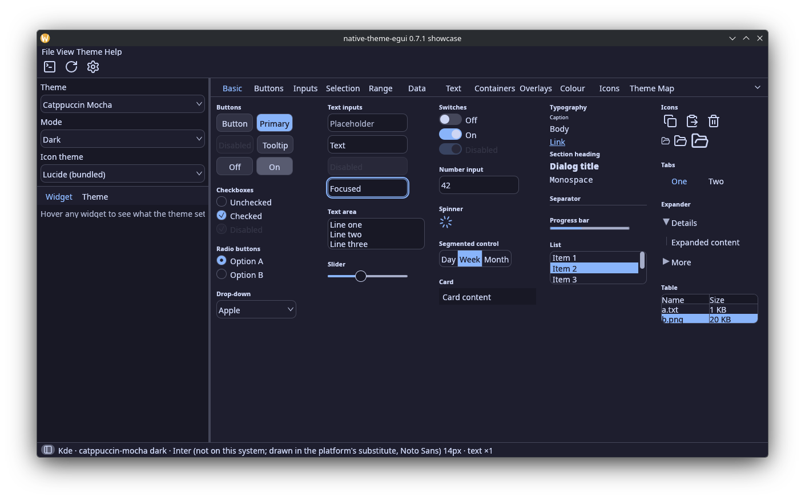

**Catppuccin Mocha, light**

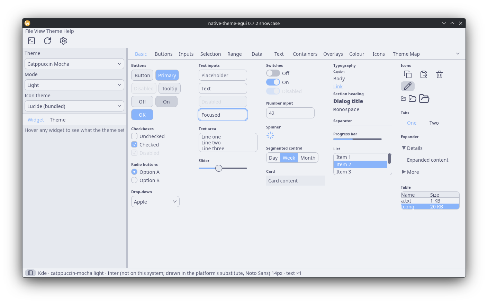

### macOS

The `macos-monterey` preset, which covers macOS 12 to 15, and `macos-tahoe`, macOS 26's own look, both captured on GitHub's `macos-26` runner, macOS 26.7.2, so the Monterey pair shows that preset drawn on macOS 26.

**macOS Monterey, light**

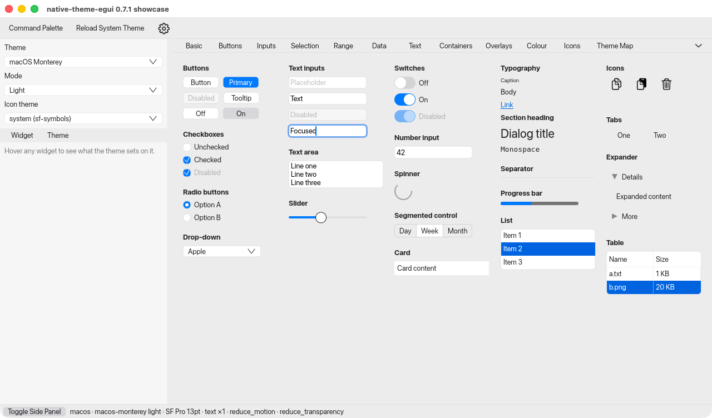

**macOS Monterey, dark**

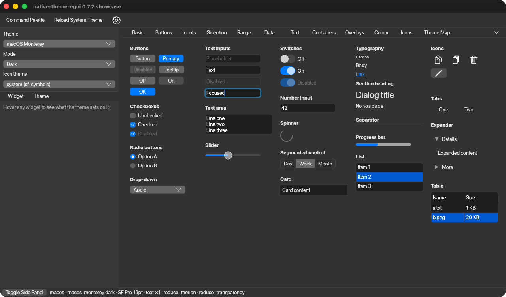

**macOS Tahoe, light**

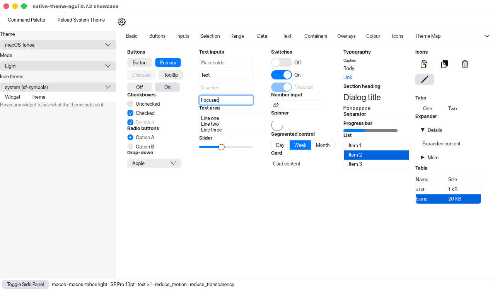

**macOS Tahoe, dark**

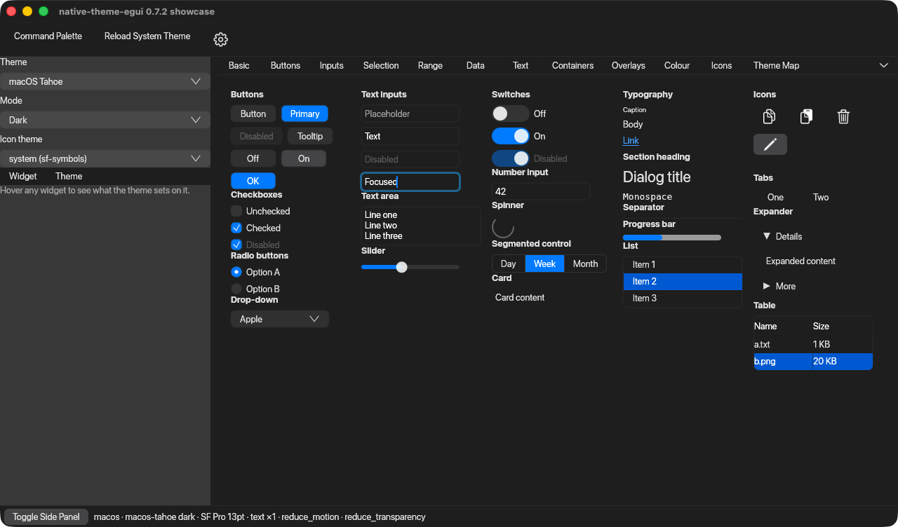

### Windows

The `windows-11` preset, captured on GitHub's `windows-2025` runner, Windows Server 2025 (build 26100): GitHub has no x64 Windows 11 image. On that image the OS reports the same metrics, fonts and system colours as Windows 11 25H2 (build 26200), except the animation and drop-shadow settings, which are off on Server.

**Windows 11, light**

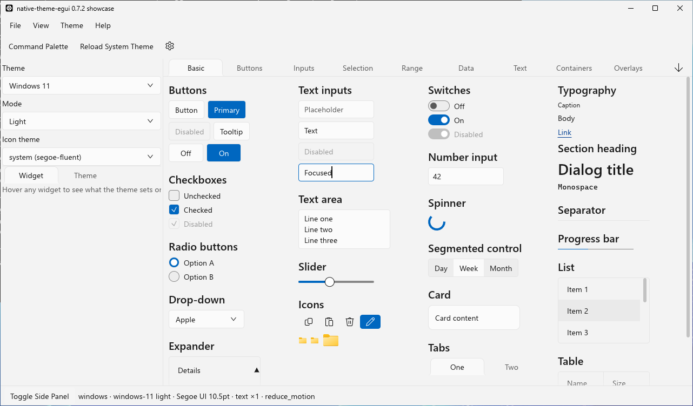

**Windows 11, dark**

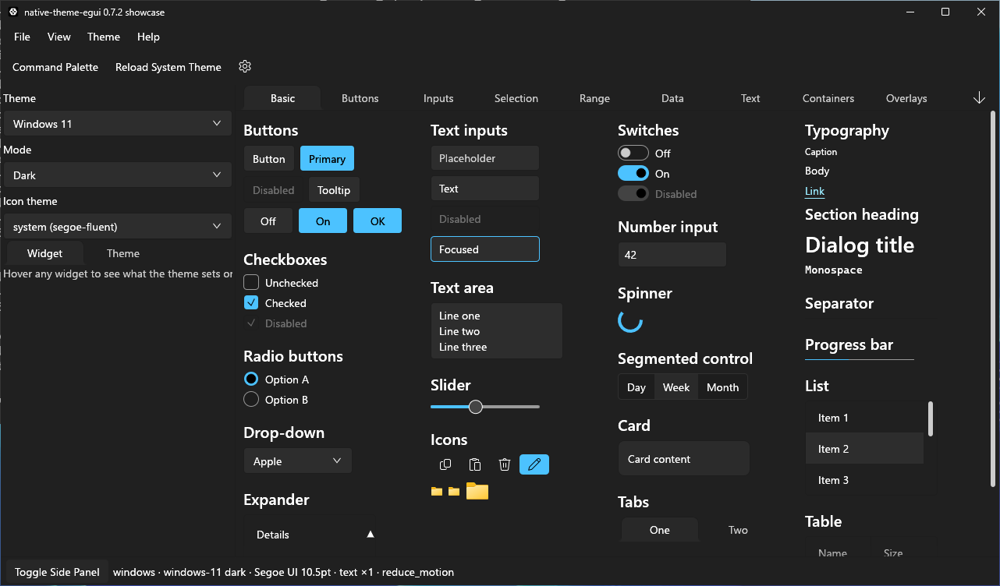

## Links

- [API reference on docs.rs](https://docs.rs/native-theme-egui)
- [The companion widget crate, `native-theme-egui-widgets`](../native-theme-egui-widgets/README.md)
- [Showcase source](examples/showcase-egui/)
- [The mapping manifest](mapping.toml)
- [CHANGELOG](../../CHANGELOG.md)

## License

Licensed under any of

- [Apache License, Version 2.0](http://www.apache.org/licenses/LICENSE-2.0)
- [MIT License](http://opensource.org/licenses/MIT)
- [0BSD License](https://opensource.org/license/0bsd)

at your option.
