# native-theme-gpui

[GPUI](https://gpui.rs/) + [gpui-component](https://crates.io/crates/gpui-component)
connector for [`native-theme`](https://crates.io/crates/native-theme).

Compatibility: the versions this connector requires, and the set it has been
verified against, are in [Compatibility](#compatibility).

## What it does

Turns a `ResolvedTheme` into a fully configured
`gpui_component::theme::Theme` and installs it:

- **Colours**: all 140 `ThemeColor` fields, including the 28 `button*`
  fields gpui-component's `Button` reads (since 0.7), so native themes keep
  their solid button surfaces instead of upstream's tinted house style.
- **Fonts and global geometry**: families, sizes, `radius`, `window_radius`
  (from `window.border.corner_radius`), `shadow`,
  `focus_ring`, `scrollbar_mode`; a `ThemeConfig` per mode so upstream's own
  `Theme::change` reproduces the native palette in light and dark. The
  connector's observer restores after each switch what the config cannot
  carry: the 12 base-palette fields `ThemeConfigColors` keeps private, and
  `selection`, `list_active` and `table_active`, whose alpha gpui-component
  caps at 0.3, 0.2 and 0.2 whenever it applies a config. A client-decorated
  window (one the compositor leaves to the application to draw, as GNOME's
  Mutter does under Wayland) has its corners rounded by `window_radius`, which
  gpui-component's `WindowBorder`, `Root` and `TitleBar` read, and its frame
  drawn by `WindowBorder` in `window.border.color` (`ThemeColor::window_border`).
- **The base layer**: gpui-base paints scrollbars and resize handles without
  going through gpui-component; the connector writes the native scrollbar
  width, thumb width, inset and radius, minimum thumb length and colours, and
  the splitter colours, and keeps them installed across upstream rebuilds.
  The splitter colours reach the handles gpui-base draws itself — groups built
  with `gpui_base::h_resizable` / `v_resizable` (`gpui_kit::base::…`), as
  colours at gpui-base's 1 px width, the hover colour only while dragged — not
  gpui-component's own `h_resizable` / `v_resizable`, `Settings`' divider
  or the dock's edges, which draw a `border` hairline and a `muted_foreground`
  pill of their own.
- **Per-widget geometry**: pure builders that return a `StyleRefinement` with
  the native heights, paddings, radii, borders and fonts for the widgets
  where gpui-component applies the caller's style after its own — and the
  native colours for the widgets whose text, fill or edge would otherwise be
  left to a token of upstream's.
- **Theme-drawn widgets** (feature `widgets`): a checkbox, radio, switch,
  slider, progress bar, spinner, tab bar and separator built on gpui-base's
  headless primitives and painted from the resolved theme, for the parts
  gpui-component draws from literals of its own. See
  [Theme-drawn widgets](#theme-drawn-widgets).
- **Accessibility**: the platform's text-scaling factor scales the theme's
  fonts (and, through GPUI's rem, every rem-relative size in gpui-component);
  reduce-motion is forwarded to GPUI; under reduce-transparency no overlay
  is drawn behind a dialog or sheet (it is transparent), and the dialog stays
  modal.
- **Icons**: mappings from every gpui-component `IconName` (106 variants) to
  the bundled Lucide and Material sets and to freedesktop icon names, `None`
  for the two a set lacks. With `svg-rasterize` (on by default), a handle
  serves gpui-component's widgets the theme's icons in place of
  gpui-component's Lucide glyphs; see
  [The widgets' own icons](#the-widgets-own-icons). gpui-component's
  `IconName` cannot be enumerated in code, so the tables are audited by hand
  against the list gpui-kit-assets generates the enum from
  (`default-icons.txt`) on every gpui-component bump; 0.10.0's is 0.7.1's, 106
  variants. The tables end in a wildcard: an
  `IconName` newer than this crate maps to no icon instead of stopping the
  build, and the test module's exhaustive list is what reports it.

## How it fits

Depend on this crate; it re-exports `native-theme` as
`native_theme_gpui::native_theme`, so your `Cargo.toml` need not add a second
dependency on it, whose version could drift from the connector's. The
[workspace README](../../README.md) has a diagram showing where each crate
sits.

## Compatibility

**Required** — the floors this crate's own `Cargo.toml` states:

| Crate | Required |
|---|---|
| `gpui-component` | 0.10.0 |
| `gpui-base` | 0.10.0 |
| `gpui-pre` (GPUI, named `gpui` in the manifest) | 0.3.12 |
| `gpui-kit` (GPUI as the code names it; the showcase) | 0.10.0 |
| `rust-version` | 1.95.0 |

With the `gpui-fast` feature, the crate builds on GPUI Fast (`gpui-fast`)
0.1.16 or later, which GPUI Kit 0.10.0 requires (see [Backends](#backends)).

Each row is a floor: Cargo may resolve any later
semver-compatible release (a later `0.10.x`, a later `0.3.x` of gpui-pre), but
that the connector builds on one is a claim only of the *Verified* line below,
because a *patch* release of these crates has broken this connector before: gpui-component
0.6.2 removed `ThemeColor::tiles`, which the published 0.5.8 wrote, and 0.5.8
stopped compiling on a fresh dependency resolution. gpui-component 0.7.1 did it
again by adding two `IconName` variants, which the published 0.6.0 matched
exhaustively; since 0.6.1 an `IconName` this crate does not know maps to no
icon instead of stopping the build.

**Verified** — the versions `scripts/update_compatibility.sh run` last resolved and ran
this connector's tests, clippy, docs and the widget-coverage script against. The
script writes the line; a hand-edited one fails a test:

<!-- compat:begin -->
Verified against gpui-base 0.10.0, gpui-component 0.10.0, gpui-fast 0.1.17, gpui-fast-apple 0.1.17, gpui-fast-linux 0.1.17, gpui-fast-macos 0.1.17, gpui-fast-macros 0.1.17, gpui-fast-platform 0.1.17, gpui-fast-web 0.1.17, gpui-fast-wgpu 0.1.17, gpui-fast-windows 0.1.17, gpui-kit 0.10.0, gpui-kit-assets 0.10.0 and gpui-pre 0.3.12 on 2026-11-21.
<!-- compat:end -->

**After that** — newer releases are tested nightly by the dependency canary
(`.github/workflows/dependency-canary.yml`), and a break it finds is recorded in
the CHANGELOG.

## Quick start

Add the crate to your `Cargo.toml`, with the OS readers (`native`):

```toml
[dependencies]
native-theme-gpui = { version = "0.7", features = ["native"] }
gpui-kit = "0.10.0"       # or gpui-component + gpui-base + gpui-pre directly
```

Without `native`, `from_system()` is the platform preset on Linux and an
error on macOS and Windows, where the code below falls back to a bundled
preset (see [Features](#features)).

The handle `WidgetIcons` wraps the application's asset source and serves
gpui-component's widgets the theme's icons; `apply_system_theme` tells it the
theme's icons, and on the `apply` path the application tells it, from the
`Resolved` that resolving a preset gives (`from_preset` returns the
`ResolvedTheme` alone).

```rust,no_run
use gpui_kit::{AppContext as _, WindowOptions};
use native_theme_gpui::icons::WidgetIcons;
use native_theme_gpui::{AccessibilityPreferences, ColorMode, Theme, apply, apply_system_theme, to_theme};
# use gpui_kit::{Context, IntoElement, Render, Window, div};
# struct MyView;
# impl Render for MyView {
#     fn render(&mut self, _: &mut Window, _: &mut Context<Self>) -> impl IntoElement {
#         div()
#     }
# }

let icons = WidgetIcons::new();
gpui_kit::application()
    .with_assets(icons.assets(gpui_kit::assets::Assets))
    .run(move |cx| {
        gpui_kit::init(cx);
        icons.install(cx);
        match native_theme_gpui::SystemTheme::from_system() {
            Ok(sys) => apply_system_theme(&sys, cx),
            Err(_) => {
                let prefs = AccessibilityPreferences::from_system();
                if let Ok(nt) = Theme::preset("adwaita")
                    && let Ok(resolved) = nt.resolve(ColorMode::Light)
                {
                    let theme = to_theme(&resolved.variant, &nt.name, resolved.mode.is_dark(), &prefs);
                    apply(theme, &resolved.variant, &prefs, cx);
                    icons.set_theme_icons(&resolved, cx);
                }
            }
        }
        let opened = gpui_kit::open_window(WindowOptions::default(), cx, |_, cx| cx.new(|_| MyView));
        if let Err(error) = opened {
            eprintln!("could not open the window: {error}");
        }
    });
```

The examples name GPUI and gpui-component through gpui-kit, as gpui-kit's own
documentation does: GPUI at its root (`gpui_kit::Window`, `gpui_kit::div`)
and gpui-component as `gpui_kit::component`. An application that depends on
gpui-component and GPUI directly instead, with GPUI under the name
gpui-component gives it (`gpui = { package = "gpui-pre", version = "0.3.12" }`),
names the same items `gpui::…` and `gpui_component::…`.

`gpui_kit::open_window` wraps the view in gpui-base's `Root`, which carries
the dialogs, sheets and notifications. A window opened before
`gpui_kit::init` gets no `WindowState` — the root plugin `init` registers,
which hosts them and sets the window's rem — so its first `open_dialog`,
`open_sheet` or `notifications` call panics with upstream's "component window
state is missing" (gpui-component `src/root.rs:149, 167`), and text scaling
fails silently, the rem staying gpui's default (`src/root.rs:22, 711-714`;
gpui-base `src/root.rs:72-73`).

gpui-base's `Root` paints no background of its own (gpui-base
`src/root.rs:246-278`). The root plugin `gpui_kit::init` registers fills the
root of every window `gpui_kit::open_window` opens with the theme's
`background`, the theme's `window.background_color`, and draws its text in
the theme's font and `foreground` (gpui-component `src/root.rs:718-732`). A
view opened with gpui's own `cx.open_window`, outside that root, has no
background until the application paints `cx.theme().background` on it. A
surface the theme states translucent, such as windows-11's sidebar
(`#f3f3f300`, WinUI's docked `NavigationView` pane), shows that background
through it.

Call `gpui_kit::init` (or `gpui_component::init`) **before** `apply`, as
upstream requires before any component is used. `apply` initialises the styled
layer itself only when it is absent. An `init` after `apply` switches the theme
to light mode (the stored light variant, or upstream's light constants when
none is stored) and sets gpui-component's scroll bar mode from the platform
(`Hover` on Linux), in place of the one `apply` chose from the theme
(gpui-component `src/theme/mod.rs:36-42`, `:375-388`).

`apply_system_theme` installs the mode the OS reports (`SystemTheme::mode`),
so do not call gpui-component's `Theme::sync_system_appearance` right after
it: on Linux GPUI reports a light appearance until the desktop portal has
answered (gpui-pre-linux `src/linux/platform.rs:144`,
`src/linux/xdg_desktop_portal.rs:49-51`), so a dark desktop's application
would turn light for its first frames. Call it when the appearance changes,
or follow the OS theme with `on_theme_change` (see
[Runtime theme change](#runtime-theme-change)).

The theme sets the colours and the global font and radius; each widget's own
native height, padding, radius and font reaches it only through the
`geometry` builder the application applies to it, as
[Per-widget geometry](#per-widget-geometry) shows.

### Light and dark under a preset

The OS accessibility preferences come from native-theme's detection cache
(`native_theme_gpui::native_theme::detect`, the source crate this one
re-exports):

```rust,no_run
use native_theme_gpui::native_theme::detect::accessibility_preferences;
use native_theme_gpui::{apply, from_preset};

# fn f(cx: &mut gpui_kit::App) -> native_theme_gpui::Result<()> {
let prefs = accessibility_preferences();
let (light, light_resolved) = from_preset("adwaita", false, &prefs)?;
let (dark, dark_resolved) = from_preset("adwaita", true, &prefs)?;
apply(light, &light_resolved, &prefs, cx);
apply(dark, &dark_resolved, &prefs, cx);   // dark is now current; both variants are stored
# Ok(())
# }
```

Afterwards gpui-component's own `Theme::sync_system_appearance(None, cx)` or
`Theme::change(mode, None, cx)` switches between the two native palettes: each
`apply` installs a `ThemeConfig` for every stored variant, and after the switch
the connector's observer restores what the config cannot carry: the
base-layer geometry, the 12 base-palette colours, and the native `selection`,
`list_active` and `table_active`, which gpui-component caps at alpha 0.3, 0.2
and 0.2 whenever it applies a config (see
[How re-application works](#how-re-application-works)). The two variants must
be one theme's: `apply` drops the other mode's stored variant when a theme of
another display name stored it. With only one variant stored, a switch to the
other mode shows upstream's built-in `ThemeColor::light()` constants, in light
mode, those three as upstream caps them (the default config is a light one and
carries no colours), so call `apply` once per variant.

An application that serves the widgets' own icons tells its handle each
variant's icons, from the `Resolved` that `Theme::resolve` returns, as the
quick start does.

## Core concepts

- **`apply(theme, &resolved, &prefs, cx)`** — installs the theme, stores the
  resolved variant and the preferences in the `NativeTheme` global, projects
  into gpui-base, writes the native scrollbar values and resize-handle colours
  (which gpui-base's own resizables draw), forwards
  reduce-motion, installs the re-apply observer once, and repaints every window.
- **`apply_system_theme(&sys, cx)`** — `apply` for the OS theme, storing both
  variants (and both configs) at once.
- **`apply_accessibility(&prefs, cx)`** — a runtime preference change (a portal
  signal, a settings toggle): rebuilds the styled theme from the stored variant
  with the new preferences, so text scaling and transparency take effect without
  the application keeping `resolved`; always forwards reduce-motion.
- **`from_preset(name, is_dark, &prefs)`** — load a bundled preset. `is_dark`
  is explicit because some presets (`solarized`, `gruvbox`) have ambiguous
  lightness; the theme is built in the mode of the variant resolved
  (`Resolved::mode`), so a light-only preset asked for dark gives a light
  theme. Pass `&AccessibilityPreferences::default()` for no scaling, or
  `native_theme_gpui::native_theme::detect::accessibility_preferences()` to
  honour the OS preferences under a preset: the cached reading, for a preset
  switch (the first call after a system read may still run the reduced-motion
  detection,
  about 3 ms measured on one KDE machine; every later call returns the cached
  block in nanoseconds). `AccessibilityPreferences::from_system()` reads them
  afresh, running the platform reader each time.
- **`from_system()`** — the OS theme as a `Loaded` (`theme`, `resolved`,
  `mode`, `accessibility`, `icon_set`, `icon_theme`; `#[non_exhaustive]`, so
  read it by field) without installing it; `SystemThemeExt::to_gpui_theme`
  gives the same from a `SystemTheme`.
- **`to_theme(&resolved, "Display Name", is_dark, &prefs)`** — the underlying
  mapping if you already have a `ResolvedTheme`; `is_dark` is the theme's mode,
  `Resolved::mode` of the variant `Theme::resolve` resolved or `SystemTheme::mode`.
- **`cx.native()`** (`ActiveNativeTheme`) — the `Native { resolved, accessibility }`
  view the geometry builders take, for the mode gpui-component currently shows;
  `cx.native_theme()` is the installed `NativeTheme`.
- **`layer_over(base, layer)`** — the connector's state-layer composite
  (source-over, straight alpha): the filled buttons' hover and pressed fills
  and the widgets' hover states are a theme layer over the fill it covers, so
  a layered state an application draws itself matches them through it.
- **`to_hsla(rgba)`** — a theme colour as the `Hsla` gpui paints, by the
  conversion the connector maps every colour with, so a colour an application
  converts for a widget of its own is the one the connector would give.

## Per-widget geometry

gpui-component widgets apply the caller's `StyleRefinement` after their own
geometry, so a refinement built from the native theme wins. Every builder in
the `geometry` module is a pure function of `Native<'_>`; the four layout
accessors, `widget_gap`, `container_margin`, `window_margin` and
`section_gap`, take a `LayoutTheme` instead:

```rust,no_run
use gpui_kit::{ParentElement, Styled, div};
use gpui_kit::component::{StyledExt, button::Button};
use native_theme_gpui::{ActiveNativeTheme, geometry};

# fn f(cx: &gpui_kit::App) {
let button = match cx.native() {
    Some(n) => Button::new("save")
        .refine_style(&geometry::button(n))
        .child(
            div().min_w_0().whitespace_nowrap().text_ellipsis()
                .refine_style(&geometry::button_label(n))
                .child("Save"),
        )
        .accessibility_label("Save"),
    None => Button::new("save").label("Save"), // before `apply`: upstream's geometry
};
# }
```

The label goes in as the button's child: gpui-component sizes a `.label()`
on an inner element after the button's refinement, `text_sm` at
`Size::Medium`, and `button_label` gives the child the platform's size.

Text sizes carry the accessibility text-scaling factor; widths, paddings,
radii and icon sizes do not (that is what the platform toolkit does). Every
builder that sets a text size also sets the platform's `defaults.line_height`,
so wrapped text in a tooltip or a dialog is spaced by the platform's metric,
not gpui's default (the golden ratio) or a dialog title's 1.25, and the font's
family (through `font_family`, as the installed theme's own) and style, so a
family or a slant the platform states for a menu, a toolbar or a title bar —
the KDE reader states all three — arrives.

Padding is per side, and a builder sets only the sides the theme states: an
unstated side leaves the widget's own padding in place.

Control heights follow one rule in `button`, `input`, `select`, `combobox`,
`menu_item` and `list_item`. Each applies the platform's `defaults.line_height`
as the control's line height and is its stated height (`h`) at a text-scaling
factor of 1 or less, in place of upstream's own (a `Select` or `Combobox`
trigger's `h_8`); above 1 the stated height is a minimum and the height is
automatic, so the control grows around its drawn text and padding. A
`DataTable` row and header (`data_table_size`, `list_header_height`) follow it
too: above 1 they are at least the scaled text's line box, upstream's own
cell padding and the row's 1 px bottom border, since a `Size` is a fixed
height. The rule
is for single-line controls: refine a multi-line `Input` or a `Textarea` with
`text_area`, which sets no height (the rows the field holds size it). To give
one a fixed height, set it after the builder as `Styled::h(input, height)`,
fully qualified. In method syntax
`input.h(..)` is `Input::h`, which shadows `Styled::h` and only records a
height upstream applies before the caller's refinement, so the builder's
height would replace it.

A builder sets a text colour only where the colour reaches the text *and*
upstream's disabled colour still wins: either upstream labels the caller's own
element with a token of its own before applying the refinement and re-applies
its state colours after it or on a child, or upstream sets no colour on that
element at all. Twelve do. Five displace a visibly different colour:
`status_bar` and `dialog_description` displace upstream's `muted_foreground`,
`tooltip` displaces `popover_foreground`, and `input` and `text_area` the
window's `foreground`, which a field's text inherits and the macOS presets'
`input.font.color` differs from. Four displace `foreground`:
`list_item`, `radio`, `select` and `accordion_title`. `title_bar`,
`dialog_title` and `toolbar` displace nothing — upstream sets no text colour
on the title bar, a dialog's title or a toolbar. Those seven change no
pixel under any bundled preset but ios-13, whose `select` text is the accent —
a widget that states no `font.color` inherits
the window's, and `foreground` is fed from that same field — but they carry it
so that a source which *does* state, say, a list row colour, or the title bar
colour the KDE reader takes from `[WM] activeForeground`, is honoured instead
of silently overridden.

The remaining builders set the font alone and leave the colour to the
token. `checkbox` and `combobox` are the near misses: upstream paints both from
`foreground`, but a `Checkbox` label is re-coloured by its own wrapper and both
apply their disabled colour *before* the refinement, so a carried colour would
either never arrive or take the disabled state's place — a preset that states
one of those two colours is a finding to record, not a builder to change, and a
test over every preset and mode says so.

| Builder | `ResolvedTheme` fields it reads | Applies to |
|---|---|---|
| `button` | `button.min_height`, `.min_width`, `.border.padding` (the stated sides), `.corner_radius`, `.line_width`, `.color`, `button.font` weight, `defaults.line_height` | `Button` (the label size is set on an inner element — `button_label` reaches it on a child label; the outline/ghost/link/text variants take the native border too) |
| `button_label` | `button.font`, `defaults.line_height` | the label passed as a `Button`'s child |
| `toggle` | `button.font`, `defaults.line_height` | `Toggle` |
| `input` | `input.min_height`, `input.border.padding` (the stated sides), `.corner_radius`, `.line_width`, `input.font`, `defaults.line_height` | `Input`. Upstream pads the root before the refinement, so the platform's sides arrive; an `Input` with a suffix takes its right padding from upstream after the refinement. When refining an `InputGroup` or `NumberInput` frame, clear the padding sides: the inner Input already pads (`input/group.rs:272-293`, `input/number_input.rs:173-180`, `input/input.rs:789-791`) |
| `input_height` | `input.min_height`, `defaults.line_height` | `Input`, through `refine_style`: the height rule `input` applies, and nothing else of it. Above a text-scaling factor of 1 the field grows around its own text and padding |
| `text_area` | `text_area.border.padding` (the stated sides, less the editor's own `Size::Medium` padding), `.corner_radius`, `.line_width`, `input.font`, `defaults.line_height` | a multi-line `Input` or a `Textarea` root. No height. A stated side below the editor's own padding (10 across, 8 down) stays the editor's |
| `editor` | `defaults.line_height` | the code `Editor`, over the 1.5 upstream sets first. Its font is the theme's mono font, and its fill is `input.background_color`, which the highlight theme `to_theme` installs gives it; its gutter is that fill, or, where the fill is translucent, the fill over `window.background_color` |
| `input_fill(n, disabled)` | `input.background_color`; disabled, `input.disabled_background` (or `input.background_color` where it is not stated), `input.disabled_text_color` and `input.disabled_opacity` | `Input`, after `input`, built with the same `disabled`. A colour, where no `ThemeColor` field maps: upstream fills a field with `Theme::input_background` — the window background in a light theme — and a disabled one with the border token mixed toward transparent, before the caller's refinement. The disabled text colour is what gpui-base then draws at half its alpha, as it draws every disabled field's text |
| `combo_box_fill(n, disabled)` | `combo_box.background_color`; disabled, `combo_box.disabled_background` (or `combo_box.background_color` where it is not stated), `combo_box.disabled_text_color` and `combo_box.disabled_opacity` | `Select`, `Combobox`, after `select` or `combobox`, built with the same `disabled`. A colour, where no `ThemeColor` field maps: upstream fills a trigger as it fills an `Input`. The disabled text colour reaches a `Combobox`'s selected text; a `Select`'s title mutes itself when disabled |
| `button_disabled` | `button.disabled_background` (or `button.background_color` where it is not stated), `button.disabled_text_color`, `button.disabled_opacity` | a disabled `Button`, after `button`. A colour, where no `ThemeColor` field maps: upstream paints a disabled button with its own faded literals and then replays the caller's refinement over them; the refinement lands at rest too, so an enabled Button must not take it |
| `input_group_button` | `button.border.corner_radius` | the button nested in an `InputGroup` (`InputGroupButton`): the platform's button radius, where upstream rounds that `XSmall` button with half the theme's radius |
| `button_checked` | `button.checked_background` (or `button.active_background`), `button.checked_text_color` (or `button.active_text_color`) | a toggle `Button` that is on (`selected(true)`), after `button`. A colour, where no `ThemeColor` field maps; with neither fill stated, upstream's selected fill stands |
| `toolbar_button_rest` | where `toolbar.button_hover_border_color` is stated: a transparent fill and border, `button.border.line_width` wide, and each stated side of `button.border.padding` less that width | a toolbar `Button` built on `variants::toolbar_button`, padded with `button.border.padding`: hides the outline colour at rest and keeps the button's size; nothing where the theme states no outline |
| `toolbar_button_checked` | `toolbar.button_checked_background` (or `toolbar.button_active_background`, else `button.active_background`), `button.checked_text_color` (or `button.active_text_color`) where the checked fill is stated; `toolbar.button_checked_border_color` at `toolbar_button_rest`'s width (none of its own where no hover outline is stated: upstream's border width then), kept under the pointer | a toolbar `Button` that is on (`selected(true)`), built on `variants::toolbar_button`, after `toolbar_button_rest`. A colour, where no `ThemeColor` field maps: a custom variant fills a selected Button with its pressed colour and letters every state in its one foreground; with no checked fill stated the text is that foreground, and with none of the three fills the refinement sets nothing. A selected Button takes no hover or press style, so the pen stays under the pointer and pressed |
| `default_button_rest` | where `button.default_button_background` is stated: that fill, and a border in `button.default_button_border_color` (or `button.border.color`) | a dialog's default `Button` built on `variants::default_button`, after `button`, enabled only (a disabled one takes `button_disabled` instead). A colour, where no `ThemeColor` field maps: the variant's own rest fill is a fifth of its border colour; nothing where the theme states no fill, and the Button is `.primary()` |
| `link` | `link.underline_enabled`, `link.font`, `link.background_color`, `defaults.line_height` | `Link`: where the platform draws links without an underline, a zero-thickness underline in place of upstream's resting one. The colour is `ThemeColor::link` (`link.font.color`) |
| `menu_item` | `menu.row_height` (where stated), `menu.min_row_height`, a least height where `menu.row_height` is unstated, `menu.border.padding` (the stated sides), `menu.icon_text_gap`, `menu.font`, `defaults.line_height` | a menu row the application draws with its own elements — gpui-component's own `MenuItemElement` is crate-private and `PopupMenu` builds its rows itself, so no upstream widget takes this style. The padding is set by physical sides, as every builder sets it: in a right-to-left layout the stated left side stays left, and the application swaps the sides or pads with `ps` / `pe` itself |
| `list_item` | `list.row_height` (where stated), `list.border.padding` (the stated sides), `list.item_font`, `defaults.line_height` | `ListItem` |
| `list_item_selected` | `list.selection_text_color` | a selected `ListItem` (`selected(true)`), after `list_item`. A colour, where no `ThemeColor` field maps: while `list.active_highlight` is on, gpui-component's default, upstream marks a selected row by its fill alone (`list_active`, `list.selection_background`) and leaves its text the row's; with it off, upstream paints the row `accent` (`menu.hover_background`) under `accent_foreground` (`menu.hover_text_color`) after the refinement (`src/list/list_item.rs:257-263`), so this colour does not reach it |
| `list` | `list.border.line_width`, `.color`, `.corner_radius`, `list.background_color` | the frame and the fill of a list view: a `List`, a `Tree`, or the box an application draws around one. Neither widget paints a border or a fill of its own (nor does a `ListItem` at rest, and the `list` token has no reader), while `DataTable` draws its frame from the same values through `Theme`, so this is what makes the three agree. It also clips its rows: on GPUI Fast to the rounded inside, on gpui-pre to the frame's rectangle, where a square row fill shows past the rounded corners, so the application rounds a row's fill where it meets the frame by the frame's inner radius (`corner_radius` less `line_width`): `list_item` sets no radius. A tree is a list view — the model has no tree theme |
| `tooltip` | `tooltip.border.padding` (the stated sides), `.corner_radius`, `.line_width`, `.color`, `.shadow_enabled` (upstream's `shadow_md` layers in `defaults.shadow_color`, or none), `tooltip.background_color`, `tooltip.font`, `defaults.line_height` | an application-built `Tooltip`. No width: give `Tooltip::new(text)` `max_w(tooltip.max_width)` on the bubble, and the text wraps inside it, a key binding included |
| `tooltip_content` | `tooltip.max_width` less the left and right padding (upstream's `px_2`, 0.5 rem at the installed font size, for a side the theme does not state) and `tooltip.border.line_width` twice | the element the application passes to `Tooltip::element`; without a key binding its bubble equals `Tooltip::new`'s with the width on the bubble, with one it grows past `tooltip.max_width` by the key and its gap |
| `popover` | `popover.border.padding` (the stated sides), `.corner_radius`, `.line_width`, `.color` | `Popover`, `HoverCard`: the edge lies inside the shadow ring gpui-component draws as a popover's edge, which stays |
| `status_bar` | `status_bar.border.padding` (the stated sides), `status_bar.font`, `defaults.line_height` | `StatusBar` |
| `dialog`, `dialog_max_width` | `dialog.border.padding` (the stated sides), `dialog.min_width`, `dialog.min_height`, `.border.corner_radius`, `.border.color`, `.background_color`, `.max_width` | `Dialog` (`Dialog::max_w` for the width). An unstated side keeps upstream's 16 px; upstream also spaces the dialog's sections by `max(top, 8px)` and a `DialogContent` by the bottom padding. `dialog.max_height` does not arrive: gpui-component clamps the dialog to what is left of the viewport after applying the caller's style |
| `dialog_entrance` | `dialog.entrance` | `Dialog::entrance`, `AlertDialog::entrance`. Both styles are approximations, drawn as `DialogEntrance::Fade`, a fade in place: `scale_fade` loses its scale, because gpui-component has no scaling entrance, and `fade_rise` its rise, because its `FadeSlide` settles from just above the dialog's place. The dialog leaves the way it entered: it fades out on the same curve and over the same duration, the motion tokens' `duration_normal`, as it faded in. `None` where the theme states none, and the dialog keeps upstream's `SlideDown` |
| `dialog_footer`, `dialog_title`, `dialog_description` | `dialog.button_gap`, `dialog.title_font`, `dialog.body_font`; the two fonts with `defaults.line_height` | `DialogFooter`, `DialogTitle`, `DialogDescription` |
| `table` | `list.item_font`, `defaults.line_height` | declarative `Table` |
| `data_table_size` | `list.row_height`, or upstream's Medium row height where it is not stated; above a text-scaling factor of 1 at least `list.item_font`'s scaled size × `defaults.line_height`, upstream's cell padding and the row's 1 px bottom border | `DataTable::with_size`; with `table` on the container for the cell text |
| `list_header_height` | `list.header_height`; above a text-scaling factor of 1 at least `list.item_font`'s scaled size × `defaults.line_height`, upstream's cell padding and the header row's 1 px bottom border — the header's text is drawn in the container's font, which `table` sets | `DataTable::header_row_height`. `None` where the theme states none, and the header keeps the body rows' height |
| `progress` | `progress_bar.track_height`, `progress_bar.border.corner_radius`, `.min_width` | `Progress` |
| `group_box_content` | `card.border.padding` (the stated sides), `.corner_radius`, `.line_width`, `.color`, `card.background_color` | `GroupBox::content_style`: the fill on every variant, over the Fill variant's own |
| `accordion_title` | `expander.header_height`, `expander.font.color` | `AccordionItem::title_style` |
| `accordion` | `expander.border.color` | `Accordion` and each `AccordionItem`: the colour of the card a bordered Accordion draws and of the line under each item but the last |
| `accordion_hover` | `expander.hover_background` (where stated) | `AccordionItem::hover`, as `item.hover(\|_\| geometry::accordion_hover(n))`; nothing where the theme states no hover, so the row stays at rest |
| `checkbox`, `radio` | `checkbox.label_gap`, `checkbox.font` (radio metrics are the checkbox's on every platform), `defaults.line_height` on the row (the label column keeps upstream's 1.25) | `Checkbox`, `Radio` |
| `select`, `combobox` | `combo_box.min_height`, `.min_width`, `.arrow_area_width` (whether it is stated), `combo_box.border.padding` (the stated sides), `.corner_radius`, `.line_width`, `combo_box.font`, `defaults.line_height` | `Select`, `Combobox`. Where the theme states `combo_box.arrow_area_width`, the right padding side is not applied and upstream's own stands: the platform measures that side to a separate arrow column, and gpui's caret sits inside the padded trigger, which has none. Without an arrow column the stated right side is applied |
| `title_bar` | `window.title_bar_font`, `defaults.line_height` | `TitleBar` |
| `title_bar_inactive` | `window.inactive_title_bar_background`, `window.inactive_title_bar_text_color` | a `TitleBar` while its window is not the active one, after `title_bar`: `.when(!window.is_window_active(), \|bar\| bar.refine_style(&geometry::title_bar_inactive(n)))`. gpui redraws the window when its activation changes. The fill is upstream's gradient drawn from the inactive colour, so a theme whose inactive pair is the active one draws the same bar in both states |
| `toolbar` | `toolbar.bar_height` (as a minimum height, where stated), `.item_gap` (where stated), `.border.padding` (the stated sides), `.border.line_width` and `.border.color` (the bottom edge), `.background_color`, `toolbar.font`, `defaults.line_height` | a toolbar row the application draws with its own elements, or gpui-component's `Toolbar`: the height is the content's (at least `bar_height`), and the `Toolbar`'s own Small minimum height (`min_h_8`) is replaced by `bar_height` where stated and reset to `auto` where not. Add items to a `Toolbar` with `content()` — `child()` turns buttons into compact ghosts in a 1.5 rem box. The edge is a bottom rule, `toolbar.border.color` at `.line_width`, inside the bar, none at a width of 0 |
| `spinner_size`, `icon_size_*` | `spinner.diameter`, `toolbar.icon_size` (which inherits `defaults.icon_sizes.toolbar`), `defaults.icon_sizes.*` for the others | `Spinner::with_size`, `Icon::with_size` |
| `scrollbar_gutter` | `scrollbar.overlay_mode`, and the groove width the base layer installed | the element an `overflow_y_scrollbar` container scrolls. gpui-component overlays its bar on the scroll area whatever the platform does, so where the platform's bars are not overlays this reserves the groove width beside the content; where they are, it reserves nothing. Where the theme states no track (a transparent `scrollbar.track_color`: `kde-breeze`, `windows-11`), content that runs under the bar shows through it, a row's hover fill and text or cells that reach the edge among it; Qt ends the view at the bar, which this gutter reproduces. |
| `widget_gap`, `container_margin`, `window_margin`, `section_gap` | `LayoutTheme` (`Theme::layout` or `SystemTheme.layout`) | your own layout; `None` where the platform specifies nothing |

The `button`, `input`, `select`, `combobox`, `list_item` and `progress`
builders are verified against real gpui-component widgets in `tests/seams.rs`,
which lays each one out headlessly with and without the refinement and
compares the measured height with the refinement's own field. The same file
lays a real `Tooltip` out and checks that its text keeps inside the bubble.
Under every native preset, at its own platform's DPI, it also checks that a
real `Input`, `Select` and `Combobox` draw their content inset by the stated
left padding, that an `Input` without a suffix draws the stated right side,
that a `Textarea` refined with the padding cleared draws none, and that a real
`Button`, `Input`, `Select`, `Combobox`, `ListItem` and an application-drawn
menu row are their stated height at a text-scaling factor of 1 and keep their
text inside them at 1, 1.1 and 2. Under kde-breeze and windows-11, which state
an arrow column and a right side of 0, a `Select` and a `Combobox` keep
upstream's own right inset.

### Flat buttons

gpui-component paints a flat button's hover from a token that means something
else: a `.ghost()` button hovers with `accent`, the item-highlight colour of
menus and lists, and an `InputGroupButton` with `muted`, the subdued surface of
`Kbd` and code blocks. Both are mapped correctly for what they are, so under a
native theme those two buttons hover in colours no other button uses.
`variants::ghost_button(cx)` is the same flat button with the platform's own
button hover and pressed colours:

```rust,no_run
use gpui_kit::component::IconName;
use gpui_kit::component::button::{Button, ButtonVariants as _};
use gpui_kit::component::input::InputGroupButton;
use native_theme_gpui::variants;

# fn f(cx: &gpui_kit::App) {
Button::new("close").icon(IconName::Close).custom(variants::ghost_button(cx));
InputGroupButton::new("copy").label("Copy").custom(variants::ghost_button(cx));
# }
```

Under a theme from the 0.8.0 model, `next::variants::ghost_button(r, cx)` is
that flat button edged in its hovered outline,
`button.body(HOVER; variant=Flat).stroke.color`, where a rule states it.
gpui-component draws a custom variant's colour as the border in every state
and lays out no border width for it, so a Button built on it is refined at
rest as well: `next::geometry::ghost_button_rest` hides the edge at rest and
lays it out inside the push button's padding, for a Button
`next::geometry::button` pads; `next::geometry::ghost_button_rest_own_padding`
does the same and sets no padding, for a Button that keeps the toolkit's own
(a small Button, a button an input group sizes), the edge then lying around
that padding:

```rust,no_run
use gpui_kit::component::IconName;
use gpui_kit::component::StyledExt as _;
use gpui_kit::component::button::{Button, ButtonVariants as _};
use gpui_kit::component::input::InputGroupButton;
use native_theme_gpui::{ActiveNativeTheme as _, next};

# fn f(cx: &gpui_kit::App) -> next::Mapped<()> {
if let Some(r) = cx.native_theme().and_then(|theme| theme.next_resolved(cx)) {
    Button::new("close")
        .icon(IconName::Close)
        .custom(next::variants::ghost_button(r, cx)?)
        .refine_style(&next::geometry::button(r)?)
        .refine_style(&next::geometry::ghost_button_rest(r)?);
    InputGroupButton::new("copy")
        .label("Copy")
        .custom(next::variants::ghost_button(r, cx)?)
        .refine_style(&next::geometry::ghost_button_rest_own_padding(r)?);
}
# Ok(())
# }
```

Build it in `render`: it reads the installed theme, so it follows a light/dark
switch. Buttons gpui-component creates internally (a dialog's close button,
calendar navigation, the tab bar) cannot be reached this way.

`geometry::input_group_button` gives a button nested in an `InputGroup` the
platform's button radius; gpui-component sizes such a button `XSmall` and
would round it with half the theme's radius.

`variants::switch_color(n)` gives gpui-component's `Switch::color` the
platform's checked track, `switch.checked_background`, for the `Native` view
`n` that `cx.native()` gives: upstream fills a checked `Switch` with `primary`
unless it is handed a colour, and `ThemeColor` has no checked-switch field.
The `widgets` feature's own `Switch` draws it without this.

`variants::bordered_button(n, cx)` gives a `Button` the platform's hover and
press border, `button.hover_border_color` (Breeze's highlight), which
upstream's `Default` variant draws in `input`, the text input's border colour.
It is `None` where the theme states no hover border, and the caller keeps the
`Default` variant. The variant's own rest fill is a fifth of its border colour,
so the caller gives an unselected button its fill, `.bg(cx.theme().button)`,
after `geometry::button`, and a disabled one takes `geometry::button_disabled`
after that, as any other. A selected button takes no such fill: upstream fills
it with the variant's pressed colour, `button_active`, as it fills a selected
`Default` button, and replays the caller's style over that state, so a rest
fill would stand where `geometry::button_checked`, applied after
`geometry::button`, sets none.

```rust,no_run
use gpui_kit::Styled as _;
use gpui_kit::component::button::{Button, ButtonVariants as _};
use gpui_kit::component::{ActiveTheme as _, StyledExt as _};
use native_theme_gpui::{ActiveNativeTheme as _, geometry, variants};

# fn f(cx: &gpui_kit::App) {
let button = Button::new("apply");
let button = match cx.native() {
    Some(n) => match variants::bordered_button(n, cx) {
        Some(v) => button
            .custom(v)
            .refine_style(&geometry::button(n))
            .bg(cx.theme().button),
        None => button.refine_style(&geometry::button(n)),
    },
    None => button,
};
# }
```

`variants::default_button(n, cx)` gives a dialog's default button the
platform's own look where the theme states one (KDE's tinted fill and frame),
and is `None` where the default button is the primary one, which the caller
then builds with `.primary()`. The variant's own rest fill is a fifth of its
border colour, so the caller gives the rest look after `geometry::button` with
the refinement `geometry::default_button_rest(n)`, the theme's fill and frame,
which is `Some` exactly where `default_button` is; a disabled default button
takes `geometry::button_disabled` instead. A plain `Dialog`'s footer is yours
(`Dialog::footer`), so the button goes there; an `AlertDialog`'s default footer
builds its OK button from a `ButtonVariant` alone, so it keeps the primary
button.

```rust,no_run
use gpui_kit::component::button::{Button, ButtonVariants as _};
use gpui_kit::component::StyledExt as _;
use native_theme_gpui::{ActiveNativeTheme as _, geometry, variants};

# fn f(cx: &gpui_kit::App) {
let button = Button::new("ok");
let button = match cx.native() {
    Some(n) => match (variants::default_button(n, cx), geometry::default_button_rest(n)) {
        (Some(v), Some(rest)) => button
            .custom(v)
            .refine_style(&geometry::button(n))
            .refine_style(&rest),
        _ => button.primary().refine_style(&geometry::button(n)),
    },
    None => button.primary(),
};
# }
```

`variants::toolbar_button(cx)` is `ghost_button` with the platform's toolbar
button states, `toolbar.button_hover_background`, `button_active_background`
and the hover outline `button_hover_border_color`, where the installed theme
states them: the platform states a toolbar button's hover, pressed and checked
colours apart from a flat button's. Add it to a `Toolbar` or `ToolbarGroup` by
`content(..)`, not `child(..)`: `child` prepares a Button for the toolbar with
`.ghost().compact()`, which replaces the custom variant.

```rust,no_run
use gpui_kit::component::IconName;
use gpui_kit::component::button::{Button, ButtonVariants as _};
use gpui_kit::component::toolbar::Toolbar;
use native_theme_gpui::variants;

# fn f(cx: &gpui_kit::App) {
let copy = Button::new("copy").icon(IconName::Copy).custom(variants::toolbar_button(cx));
let toolbar = Toolbar::new("edit").content(copy);
# }
```

Where the theme states the outline, the variant's colour is that edge, which
upstream draws as the border in every state and mixes into the fill at rest,
with no border width for a custom variant: refine the button with
`geometry::toolbar_button_rest(n)`, which assumes it is padded with
`button.border.padding`; it hides the edge at rest, gives it its width and
keeps the button's size. Refine a checked one after that with
`geometry::toolbar_button_checked(n)`: upstream replays every refinement over
the selected state (gpui-component 0.10.0 `button/button.rs:834-842`), so the
rest refinement's transparent fill applied last would cover the checked fill.

What stays upstream work (inner elements the caller's style cannot reach:
checkbox and radio indicators, switch, slider, separator thickness, splitter
width, button icon gap, popup-menu rows; the hover of the
flat buttons gpui-component builds internally, which takes `accent` where the
platform has a button hover; the checkbox and radio unchecked border, which
takes the text input's border colour; and tab height, radius
and text size, which `Tab`'s render writes into the same style bag the caller's
setters fill, `tab/tab.rs:986-994` at gpui-component 0.10.0) is out of the caller's reach; the
[roadmap](../../ROADMAP.md#upstream-receivers-for-the-gpui-connector)'s
*Upstream receivers for the gpui connector*, read at gpui-component 0.10.0,
lists the upstream changes proposed for most of it. The checkbox, radio, switch, slider,
progress bar, spinner, tab bar and separator among them have theme-drawn
replacements in the `widgets` module.

Issue #4's KDE looks that gpui-component's own widgets cannot take:
`PopupMenu` (a hovered item's outline, the pressed item, its inset, row gap,
padding and height, which are constants), `AppMenuBar` (the bar's fill and
the titles' fills, text and padding: its titles are ghost Buttons in the
shared tokens), `ListItem` and `DataTable` (a hovered row's outline; the
header's separators, in the shared `border`), `Slider` (the thumb's outline)
and `Select` (an open combo box's fill and frame: it shows `ring` while
open). The showcase draws the first four with its own elements; the
`widgets` module's `Slider` draws the thumb's outline.

A pressed button's border: the bordered, default and toolbar variants are
custom variants, and a custom variant has one border colour for hover and
press (gpui-component 0.10.0 `button/button.rs:1134`, `border_color`'s
`Custom` arm). A pressed bordered or default button keeps
`button.body(HOVER).stroke.color`, and a pressed tool button
`toolbar.button(HOVER).stroke.color`; a `PRESSED` stroke the theme states
apart from its hover one is not drawn.

## Theme-drawn widgets

With the `widgets` feature (on by default), `native_theme_gpui::widgets` has
controls for the parts gpui-component draws from literals of its own. Each is
built the way gpui-component builds its own control, on gpui-base's headless
primitive, which owns activation, focus, keyboard, dragging and the AccessKit
role, and paints every part from the theme leaf that states it:

| Widget | Paints | Instead of gpui-component's |
|---|---|---|
| `Checkbox`, `Radio`, `RadioGroup` | `checkbox.*`: indicator size, fills per state, border and its colour under the pointer (`hover_border_color`), radius, mark and its stroke (`check_mark_stroke_width`), the mixed state's dash (`Checkbox::indeterminate`), the radio's dot (`radio_dot_diameter`), label gap and font. Where the theme states no stroke (and, for a radio, no dot), the mark is gpui-component's `IconName::Check` through the application's icon resolver (`set_icon_resolver`), as gpui-component's own check box draws it; where it states one, the connector strokes that glyph at its width | an indicator sized in rems per `Size`; a check glyph as the radio's mark |
| `Switch` | `switch.*`: track and thumb sizes, radius, fills per state, hover; on a 0.8.0 theme the label in `switch.label` (its colour per state), `switch.label_gap` from the track, before it where `switch.label_side` says leading, and at the far end of a row laid out wider than its content where `switch.label_gap_stretches` says so. The on and off glyphs `switch.show_state_glyphs` asks for are not drawn: gpui-component's switch draws none and the model gives no glyph (`SwitchLook::next_glyphs_unmapped`) | pixel literals per `Size` |
| `Slider` | `slider.*`: rail, fill, thumb, hover; the thumb's outline where `slider.thumb_border_line_width` is stated (`ThumbOutline`), in its hover colour with the pointer on the thumb though not while it is dragged (gpui applies no hover style during a drag), and on the end thumb in its focus colour while the slider has the focus (a press on the rail gives it, a press on a thumb does not); keyboard steps; horizontal or vertical (`Slider::axis`) | a rail of its fill at 20% alpha, a thumb of its own size and a ring of its fill at half alpha |
| `ProgressBar` | `progress_bar.*`: track, fill, frame, height, minimum width; indeterminate with `ProgressBar::loading`, its fill sweeping on gpui-component's motion | a track of its fill at 20% alpha |
| `Spinner` | the icon set's own loading indicator (Breeze's `process-working`, Material's and Lucide's), `spinner.diameter` across at `Size::Medium` and × 0.75 / × 0.875 / × 1.5 at XSmall / Small / Large -- gpui-component's own spinner's ratios to its Medium (`icon.rs`, `Icon::with_size`) -- never below `spinner.min_diameter`, the bundled sets tinted `spinner.fill_color`; a 240° arc in `spinner.fill_color` at `spinner.stroke_width` only for a set without one | a turning icon of its own |
| `TabBar`, `Tab` | `tab.*`: the bar, an unselected tab's fill and label, the hover in place of that fill, the selected tab's fill, label and `tab.border` outline (the selected tab only, rounded on its top corners) and, where `tab.active_outward_corner_radius` is stated, its outward bottom corners, the outline following them, sizes, padding, the gap between tabs (`item_gap`) and font | an idle tab painted transparent, and a primary underline or a frame of its own on the selected one |
| `Separator` | a line `separator.line_width` thick, one device pixel at least, in `separator.line_color` | a line a literal 1px thick |

Each reads the variant `apply` installed for the current mode as it renders,
so it follows a light/dark switch. The tab bar, check box, radio, slider,
switch and progress bar follow `gpui_base::LayoutDirection::global`, so they
mirror in a right-to-left layout as gpui-component's widgets do; the slider's
Left and Right keys swap there. With no native theme installed, or a
length the theme gives that is not finite, it renders gpui-component's own
control. Each has a `…Look` type (`CheckboxLook::of(&resolved, …)`,
`TabLook::of(&resolved)`, …) with the values it paints, for an application
that draws something of its own alike.

```rust,no_run
use gpui_kit::SharedString;
use native_theme_gpui::IconSet;
use native_theme_gpui::widgets::{Checkbox, Separator, Spinner, Tab, TabBar};

# struct Settings {
#     autosave: bool,
#     page: usize,
# }
# impl Settings {
# fn controls(&self, cx: &mut gpui_kit::Context<Self>) {
Checkbox::new("autosave")
    .label("Autosave")
    .checked(self.autosave)
    .on_change(cx.listener(|this, checked: &bool, _, _| this.autosave = *checked));

TabBar::new("pages")
    .children(["General", "Advanced"].map(Tab::new))
    .selected_index(self.page)
    .on_click(cx.listener(|this, ix: &usize, _, _| this.page = *ix));

// The icon set the application's icons come from; for a freedesktop set,
// the icon theme too. Without them: the system's.
Spinner::new("loading").icon_set(IconSet::Freedesktop).icon_theme(SharedString::from("breeze"));

Separator::horizontal();
# }
# }
```

The spinner loads its indicator once per set, icon theme, colour and size,
and keeps it for the life of the application. `TabBar` leaves the bar's own
style to the caller (`Styled`): a rule under it, its inset. Where an
`on_click` handler is set, a clicked tab the bar clips is scrolled into view
on the next frame; `TabBar::track_scroll(&handle)` gives the bar the
application's own `ScrollHandle`, to reveal a tab otherwise.

## The widgets' own icons

gpui-component's widgets draw icons of their own: a select's caret, the check
mark of a chosen row or a menu item, a dialog's close button, the window
controls, and every other icon a widget draws by its `IconName`. They are
gpui-component's bundled Lucide glyphs, whatever the theme's icon set. The
handle `icons::WidgetIcons` (feature `svg-rasterize`, on by default) serves
them from the theme's icon set instead: Lucide, Material, or a freedesktop
icon theme such as Breeze or Adwaita, each icon looked up by the connector's
tables (see [What gets mapped](#what-gets-mapped)) and drawn in the colour
gpui-component gives it.

**Installing it** takes three steps, in this order:

1. create the handle, `WidgetIcons::new()`;
2. wrap the application's asset source in it, `icons.assets(…)`, and give
   the wrapper to `Application::with_assets` (gpui-kit's own source is
   `gpui_kit::assets::Assets`), so that the asset source serves the icons the
   handle loaded and passes every other path on;
3. install it, `icons.install(cx)`, after `gpui_kit::init` and before the
   first theme is applied: from then on gpui-component's icon resolver
   (`set_icon_resolver`) asks the handle for the path of every icon drawn.
   Installing replaces a resolver, or a handle, installed before.

The handle installed must be the one whose `assets()` went to
`Application::with_assets`: otherwise no icon it would serve could load, so
it serves none, its report says `NoAssetSource`, and the widgets keep
gpui-component's glyphs.

**Telling it the theme's icons.** `apply_system_theme` tells an installed
handle the theme's icon set and the icon theme of each colour mode. On the
`apply` path the application tells it itself,
`icons.set_theme_icons(&resolved, cx)`, with the `Resolved` it built the
theme from (`Theme::resolve` returns it; `from_preset` returns the
`ResolvedTheme` alone), once for each variant it applies, as it calls `apply`
once for each. The handle follows the colour mode: it answers from the icons
of the mode gpui-component's theme is in, so a light/dark switch through
gpui-component alone needs no call. What to tell it is the set the
application draws its own icons from: where the theme names an icon theme
the machine does not have, `native_theme::icons::default_icon_choice` falls
back to the system's, and the handle serves what it is told.

**Its three states.** A new handle follows the theme's icons, as they are
told. `icons.fix(choice, cx)` fixes it to icons the application chose, such
as a set its user picked; the theme's icons told meanwhile are kept, and
`icons.follow_theme(cx)` follows them again. `icons.switch_off(cx)` turns it
off: every widget draws gpui-component's glyphs. Switching off keeps the
icons loaded, so following or fixing the same icons again loads nothing.

**The paths.** The handle serves its icons under paths of its own, one per
set, icon theme and name, all under `native-theme-gpui/`, so a drawing of one
set is never shown for another; an application keeps no asset of its own
there. It answers the 106 `icons/*.svg` paths of gpui-component's
`IconName`, whoever draws them: an application's own
`Icon::new(IconName::…)` draws the set's icon too, and so does an
application's own artwork under one of those paths, once a set is served.

**A resolver of the application's own.** An application that answers some
icon paths itself sets its resolver after `install`, which would replace it
otherwise, and asks `icons.lookup(path, cx)` for the paths it leaves to the
handle: `IconAnswer::Draw(path)` and `IconAnswer::Empty(path)` are the path
to return, `IconAnswer::NotMine` leaves the icon to gpui-component (`None`).
`icons::load_gpui_icon` is the lookup the handle serves from, for an
application's own icons by `IconName` at their size and colour, and
`icons::mask_drawable` says whether gpui's one-colour mask carries an icon.

**The report.** `icons.report()` says what the handle serves, and why it
serves nothing where it does not: `NotInstalled`, `Off`, `NoAssetSource`,
`NotTold`, `NotServed` (SF Symbols, Segoe Fluent, or a set the connector
does not know), or `Loaded`, whose `LoadedSet::served` says whether the set
is served and whose `light` and `dark` list, for each mode, the names it has
no icon for, the essential icons it lacks and the names that keep
gpui-component's glyph. An application checks it for the sets it supports.

### What the widget icons leave as they are

- **Where gpui-component's glyphs stay.** An icon the theme's set lacks is
  not replaced by another set's, with two exceptions, where the widgets keep
  gpui-component's glyphs for every icon. One: a set that lacks one of nine
  glyphs nearly every window needs (`icons::ESSENTIAL_ICONS`: the window
  controls, `Close`, `ChevronDown`, `Check`, `Minus` and `Plus`) in either
  colour mode, or a set that gives no icon at all, is not served, since the
  alternative would be a control the user cannot see;
  `icons.set_essentials(…)` replaces the list, with an empty one too. Two:
  SF Symbols and Segoe Fluent are not served in this release, since their
  icons load as pixels and the connector knows them by role only.
- **The filled star under Lucide.** `StarFill` keeps gpui-component's
  glyph, a filled star Lucide lacks.
- **A newer `IconName`.** An `IconName` a later gpui-component adds, which
  the connector's tables do not know (their wildcard arms, in
  `lucide_name_for_gpui_icon`, `material_name_for_gpui_icon` and
  `freedesktop_name_candidates` in `src/icons.rs`), is not the handle's to
  answer: it keeps gpui-component's glyph among the served set's icons until
  the connector's tables gain it.
- **Icons drawn empty.** An icon a served set lacks is drawn empty, and the
  report names it. A button whose only content it is is drawn empty too: a
  password field's eye, a carousel's arrows, a sidebar's toggle.
- **One colour only.** Only an icon drawn in one colour is served:
  gpui-component draws its icons as one-colour masks. Where the theme has an
  icon for a name only in several colours, the name is drawn empty, so an
  alert's or a notification's status icon is gone where the theme's is in
  several colours.
- **16 px.** A freedesktop theme's icon is looked up at 16 px, and drawn at
  the size the widget asks for.
- **Outside the hook.** Native menus on macOS and Windows, a
  `gpui_kit_assets::IconName` rendered by itself, the Markdown task box's
  mark and an `Icon` built from bytes are not drawn through the resolver, so
  the handle does not reach them.
- **The connector's own check box and spinner.** The connector's
  `widgets::Checkbox` draws its own mark, a stroked check, or a dash in the
  mixed state, where the theme states `checkbox.check_mark_stroke_width`,
  and the set's `Check` or `Minus` otherwise; gpui-component's check box and
  a menu's or a list's check mark show the set's. The connector's
  `widgets::Spinner` turns the theme's animated indicator, or an arc, while
  gpui-component's `Spinner` turns the set's `Loader`: under Adwaita, which
  has no spinner icon, the three-dot loading icon.
- **Staleness.** The handle keeps serving the drawings it loaded until the
  set changes. It keeps every icon theme of the current set it has loaded,
  so a light/dark switch loads each icon theme once. A theme whose files
  change while the application runs is loaded again only after another set
  has been chosen and then the theme again, and the new drawing then reaches
  only sizes a window has not drawn yet and windows opened afterwards: a
  drawing a window already holds stays for the run, since GPUI keeps one
  drawing per path and size, and the theme's paths are the same.

## How re-application works

gpui-component's `Theme::change`, `sync_system_appearance` and `sync_base`
rebuild gpui-base's theme with upstream's fixed scrollbar styles, and a
rebuild from a config (`Theme::change`, `sync_system_appearance`, a
`ThemeRegistry` reload) also resets what the config cannot carry. `apply`
therefore installs, once per `App`, a global observer on `gpui_base::Theme`
that, on every notification of that theme, and so after every such rebuild:

- restores the 12 base-palette colours (`red` … `cyan_light`), which
  `ThemeConfigColors` keeps private, so the variant's config cannot carry them;
- restores `selection`, `list_active` and `table_active`, with their tokens,
  where each holds what gpui-component's cap made of the native colour.
  gpui-component 0.10.0 caps their alpha at 0.3, 0.2 and 0.2 whenever it applies
  a config, a colour the config states included (`src/theme/schema.rs:1043-1074`),
  so a selection the theme states opaque, as Breeze and macOS draw it, would
  be a faint wash from the first switch on. The restore goes through
  `Theme::update`, which also rebuilds gpui-base's copies of `selection`: its
  colour tokens, which paint selected text, and the text view's defaults;
- writes the native scrollbar geometry and resize-handle colours back.

It absorbs the notification of its own write with a flag and repairs the
handle colours if another effect rebuilt the base theme in the meantime; the
scrollbar styles are opaque upstream, so a rebuild that happens to leave the
handle colours unchanged is repaired at the next one.

`apply` also installs the theme's `tooltip.show_delay_ms` as gpui-base's
application-wide `TooltipDefaults` show delay, which every tooltip shown
through gpui-component's tooltip overlay waits (a `Button::tooltip`'s, among
others), and keeps the grace period installed. Where the theme states no
delay, the application's comes back: the one installed before the connector's
first write, or set by the application since (gpui-base's 500 ms where it set
none). The observer installs it again after every upstream rebuild, so a mode
switch through `Theme::change` or `sync_system_appearance` brings the new
mode's variant's delay. A delay is told apart by value: an application delay
equal to the one the connector last wrote is taken for the connector's. GPUI's
own `.tooltip()` on an element does not read `TooltipDefaults`: it waits
GPUI's 500 ms unless the element is given `tooltip_show_delay(&resolved)`
through `StatefulInteractiveElement::tooltip_show_delay`.

`apply` and `apply_system_theme` also install the theme's caret blink, where
the variant states one (`input.caret_blink_on_ms`, `caret_blink_off_ms`,
`caret_blink_timeout_ms`): `cursor_blink` is `CursorBlink::steady()` for a
`caret_blink_off_ms` of 0, else `CursorBlink::blinking` with each phase half
of the two durations together (gpui-base blinks in equal phases, so the rate
stays the platform's and the share of the cycle the caret is shown does not:
iOS's 650 / 350 becomes 500 / 500), with the time-out, where stated, as its
idle time-out. Where the variant states none, the application's blink comes
back: the one installed before the connector's first write, or set by the
application since (gpui-component's 500 ms, without a time-out, where it set
none). It is told apart by value, as the tooltip delay is: an application
blink equal to the one the connector last wrote is taken for the connector's,
and a later theme without a blink then brings back the application's earlier
one. Nothing else writes it: a mode switch through `Theme::change` or
`sync_system_appearance` keeps the blink of the variant `apply` installed, and
`apply_accessibility` leaves it.

Assumptions: the connector is the only code writing `gpui_base::Theme`
besides gpui-component itself, and the only code writing the styled theme's 12
base-palette fields after `apply` (what becomes of an application's own value
there, and in `selection`, `list_active` and `table_active`, is in
[Overriding theme values](#overriding-theme-values)); and gpui-component's
`ThemeRegistry` observer replaces the styled theme's configs by *name* on a registry change, so an
application that loads a theme through `ThemeRegistry` under the same display
name as the native theme replaces the connector's colours (the base-layer
geometry is still restored). The default registry holds two themes,
`Default Light` and `Default Dark`.

## Limits

Two things a theme cannot reach in gpui-component 0.10.0; each is a request to
upstream. The upstream lines cited are 0.9.1's, whose code 0.10.0 keeps a few
lines apart.

What the connector's widget icons leave as they are is in
[The widgets' own icons](#what-the-widget-icons-leave-as-they-are).

**A table's scroll bar is 16 px wide.** `DataTable` sizes the box its scroll
bars sit in with the fixed `Scrollbar::width()`, 16 px (gpui-component
`src/table/state.rs:2743`, `:2762`; gpui-base `src/scrollbar.rs:22`,
`:950-952`), where every other scroll area takes the track width the connector
installs, `scrollbar.groove_width` (21 px under kde-breeze). With a wider
groove, a table's bar is cut to 16 px with its thumb off centre, and its hit
area reaches into the last column by the difference (read from gpui-base's
layout and paint code, `src/scrollbar.rs:1425-1448`, `:1554-1556`,
`:1600-1604`, not run). An application whose tables matter more than its other
scroll areas narrows the groove to 16 px with an overlay, which every scroll
bar then takes:

```rust,no_run
use native_theme_gpui::{SystemTheme, Theme, apply_system_theme};

# fn f(cx: &mut gpui_kit::App) -> native_theme_gpui::Result<()> {
let overlay = Theme::from_toml(r##"
[light.scrollbar]
groove_width_px = 16.0

[dark.scrollbar]
groove_width_px = 16.0
"##)?;
apply_system_theme(&SystemTheme::from_system()?.with_overlay(&overlay)?, cx);
# Ok(())
# }
```

**A selected cell's fill covers its text.** In a `DataTable` with cell
selection on (`cell_selectable`, off by default), gpui-component paints
`table_active` over a selected cell, inside a 1 px edge of `table_active_border`
(`src/table/state.rs:2458-2472`, `:2630-2638`), where it paints it behind a
selected row as long as `list.active_highlight` is on, its default
(`:2536-2541`; with it off, a selected row is `accent`). The connector gives
`table_active` the platform's row selection colour, `list.selection_background`,
which every bundled preset but windows-11 states opaque, so a selected cell's
text is hidden. One token cannot serve both: a translucent one keeps the cell
readable and washes out every selected row. An application that selects cells
writes a translucent `table_active` of its own through `Theme::update`, at an
alpha other than 0.2 (gpui-component's cap, which the connector undoes, see
[How re-application works](#how-re-application-works)), after every call that
replaces it (see [Overriding theme values](#overriding-theme-values)):

```rust,no_run
use gpui_kit::component::Theme;

# fn f(cx: &mut gpui_kit::App) {
Theme::update(cx, |theme| theme.table_active = theme.table_active.alpha(0.25));
# }
```

One more limit is gpui's own and concerns the builders from the 0.8.0
model (`native_theme_gpui::next`). **A translucent stroke shows the whole fill under
it.** The 0.8.0 model says how far a part's fill runs under its stroke: under
the whole band (`StrokeAlign::Inside`), to the band's centre line (`Center`,
as Breeze draws a scroll bar's handle), or to its inner edge (`Outside`). gpui
paints a quad's border over its background inside its bounds (gpui-pre-wgpu
0.3.12 `src/shaders.wgsl`, `fs_quad`: "Blend the border on top of the
background"), so it draws `Inside`, and the builders give each part as one
quad. Under an opaque stroke the three look the same, and gpui draws all three
exactly. A translucent `Center` or `Outside` stroke is drawn in its stated
colour over the whole fill, so the band shows more of the fill than the
platform does; no border colour can take the fill away.

**A stroke per side.** gpui gives a quad one border colour (gpui-pre 0.3.12
`src/window.rs`, `PaintQuad`, `border_color`). A per-side stroke whose four
sides have one width and solid colours, at least three of them the same colour,
is drawn as a uniform stroke of that width and colour in the stroke's alignment
(`Stroke::prevailing`, docs/v0.8.0-spec.md §10, rule 2): the fourth side's
other colour, such as WinUI's elevation edge, is not drawn. Every other per-side
stroke (different widths, a side painted as layers or not painted, two colours
on two sides each) is not drawn: the builder reports the part's stroke as
unmapped.

**Gradients and layered fills.** The connector hands gpui-component one colour
per fill: its `ThemeColor` slots are `Hsla` (gpui-component 0.10.0
`src/theme/theme_color.rs`, `ThemeColor`), and the builders set a part's fill
as one colour. A fill the theme states as layers (`Paint::Complex`, a gradient
among them) is drawn in the one colour the model gives in its place, its
fallback colour (docs/v0.8.0-spec.md §10, rule 2), and as gpui-component's own
fill where it gives none, layers that are all gradients. The fill readers
`next::fill_of` and `next::state_fill_of` take the fill's home and return
those layers as `Unmapped` at it (rule 4), not as the `None` of a fill the
theme leaves unstated, and a builder that reads such a fill returns that
`Unmapped`; the showcase's Widget Info names the home in a line,
`gpui-component's own: the theme states no value gpui can take at <home>`, in
place of the fill's swatch. No bundled preset states such a fill.

**Corners are circular, one radius a part.** gpui rounds a quad with four
circular radii (gpui-pre 0.3.12 `src/geometry.rs`, `Corners`), and
gpui-component's theme and widgets take one radius each. A continuous corner
(`CornerCurve::Continuous`, Apple's) is drawn as the circular corner of the
stated radius (docs/v0.8.0-spec.md §10, rule 2), and Widget Info marks its
value `(drawn circular)`. A pill is drawn as gpui-component's full radius,
9999 px, which gpui clamps to half the shorter side (gpui-component 0.10.0
`src/theme/mod.rs`, `RADIUS_FULL`). Per-corner radii that differ, and a
concentric radius (`CornerRadius::Concentric`, the container's radius less an
inset, which a builder does not know), are reported as unmapped; no preset
states either.

**A checked button looks the same hovered and pressed.** gpui-component
gives a selected `Button` no hover or press style: it registers its hover and
active styles only while the Button is not selected (gpui-component 0.10.0
`src/button/button.rs:733`, `:758`), and replays the caller's refinement over
its selected style (`:836-842`). So a checked button, the push button
(`next::geometry::button_checked`), the toolbar's
(`next::geometry::toolbar_button_checked`) and the flat one's edge
(`next::geometry::ghost_button_checked`), is drawn in its checked fill,
label and pen under the pointer and pressed too, and a fill, label or pen the
theme states for `CHECKED | HOVER` or `CHECKED | PRESSED` (the macOS presets
state the toolbar button's fills and labels, kde-breeze the flat button's
hovered Highlight pen, windows-11 the push and toolbar buttons' pressed
`Stroke::None`) is not drawn; the connector draws nothing of its own in
its place. No builder reads a checked button that is disabled either:
`next::geometry::button_checked` reads `CHECKED` and
`next::geometry::button_disabled` `DISABLED`, so the stroke the theme states
for `DISABLED | CHECKED` (windows-11's `Stroke::None`, under high contrast
the grey text) is not drawn. `next::geometry::button_checked` draws the
checked pen at `next::geometry::button`'s width, which the selected Button
keeps; a checked stroke stated at another width is reported not mapped
(`button.body(CHECKED).stroke.width`, spec §10, rule 4), and the builder,
which returns one refinement or the one home it does not map, is then not
applied: the checked fill and label the theme states go with it, and the
selected Button keeps gpui-component's own selected fill and label.

**A primary button has no outline.** gpui-component lays a border out only
for a `Default` Button and an outline one (gpui-component 0.10.0
`src/button/button.rs:727-732`), so a `.primary()` Button is drawn without
one, and the primary body's stroke the theme states at rest, hovered,
pressed or disabled (`button.body(<state>; variant=Primary).stroke`:
windows-11's AccentControlElevationBorderBrush at rest and hovered, none
pressed and disabled) is not drawn; the connector draws nothing of its own in
its place.

**A toolbar or flat button's icon takes one colour.** gpui-component's
`Button` gives its icon no colour of its own: an `Icon` is drawn in the colour
it is given (`src/icon.rs`, `Styled for Icon`), else in the Button's text
colour. `next::geometry::toolbar_button_icon_color` gives
`toolbar.button_icon`'s colour for the state a Button is built in, at rest,
checked or disabled, and `next::geometry::ghost_button_icon_color`
`button.icon(<state>; variant=Flat)`'s for a flat Button; an `Icon` keeps it
under the pointer and pressed, so a hovered or pressed icon colour the theme
states (the macOS presets state a hovered toolbar one) is not drawn.

**An expander's edge keeps gpui-component's width.** `next::geometry::accordion`
gives the edge's colour (and a width of 0 where the stroke is stated as none),
but not a stated visible width: its one refinement lands on the `Accordion`,
edged on every side, and on each `AccordionItem`, edged only at the bottom and
not the last (gpui-component 0.10.0 `src/accordion.rs:108-114`, `:380-384`),
so a width on every side would frame each item. Upstream's 1 px stands where
the macOS presets and ios-13 state `expander.container(NONE)`'s stroke 0.5 px
wide.

## Overriding theme values

An application that wants a value of its own writes it over the installed
theme through gpui-component's `Theme::update`, which brings `Theme::tokens`
and gpui-base's copy of the theme in step with the fields the closure sets
(gpui-component `src/theme/mod.rs:264-299`, `src/theme/theme_color.rs:373-388`);
writing `theme.tokens` as well is not needed.

Three kinds of call replace such a value:

- every `apply`, `apply_system_theme` (an `on_theme_change` closure's
  included) and `apply_accessibility` (where a variant is stored) installs a
  new theme, every field of it but the application's `notification`, `list`,
  `sheet` and `motion` settings, and `cursor_blink` where the theme states no
  blink (`apply_accessibility` keeps it in any case);
- every rebuild from a config, `Theme::change`, `Theme::sync_system_appearance`
  and a `ThemeRegistry` reload, replaces the colours, fonts, radii, `shadow`
  and the highlight theme with the config's (`src/theme/schema.rs:1078-1126`);
  `focus_ring`, `scrollbar_mode` and `cursor_blink` survive it;
- `gpui_kit::init` (or `gpui_component::init`) after `apply` is such a rebuild,
  to light mode, and also sets `scrollbar_mode` from the platform by
  upstream's own rule, `Theme::sync_scrollbar_appearance`: on Windows the
  system's auto-hide setting gives `Hover` and its absence `Always`, elsewhere
  auto-hide gives `Scrolling` and its absence `Hover` (gpui-component 0.10.0
  `src/theme/mod.rs:145-154`, `:386-392`), while `apply` maps
  `scrollbar.overlay_mode` to `Scrolling`, and its absence to `Always`, on
  every platform.

So the application writes its overrides in one function of its own and calls
it after each of those calls (and calls `init` before `apply`, as the Quick
start says):

```rust,no_run
use gpui_kit::App;
use gpui_kit::component::{Theme, ThemeMode};
use native_theme_gpui::{SystemTheme, apply_system_theme};

/// The application's own values, written after every call that replaces them.
fn theme_overrides(cx: &mut App) {
    Theme::update(cx, |theme| {
        theme.focus_ring = false;
        theme.table_active = theme.table_active.alpha(0.25);
    });
}

# fn f(cx: &mut App) -> native_theme_gpui::Result<()> {
apply_system_theme(&SystemTheme::from_system()?, cx);
theme_overrides(cx);

// Later, a switch of the mode:
Theme::change(ThemeMode::Dark, None, cx);
theme_overrides(cx);
# Ok(())
# }
```

A value that is theme data, a colour or size of the platform's that the
`geometry` builders and the other connectors should take too, belongs in a TOML
overlay instead ([Apply user overrides to the OS theme](#apply-user-overrides-to-the-os-theme)):
it reaches both modes and survives all of the above.

The connector keeps some fields at the native value itself: the 12
base-palette colours (`red` … `cyan_light`), which it writes back whenever
gpui-base's theme is notified, so a value of the application's there does not
stay (its own `Theme::update` causes such a notification); and `selection`,
`list_active` and `table_active` where they hold gpui-component's cap of the
native colour (the native colour at alpha 0.3, 0.2 and 0.2). A value the
application sets to exactly that capped colour cannot be told from the cap and
is replaced too; any other value of its own stays until one of the calls above
replaces it.

**The focus ring.** gpui-component draws focus the same way however the focus
came, a click included (`DataTable` and `Carousel` are the exceptions: they
show their focus style only for a focus that did not come from the pointer,
`src/table/data_table.rs:255-261`, `src/carousel/carousel.rs:132-138`): a focused
control's border turns `ring`, and a 3 px band of `ring` at alpha 0.5 lies
outside it (gpui-component `src/styled.rs:11-12`, `:257-262`, `:302-327`).
`theme.focus_ring = false`, as above, turns the band off. What remains: a
focused element with a border keeps its border in `ring`, and one without a
border gets a 1 px line (`:264-299`), in `ring`, or, on a borderless button
that is neither a ghost nor unpadded, in the button's text colour at 60 % of
its alpha (`src/button/button.rs:643-650`). For a
text field that is Breeze's look on any focus; a focused button keeps a tinted
border, which Breeze shows for keyboard focus only. Breeze, WinUI and Material
draw their focus ring only for a focus that came from the keyboard;
gpui-component draws its band on a click as well and offers no way to turn that
off. So where the theme says so (`defaults.focus_ring_keyboard_only`, true in
kde-breeze, windows-11 and material-3), `apply` leaves the band off, makes
`ring` opaque, and registers a plugin of gpui-base's `Root` that turns the band
on for keyboard focus: in every window whose `Root` is made after the first
`apply`, gpui-component's controls draw their band while the window's focus is
one that followed a key press, and none after a click, with nothing to call.
The band is gpui-component's own, 3 px outside the edge in `ring` with its
alpha set to 0.5; the connector's own controls draw the theme's ring, at its
width and offset, after a key (below). In a window without the plugin (its
`Root` made before the first `apply`) a focused control shows its border, or a
1 px line, in `ring` (a borderless button other than a link, a text or an upstream
`.ghost()` one: a 1 px line in its text colour at 60 %), also when Tab reached
it. `Theme::focus_ring` is one value for the application, so each window's
`Root` sets it when it renders; a view drawn again without its `Root`, after
another window's rendered, reads that window's value until its own `Root`
renders again. Each write of the flag notifies the observers of
gpui-component's `Theme` global (gpui-pre 0.3.12 `src/app.rs:2555-2557`);
nothing in gpui-component, gpui-base, gpui-kit or this crate observes it, but
an application that observes it and refreshes its windows, with two windows
whose focus answers differ, re-renders on every frame. Two of gpui-component's widgets keep a ring that
`Theme::focus_ring` does not switch: a `Tab` (2 px inset in `ring`, while the
last input was a key) and a `Slider`, which rings its thumb (3 px, `ring` with
its alpha set to 0.5) while it has the focus, however it got it, and while the
pointer is over the thumb. The theme-drawn `widgets::TabBar` and
`widgets::Slider` follow the theme's rule. `apply` sets `focus_ring` from the
theme again (on where `defaults.focus_ring_width` is above 0 and
`focus_ring_keyboard_only` is not true); on a theme that says keyboard only the
plugin writes it at each render of a window's `Root`, and on any other theme an
application that wants another value writes it after each `apply`, as before.

## Features

The first six are on by default; `default-features = false` is the way to
narrow. `gpui-fast` is off: it changes the GPUI core rather than adding to it
(see [Backends](#backends)). `native` and `watch` are off, as in native-theme.

| Feature | Enables |
|---|---|
| `widgets` | the theme-drawn controls of [`widgets`](#theme-drawn-widgets) |
| `material-icons` | the bundled Material Symbols set (`native-theme/material-icons`) |
| `lucide-icons` | the bundled Lucide set (`native-theme/lucide-icons`) |
| `system-icons` | the platform's own icons (`native-theme/system-icons`) |
| `svg-rasterize` | SVG icons rasterised by this crate (`native-theme/svg-rasterize`), and the widget icons (`icons::WidgetIcons`) |
| `system-fonts` | a theme family the system lacks is drawn in the family the platform substitutes for it (`native-theme/system-fonts`; fontconfig on Linux), not in gpui's own fallback list |
| `gpui-fast` | builds on GPUI Kit's GPUI Fast core instead of gpui-pre (`gpui-kit/gpui-fast`, `gpui-component/gpui-fast`) |
| `native` | the OS readers (`native-theme/native`), so `from_system()` reads the OS theme |
| `watch` | `on_theme_change`, which runs a closure on gpui's foreground, with a window, when the OS theme changes (`native-theme/watch`, `futures`; see [Runtime theme change](#runtime-theme-change)) |

The OS readers are the `native` feature (or native-theme's `kde`, `portal`,
`macos` and `windows`, one platform each), off by default as in native-theme;
without one, `from_system()` is the platform preset on Linux and an error on
macOS and Windows. `watch` (opt-in) watches with a reader feature only.

Without `svg-rasterize` an SVG icon is still an icon: the `icons` module hands
gpui the SVG bytes (colourised first when a colour is given) as an
`ImageSource::Image` of `ImageFormat::Svg`, and gpui decodes it with the resvg
it always depends on. It saves building native-theme's own resvg, at two
costs: gpui decodes the image in the background, so an element holding it
paints nothing the first time it comes up (an animation flickers through its
first pass), and gpui picks the raster size, twice the SVG's own, so the `size`
argument has no effect. `icons::to_image_source` documents it.

## Accessibility

| Preference | Effect |
|---|---|
| `text_scaling_factor` | multiplies `Theme.font_size` and `mono_font_size` (and their `ThemeConfig` copies); gpui-component's `WindowState` plugin sets the window rem to `font_size`, so every rem-relative size in gpui-component scales; the geometry builders scale text sizes and grow control heights; `scaled_text_size(size, &prefs)` scales a text size the connector does not apply itself, such as a `text_scale` role's |
| `reduce_motion` | `true` switches `App::reduce_motion` on if it is off; a later `false` undoes only that, then gpui-base (which reads the OS preference itself) re-reads the OS and decides. GPUI's animations, gpui-base's motion and gpui-component's animated widgets read the flag (the spinner, shimmer, progress, marker and accordion among them) |
| `reduce_transparency` | the overlay behind a dialog or sheet is not drawn (`overlay` becomes transparent): macOS asks for no semitransparent backgrounds, and an opaque overlay would hide the window. The dialog or sheet stays modal |
| `high_contrast` | nothing, by design: GPUI and gpui-component have no receiver, and high contrast belongs in the theme data, which the OS readers fill with what the platform draws under high contrast; `is_high_contrast(&sys)` reads the flag |

Non-finite or non-positive scaling factors count as 1.0.

Keyboard focus: the theme-drawn `Checkbox`, `Radio`, `Slider` and `Switch` draw the
theme's focus ring while focused, placed as the model places it
(docs/v0.8.0-spec.md §2, `FocusIndicator`): its base line is the control's edge
moved out by `defaults.focus_ring_offset` (inward where negative), its corners the
control's grown by the offset, floored at 0, or, on a 0.8.0 theme,
`focus_ring.corners` where stated; the ring is a band
`defaults.focus_ring_width` wide outward from that line in
`defaults.focus_ring_color` as stated (on a 0.8.0 theme `focus_ring.stroke`'s own
width and colour), and a 0.8.0 theme's `focus_ring.inner_stroke` a second band
inward from it, each far edge concentric. Both are painted over the control,
inside its edge too, where an inset ring (libadwaita's) lies; gpui paints a box's
border after its children (gpui-pre 0.3.12 `src/style.rs`, `Style::paint`), so
where the ring reaches inside the edge of a control whose border shows, that
border is drawn as a child under the ring. A 0.8.0 indicator that is not a ring
(`focus_ring.kind` `Fill` or `Underline`), a ring stated per side and concentric
corners are unmapped (`widgets::focus_ring_unmapped`), and no ring is drawn.
Where a 0.8.0 theme states a ring of the part's own (`PartStyle.focus` of
`checkbox.indicator`, `radio.indicator`, `switch.track`, `slider.thumb` or
`tab.tab`, read at the focused state), the control draws that ring round that
part in place of the global one, by its own trigger, and none where the part
states none (`widgets::part_focus`, `widgets::part_ring_unmapped`); gpui-component's
own widgets (the button, the text field, the list row, the segment, the
expander's header) draw their own ring and take no part's, which Widget Info
reports not mapped.
Where the theme says the platform shows its ring for keyboard focus
only, a control draws it only for a focus that followed a key press: the answer
is `Window::last_input_was_keyboard` when the focus arrives, kept until it
leaves. The theme-drawn `TabBar` rings the focused tab by the same rule (with
`tab.tab`'s own ring where a 0.8.0 theme states one) as an inset shadow inside
the tab, against its edge, in `defaults.focus_ring_color` and
`focus_ring_width`, and a 0.8.0 theme's `focus_ring.inner_stroke` as a second
band inward from it. The ring's offset (unless it is minus the width, which
puts the band against the edge) and its stated corners are not drawn there,
and Widget Info reports them not mapped (`TabLook::next_ring_unmapped`): the
ring keeps inside the tab and in its corners because the tabs' row scrolls
sideways, and gpui clips a scrolling box on its scrolling axis (gpui-pre
0.3.12 `src/style.rs`, `Style::overflow_mask`), so a ring outside the tabs
would lose its band left of the first tab and right of the last. A click selects a tab without focusing it;
the tabs take the focus from the keyboard, the arrow keys moving it along the
bar. gpui-component's own widgets draw their 3 px ring in `ring` with its
alpha set to 0.5, whatever the colour's own, where `Theme::focus_ring` is on
(gpui-component 0.10.0 `src/styled.rs:11-12`, `focus_style`), and
gpui-component's `Tab` draws another, 2 px inset at the full colour, a literal
the theme's width does not reach, while the last input was a key (gpui's
`focus_visible`), whatever the theme says (`src/tab/tab.rs:933`, `:962-973`).

Assistive technology: the theme-drawn `Slider` takes an `accessibility_label`,
the name a screen reader announces, since a slider draws no text of its own,
and reports its disabled state while disabled, as gpui-component's `Slider`
does. gpui-component's own `Slider` has, since 0.10.0, what the theme-drawn one
has not: Page Up and Page Down steps, a numeric `SetValue` from assistive
technology, and a `Release` event after a key's `Change`.

The match highlight: a `Select`, `Combobox` or `Command` with
`highlight_matches(true)` draws the part of a row that matches the query in
`list_highlight_foreground` (gpui-component 0.10.0 `src/label.rs:261-275`), which `apply` fills with
the resting text colour, `defaults.text_color`, since the model states no
colour for a match. No one colour reads in all three row states on every
preset: this one never falls below a contrast of 1.5 at rest or hovered, and
does on the selected row in 7 of the 34 bundled preset and mode combinations,
against 20 for the `info` colour, 10 of them invisible. An application that wants a match
that keeps the row's own text colour draws it through
`SearchableListItem::render_highlighted`.

## Common recipes

### Apply user overrides to the OS theme

An overlay states only what it changes, in both variants: `apply_system_theme`
shows the variant of the OS's colour mode, so an overlay of `[light.defaults]`
alone changes nothing on screen under a dark OS.

```rust,no_run
use native_theme_gpui::{SystemTheme, Theme, apply_system_theme};

# fn f(cx: &mut gpui_kit::App) -> native_theme_gpui::Result<()> {
let sys = SystemTheme::from_system()?;
let overlay = Theme::from_toml(r##"
[light.defaults]
accent_color = "#ff6600"

[dark.defaults]
accent_color = "#ff6600"
"##)?;
let customised = sys.with_overlay(&overlay)?;
apply_system_theme(&customised, cx);
# Ok(())
# }
```

### Runtime theme change

With the `watch` feature, `on_theme_change(window, cx, f)` runs `f` on gpui's
foreground, with the window and the `App`, each time the OS theme changes,
for as long as the returned `ThemeSubscription` is held and the window is
open. Register it on the application's longest-lived window, the main
window: once that window closes, events stop. In `f`, clear native-theme's
detection caches, read the theme again and apply it. The caches hold
dark mode, the icon theme and the accessibility preferences, so a
re-read without `invalidate_caches()` gets the old ones. The caches are
native-theme's, reached through the re-exported source crate
(`native_theme_gpui::native_theme`), so the connector stays the one
dependency:

```toml
[dependencies]
native-theme-gpui = { version = "0.7", features = ["native", "watch"] }
```

```rust,no_run
use native_theme_gpui::native_theme::detect::invalidate_caches;
use native_theme_gpui::{SystemTheme, ThemeSubscription, apply_system_theme, on_theme_change};

struct MyView {
    // The watcher stops when this is dropped.
    _theme_watcher: Option<ThemeSubscription>,
}

# fn f(window: &mut gpui_kit::Window, cx: &mut gpui_kit::Context<MyView>) {
// In the main window's view constructor, with `window: &mut Window` and
// `cx: &mut Context<MyView>`: a watcher that cannot start (a desktop with
// none) returns its error, and `ok()` drops it.
let _theme_watcher = on_theme_change(window, cx, |_event, _window, cx| {
    invalidate_caches();
    if let Ok(sys) = SystemTheme::from_system() {
        apply_system_theme(&sys, cx);
    }
})
.ok();
# }
```

Read again with the entry point the application used: one that pinned a
preset with `SystemTheme::from_system_with_preset` reads with it again, or
`from_system()` picks the running OS version's preset:

```rust,no_run
# use native_theme_gpui::{SystemTheme, apply_system_theme};
# fn f(cx: &mut gpui_kit::App) -> native_theme_gpui::Result<()> {
let sys = SystemTheme::from_system_with_preset("macos-monterey")?;
apply_system_theme(&sys, cx);
# Ok(())
# }
```

`apply_system_theme` stores both variants, so gpui-component's
`Theme::sync_system_appearance` keeps switching between the new theme's light
and dark palettes after it. KDE Plasma, GNOME and Budgie, macOS and Windows
are watched; on another Linux desktop, or without a reader feature,
`on_theme_change` returns `Error::WatchUnavailable`, and
`Error::ReaderFailed` where the watcher cannot start.

### Custom icons

For app-specific icons generated via [`native-theme-build`](https://crates.io/crates/native-theme-build).
The code it generates names native-theme's paths through the crate path it is
given, so give it the re-exported source crate, and the connector stays the
one dependency: `IconGenerator::new().crate_path("native_theme_gpui::native_theme")`.

```rust,no_run
use native_theme_gpui::icons::custom_icon_to_image_source;
# use std::borrow::Cow;
# use native_theme_gpui::{IconProvider, IconSet};
# #[derive(Debug)]
# enum AppIcon { PlayPause }
# impl IconProvider for AppIcon {
#     fn icon_name(&self, _: IconSet) -> Option<&str> { None }
#     fn icon_svg(&self, _: IconSet) -> Option<Cow<'static, [u8]>> { None }
# }

# fn f() -> native_theme_gpui::Result<()> {
// `loaded` from `from_system()`: a freedesktop icon comes from the icon theme
// the spinner and the role icons come from.
let loaded = native_theme_gpui::from_system()?;
let (set, icon_theme) = (loaded.icon_set, loaded.icon_theme.as_deref());
let handle = custom_icon_to_image_source(&AppIcon::PlayPause, set, icon_theme, None, None);
# Ok(())
# }
```

### Role icons

An icon by its role, in the theme's icon set and text colour:
`SystemTheme::icon` loads it from the set the theme names — a freedesktop
icon from that colour mode's icon theme — and colours it, a freedesktop icon
only where its foreground is left to the caller (a symbolic icon, a
`currentColor` the icon sets no colour for), so a full-colour one keeps its
own palette. An icon the set does not have is `None`; nothing is substituted.
`icons::icon_name` is another thing: the `IconName` gpui-component draws for
the role, its Lucide glyph, or the theme's icon for that name where the
widget icons serve the theme's set (see
[The widgets' own icons](#the-widgets-own-icons)).

```rust,no_run
use gpui_kit::{Styled, img, px};
use native_theme_gpui::icons::to_image_source;
use native_theme_gpui::{IconRole, SystemTheme, icon_sizes};

# fn f(window: &gpui_kit::Window) -> native_theme_gpui::Result<()> {
let sys = SystemTheme::from_system()?;
let resolved = sys.pick(sys.mode);
let fg = resolved.defaults.text_color;
if let Some(data) = sys.icon(IconRole::ActionCopy, sys.mode, Some(fg)) {
    let logical = icon_sizes(resolved).toolbar;
    let physical = (logical * window.scale_factor()).round() as u32;
    // `None`: `sys.icon` has coloured the icon already.
    if let Some(source) = to_image_source(&data, None, Some(physical)) {
        let icon = img(source).size(px(logical));
    }
}
# Ok(())
# }
```

An SVG icon is rasterised at the size given; a raster one comes at the size
its loader looked it up at, which `SystemTheme::icon` states. The `icons`
module documentation has the same recipe as a compiled example.

### Animated spinners

The theme-drawn `widgets::Spinner` draws the icon set's indicator itself (see
[Theme-drawn widgets](#theme-drawn-widgets)). To draw one of your own, load the
indicator of the theme's set and convert it in the colour the `Spinner` draws
it in: a frame coloured as its set is coloured, a turning icon in that one
colour:

```rust,no_run
use gpui_kit::{IntoElement, Styled, px};
use native_theme_gpui::icons::{animated_frames_to_image_sources_for, with_spin_animation};
use native_theme_gpui::native_theme::detect::prefers_reduced_motion;
use native_theme_gpui::native_theme::icons::load_icon_indicator;
use native_theme_gpui::{AnimatedIcon, IconData, IconSet, TransformAnimation, to_hsla};

# fn f() -> native_theme_gpui::Result<()> {
let loaded = native_theme_gpui::from_system()?;
// The `Spinner`'s colour: `spinner.fill_color` for the monochrome bundled
// sets, which tint a frame with it; `defaults.text_color` for the others,
// which fill a frame's `currentColor` with it where the frame sets no colour
// of its own.
let stated = match loaded.icon_set {
    IconSet::Material | IconSet::Lucide => loaded.resolved.spinner.fill_color,
    _ => loaded.resolved.defaults.text_color,
};
let colour = to_hsla(stated);
let diameter = px(loaded.resolved.spinner.diameter);
if let Some(anim) = load_icon_indicator(loaded.icon_set, loaded.icon_theme.as_deref()) {
    match &anim {
        AnimatedIcon::Frames(_) => {
            // Cache this — do not call on every frame tick.
            if let Some(frames) =
                animated_frames_to_image_sources_for(loaded.icon_set, &anim, Some(colour), None)
            {
                let element = if prefers_reduced_motion() {
                    // The first frame, standing still.
                    frames.sources.first().cloned().map(gpui_kit::img)
                } else {
                    // On each tick of `frames.frame_duration_ms`, the next of
                    // `frames.sources`, through `gpui_kit::img`.
                    None
                };
            }
        }
        AnimatedIcon::Transform(_) => {
            // The icon carries its SVG and its period. gpui draws an SVG
            // element as an alpha mask in its text colour, so a turning icon
            // is one colour and its own colours are lost, as in the `Spinner`.
            if let (Some(IconData::Svg(bytes)), Some(TransformAnimation::Spin { duration_ms })) =
                (anim.icon(), anim.animation())
            {
                let icon = gpui_kit::svg().data(bytes).size(diameter).text_color(colour);
                let element = if prefers_reduced_motion() {
                    icon.into_any_element()
                } else {
                    with_spin_animation(icon, "loading", *duration_ms).into_any_element()
                };
            }
        }
        _ => {}
    }
}
# Ok(())
# }
```

`animated_frames_to_image_sources_for` colours each frame as its set does
(the `None` asks for no size, where the `Spinner` rasterises at the window's
pixel size):
it tints a Material or Lucide frame through the monochrome colouriser, fills
a freedesktop frame's `currentColor` only where the document sets no `color`
of its own (Breeze's `process-working` keeps its stylesheet's), and draws an
SF Symbols or Segoe Fluent frame, and any RGBA frame, as it is.
`animated_frames_to_image_sources(&anim, color, size)` puts every SVG frame
through the monochrome colouriser, which suits a bundled set's frames only.

With `svg-rasterize` (see [Features](#features)), every `ImageSource` the
`icons` module builds is an `ImageSource::Render`: an image gpui draws from as
it stands. The other shape, `ImageSource::Image`,
hands gpui encoded bytes it decodes in the background, and an element holding
one paints nothing until that finishes — which makes an animation flicker its
way through its first pass, one blank frame at a time. The price of the decoded
shape is a tile in each window's sprite atlas per image, held from the first
frame that draws it until the image is handed to `App::drop_image`, so an
application that rebuilds its icons — on an icon-theme change, or a colour
change that re-colourises them — should drop each replaced source that way
before letting go of it. `examples/showcase-gpui/support.rs` does it in
`release_sources`.

## Backends

GPUI Kit 0.10.0 builds on one of two GPUI cores: **gpui-pre**, its default,
and **GPUI Fast** (the `gpui-fast` package, a fork of gpui-pre with retained
rendering and layout), which its `gpui-fast` feature selects; it builds GPUI
Fast 0.1.16 or later (gpui-kit 0.10.0's `gpui-fast = "0.1.16"`). The two
cores' types are distinct (`Hsla`, `Pixels`, `App`, …), and Cargo unifies
features across the build graph: once a crate's `gpui-fast` feature is on, it
is on for every user of that crate. gpui-kit, gpui-component and gpui-base
each have one, and they must switch together, or one crate's GPUI types are
not the other's.

This crate names GPUI through gpui-kit (`extern crate gpui_kit as gpui;`, the
alias gpui-kit documents), so it is built on the core gpui-kit is built on:

- An application on **gpui-pre** needs nothing: it is the default.
- An application on **GPUI Fast** 0.1.16 turns on this crate's `gpui-fast`
  feature, which turns on the other two, `gpui-kit/gpui-fast` and
  `gpui-component/gpui-fast`, together. gpui-kit's own `gpui-fast` reaches
  gpui-component's only through gpui-kit's `component` feature, which this
  crate leaves off, so it is named here; an application that turns on
  `gpui-kit/gpui-fast` with gpui-kit's `component` feature (on by default)
  switches all three without it. Turning on `gpui-component/gpui-fast`
  alone leaves gpui-kit on gpui-pre, and gpui-kit itself then fails to
  compile.

The gpui-pre crates stay in the build on GPUI Fast as well: gpui-component and
gpui-base depend on them either way. The documentation on docs.rs is built on
gpui-pre. This crate's tests run on GPUI Fast with
`cargo test -p native-theme-gpui --features gpui-fast --all-targets`: the
`--all-targets` leaves the doctests out, since each is a crate of its own that
names gpui-pre as `gpui`, not GPUI through gpui-kit.

**gpui-pre** is GPUI as the gpui-kit maintainer publishes it: snapshots of
Zed's `main` branch, republished as `0.3.N` patch bumps every other Sunday.
Breaking changes from Zed therefore arrive as patch releases. This crate's
manifest names the package (`gpui = { package = "gpui-pre", … }`) at the
floor in [Compatibility](#compatibility). Outside the `widgets` module its
GPUI surface is small: colours and lengths (`Hsla`, `Rgba`, `Pixels`),
`StyleRefinement`, images (`ImageSource`, `RenderImage`, and `Image` /
`ImageFormat` without `svg-rasterize`), the `svg` spin animation, and `App` /
`Global`; the `widgets` module draws elements of its own with GPUI's element
API. To freeze a snapshot in an application, pin `gpui-pre = "=0.3.N"` there;
a library must not, because an exact pin would conflict with any other
dependency wanting a later snapshot.

## What gets mapped

- **All 140 `ThemeColor` fields.** The status button fields copy the semantic
  colours their variant used before (solid surfaces); `table_head*` come
  from the list header (`list.header_background`, `list.header_font`), while
  `table_foot*` are the window background and the muted text colour, since
  the model states no footer colour; `status_bar*` come from the status-bar
  theme; `chart_grid`, the grid of gpui-component's charts, is
  `separator.line_color`; the rest as before (direct roles plus derived hover/active states).
- **Fonts and geometry** — `family`, `size` (scaled by the text-scaling
  factor), `radius`, `window_radius` (`window.border.corner_radius`, the
  corners of a client-decorated window), `shadow`, `focus_ring`,
  `scrollbar_mode`.
- **Base layer** — scrollbar track width, thumb width, thumb inset (centred),
  thumb radius, minimum thumb length, track and thumb colours; resize-handle
  colours from the splitter, which gpui-base's own resizables draw (not
  gpui-component's, `Settings` or dock edges).
- **Tooltip delay** — `tooltip.show_delay_ms`, installed as gpui-base's
  application-wide `TooltipDefaults` show delay (*How re-application works*).
  The dialog entrance and the `DataTable` header height are builders the
  application applies, `geometry::dialog_entrance` and
  `geometry::list_header_height` (*Per-widget geometry*).
- **Caret blink** — `input.caret_blink_on_ms`, `caret_blink_off_ms` and
  `caret_blink_timeout_ms`, installed by `apply` as gpui-component's
  `Theme::cursor_blink` (*How re-application works*): steady where
  `caret_blink_off_ms` is 0, else blinking with each phase half of the two
  durations together, since gpui-base blinks in equal phases, and the
  time-out as its idle time-out.
- **Icons** — every gpui-component `IconName` (106 variants) in three tables
  returning `Option<&'static str>`: the Lucide table returns Lucide's own file
  names (`StarFill` has no Lucide equivalent), the Material table names
  Material Symbols Outlined files (`StarOff` has none), the freedesktop table
  names Breeze/Adwaita icons. `None` means the set has no equivalent; nothing
  is substituted. 31 of the 42 `IconRole` variants map to `IconName`
  (`icons::icon_name`); a role's icon in the theme's own set is
  `SystemTheme::icon` (see [Role icons](#role-icons)); and the widget icons
  (`icons::WidgetIcons`, feature `svg-rasterize`) serve gpui-component's
  widgets their own icons from these tables (see
  [The widgets' own icons](#the-widgets-own-icons)).
- **Not mapped: scroll bounce.** It is a platform behaviour, not theme data:
  gpui-base's `ScrollBounce` bounces by build target, on macOS, iOS and
  Android, whose own scroll views do (`ScrollBounce::enabled_by_default`), and
  never under reduce motion, which the connector forwards from the OS. We found
  no documented OS setting for it to read.

## Showcase

```sh
cargo run -p native-theme-gpui --example showcase-gpui
# following the OS theme's changes, through `on_theme_change`:
cargo run -p native-theme-gpui --example showcase-gpui --features watch
```

Displays every gpui-component widget themed with native-theme presets, with
live theme switching, the geometry builders applied where they reach, a
140-field colour map and a 106-icon gallery. It opens on the Basic page, the
controls all three showcases draw — buttons, checkboxes, radio buttons, text,
text fields, a drop-down, a slider and a progress bar — in the same order and
states, packed onto one screen, so the three showcases' captures compare
control by control. The window asks the window
manager to draw its frame. Where it does, as KWin does, the frame is the
desktop's own and the menus sit in a row at the top of the window (on macOS,
in the system's menu bar); where it does not, as GNOME's Mutter does not for
a Wayland client, the window's title bar is gpui-component's, with the
menus, labelled with this crate's name and version. The rest of the window
is built from the same widgets: a toolbar of actions (the command palette, a
theme reload and the Preferences), and two resizable panels. The side panel holds the theme
settings, each labelled -- Theme, Palette, Mode and Icon theme -- and below a
separator, the inspector. Theme offers `default`, the desktop's own theme,
and the platform presets meant for the platform it runs on (`kde-breeze`
on KDE Plasma, `adwaita` on Linux, `windows-11` on Windows, `macos-monterey`,
`macos-tahoe` and `ios-13` on macOS, and `material-3` everywhere); Palette
lays one of the bundled palettes (`Palette::BUNDLED_NAMES`: the Catppuccin
four, Dracula, Alucard, Nord, Solarized, Tokyo Night, Gruvbox and One, each
for one scheme) over it, or `none`, the preset's own colours, and locks the
mode to the palette's scheme. Under a palette, gpui-component's theme colours
and the connector's own widgets are drawn from the 0.8.0 theme with the
palette. Still read from the 0.7.2 preset, which has no palettes, until their
pages move to the 0.8.0 model, as the palette's tooltip says: the button
variant and rest fill the showcase gives the Basic page's default-button
sample (`variants::default_button`, `geometry::default_button_rest`), the checked
track of the Switches built without the `widgets` feature
(`variants::switch_color`: Basic, Inputs and Preferences), and the
showcase's own refinements -- its colours and geometry, its menus, and the
side panel's padding and label font. While High contrast is on, a preset
with a High level for the mode asked sets the palette aside, and the
palette's and the High contrast switch's infos say so. The content panel shows the page, with a tab per
page above it. A status bar has the side panel's toggle at its left end.
Resting the pointer on any widget shows in the inspector what the theme sets
on it, with the upstream line each colour is read at. Two parts report
nothing: the resizable group and its content panel, not yet (the handle
between the panels and the side panel do), and the inspector's own content
below its tabs, by design, so the pointer can move into it without replacing
what it shows.

Flags: `--theme NAME` (`default` or a preset the Theme setting offers; a
community preset of 0.7.2, such as `nord`, is reported, its colours being a
palette), `--palette NAME` (`none` or a palette the Palette setting offers),
`--variant light|dark|system`,
`--tab PAGE` (`basic`, `buttons`, `inputs`, `data`, `feedback`, `typography`,
`layout`, `overlays`, `charts`, `icons`, `theme-map`),
`--icon-set default|material|lucide|gpui-builtin|system|freedesktop|<installed theme>`
(`default` follows the theme's own icon theme), `--screenshot FILE` (macOS
and Windows; on Linux it exits with 1 before the window opens, and the
capture scripts take the window), `--capture` (open at 1280 × 720 for a
capture taken by another tool), `--pointer X,Y` and `--press` (hold the
pointer, and the primary button, at a point of the window),
`--dump-layout FILE` (the rectangles of the elements
`docs/showcase-elements.toml` lists; the showcase quits once it and any
`--screenshot` are written, unless `--capture` keeps the window) and
`--open-menu TITLE` (opens that menu of the window's menu bar, File, View,
Theme or Help, without case; an unknown title is reported and ignored, and on
macOS, where the menus are the system menu bar's and the window draws none,
every title is).

## Gallery

### Linux

**KDE Breeze, light**

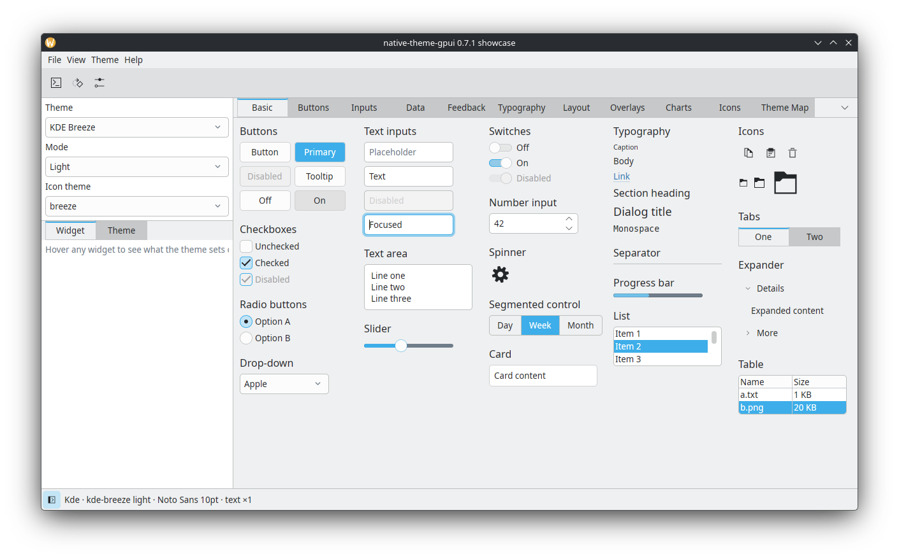

**KDE Breeze, dark**

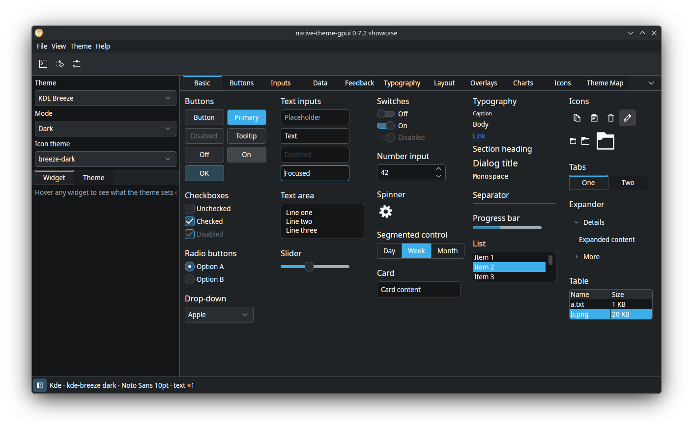

**Material, light**

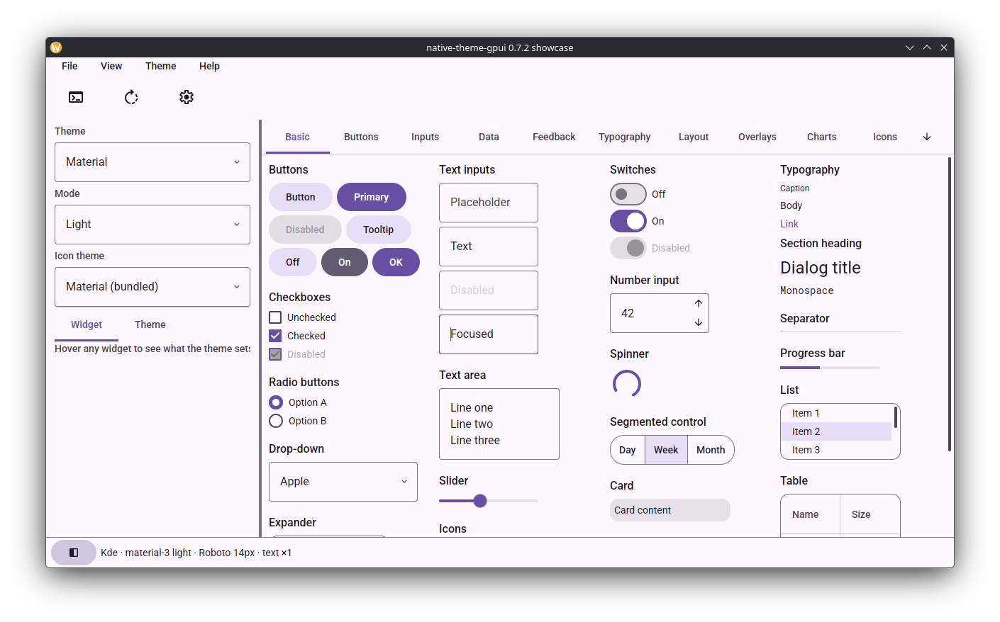

**Material, dark**

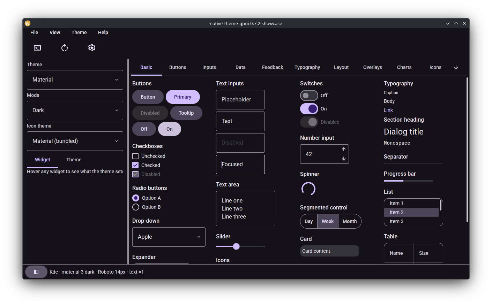

**Catppuccin Mocha, light**

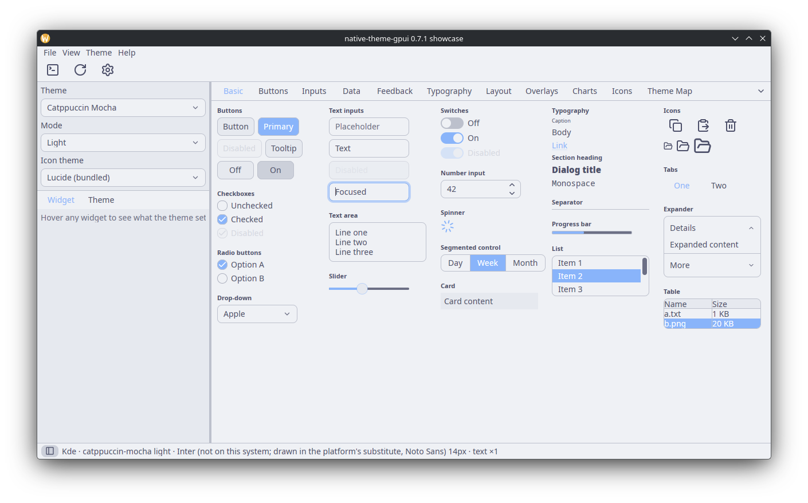

**Catppuccin Mocha, dark**

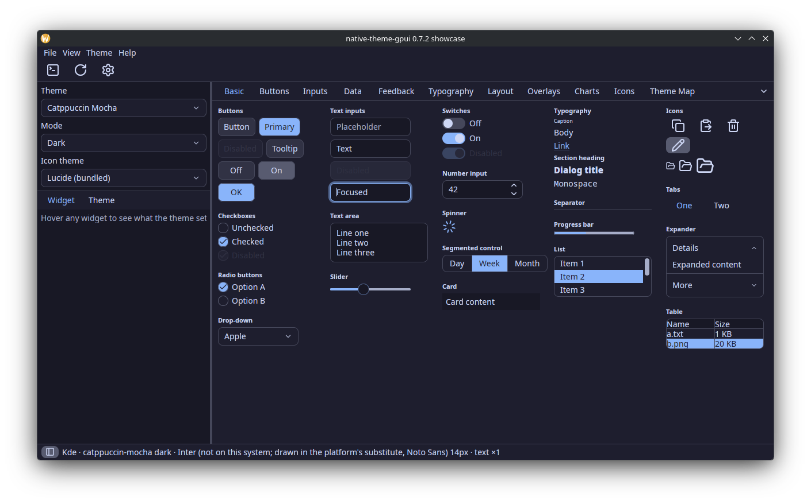

### macOS

The `macos-monterey` preset, which covers macOS 12 to 15, and `macos-tahoe`, macOS 26's own look, both captured on GitHub's `macos-26` runner, macOS 26.7.2, so the Monterey pair shows that preset drawn on macOS 26.

**macOS Monterey, light**

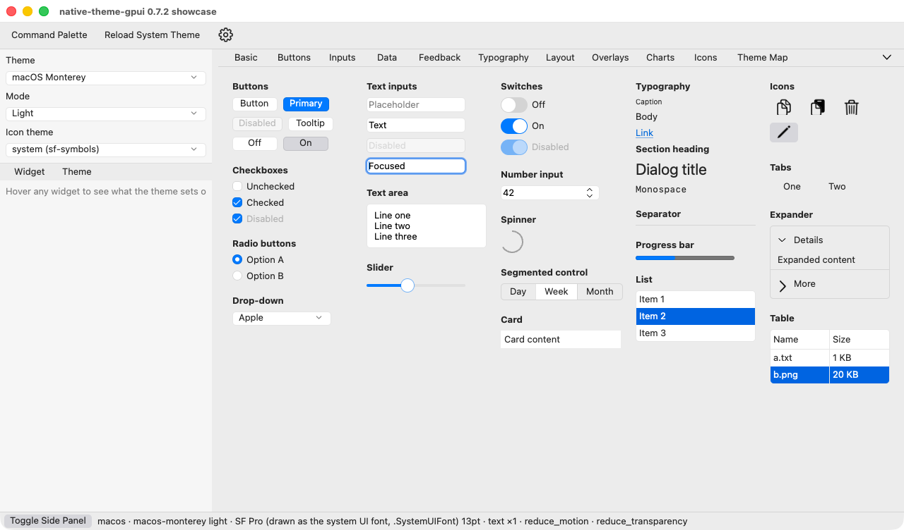

**macOS Monterey, dark**

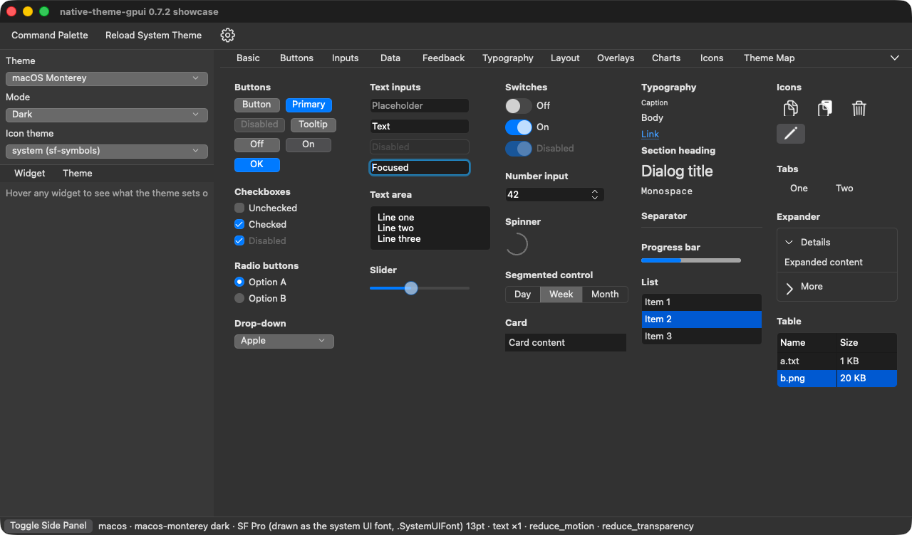

**macOS Tahoe, light**

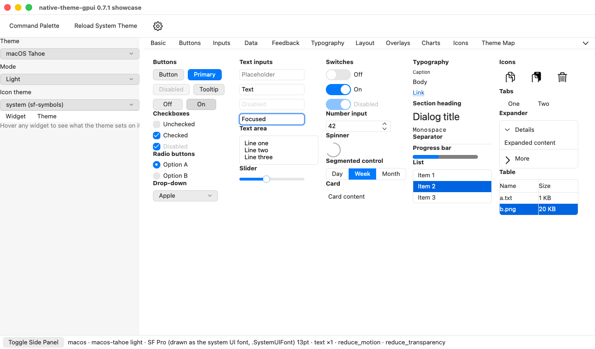

**macOS Tahoe, dark**

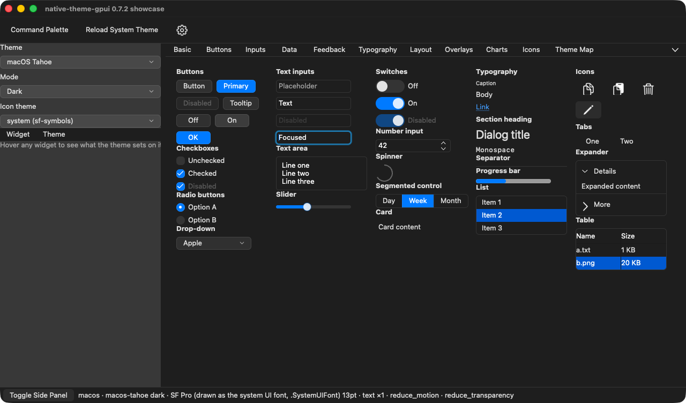

### Windows

The `windows-11` preset, captured on GitHub's `windows-2025` runner, Windows Server 2025 (build 26100): GitHub has no x64 Windows 11 image. On that image the OS reports the same metrics, fonts and system colours as Windows 11 25H2 (build 26200), except the animation and drop-shadow settings, which are off on Server.

**Windows 11, light**

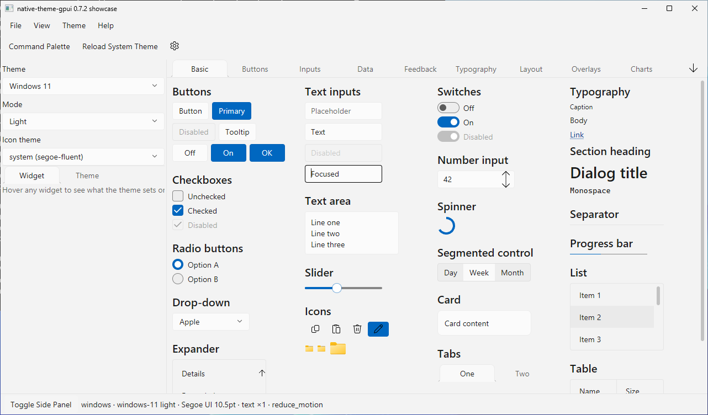

**Windows 11, dark**

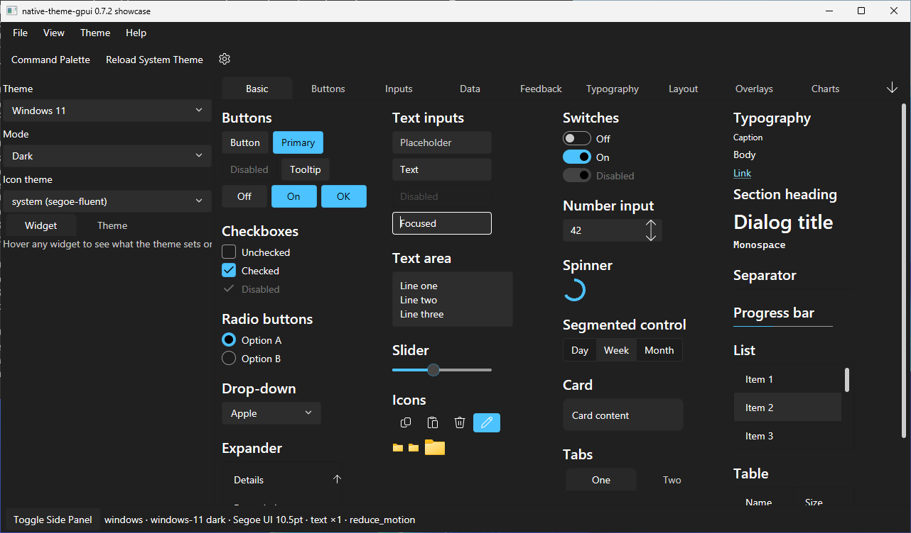

## Links

- [API reference on docs.rs](https://docs.rs/native-theme-gpui)
- [Showcase source](examples/showcase-gpui/)
- [CHANGELOG](../../CHANGELOG.md)

## License

Licensed under any of

- [Apache License, Version 2.0](http://www.apache.org/licenses/LICENSE-2.0)
- [MIT License](http://opensource.org/licenses/MIT)
- [0BSD License](https://opensource.org/license/0bsd)

at your option.
