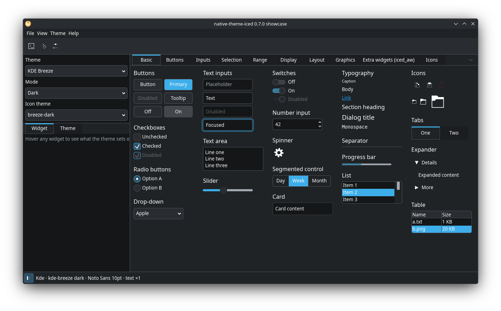
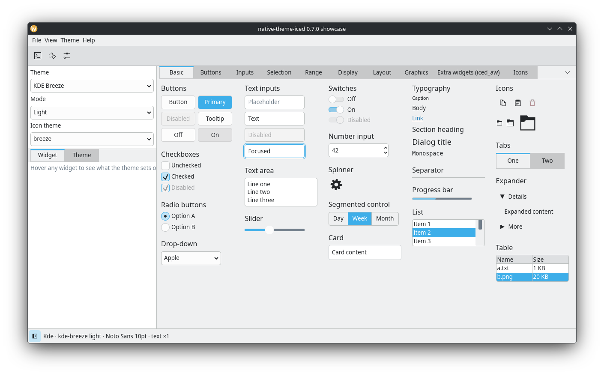
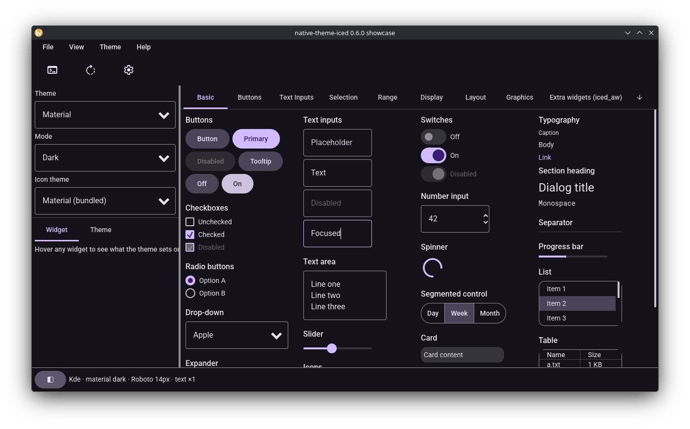
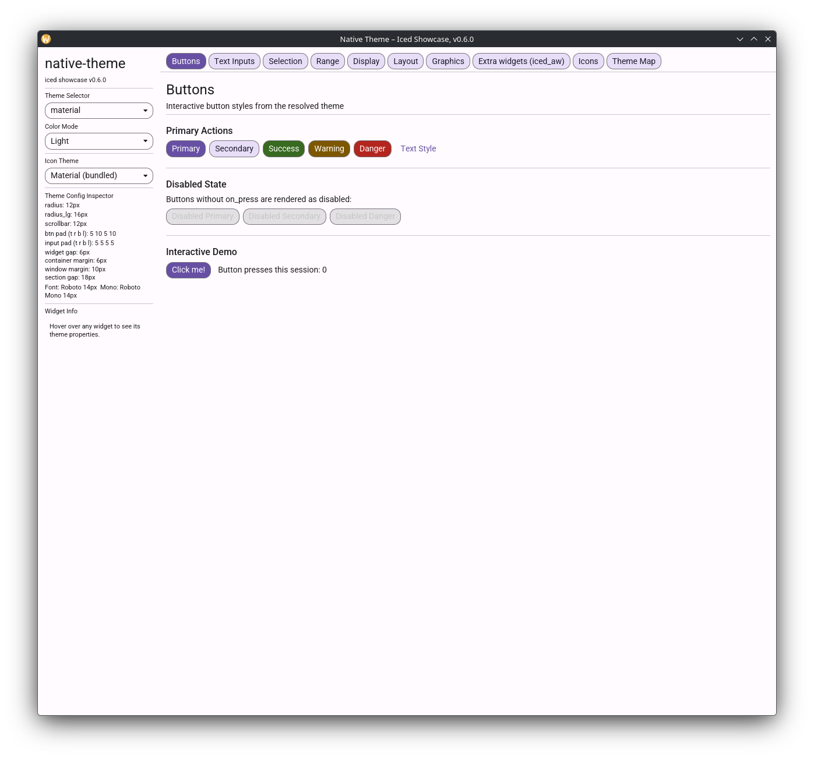
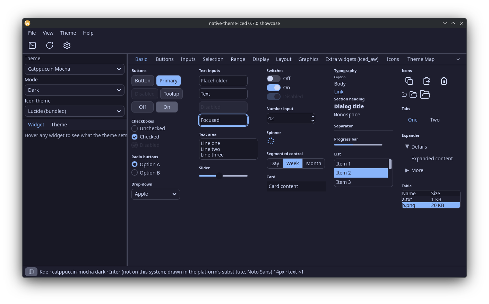
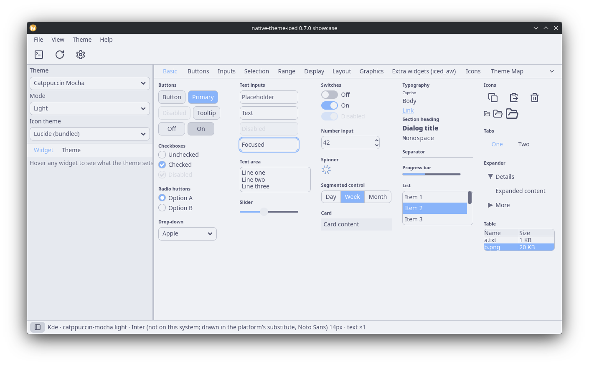
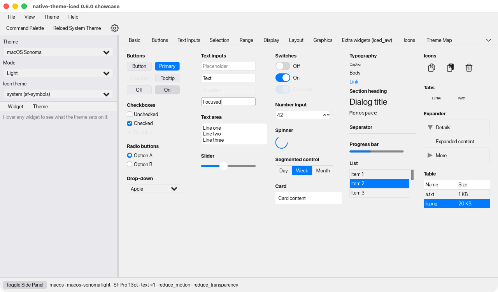
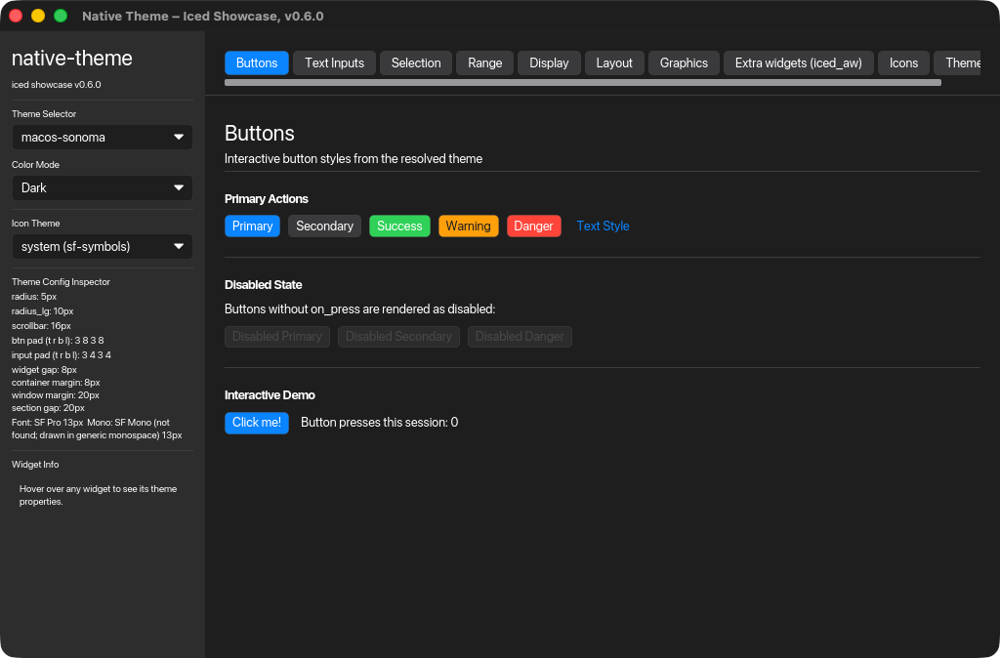
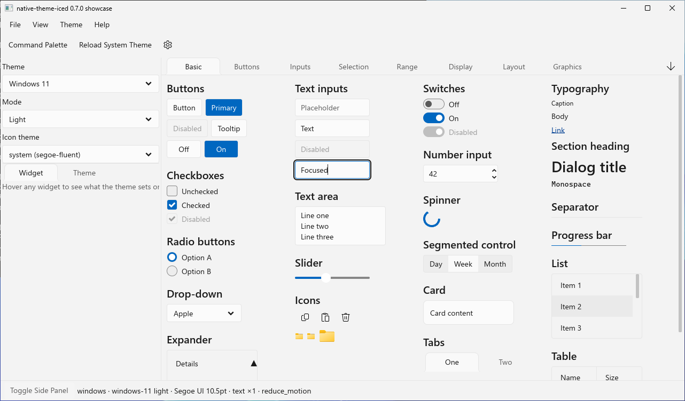
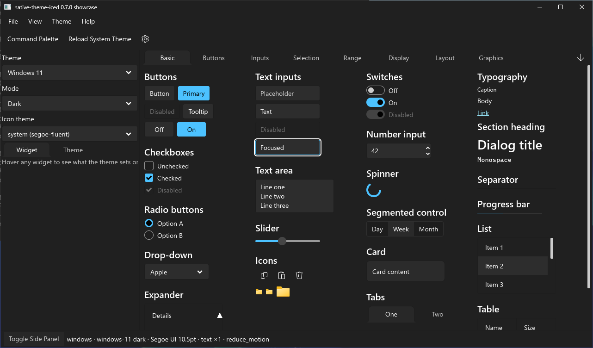

# native-theme-iced

[iced](https://iced.rs/) connector for [`native-theme`](https://crates.io/crates/native-theme).

Compatibility: the versions this connector requires, and the set it has been
verified against, are in [Compatibility](#compatibility).

## What it does

Two layers, and you can stop after the first:

1. **A palette.** A `ResolvedTheme` becomes a configured
   `iced::Theme` (Palette + Extended palette), so iced's built-in
   Catalog-driven widget styles pick up the platform's colours with no further
   code.
2. **Per-widget style functions.** iced's palette has six colours, so a widget
   state it has no slot for — a button's pressed fill, an input's focus border,
   a switch's track — is a value iced invents. `styles::*` hands each widget
   the resolved theme's own field instead. See [Styles](#styles).

Plus widget-metric helpers (`button_padding`, `border_corner_radius`, `font_size`, …)
for the sizing iced applies per widget rather than through the Catalog.

## How it fits

Depend on this crate; it re-exports `native-theme` as
`native_theme_iced::native_theme`, so your `Cargo.toml` need not add a second
dependency on it, whose version could drift from the connector's. The
workspace-level README at the repo root has a diagram showing where each
crate sits.

Unlike the GPUI connector, iced applies geometry (padding, sizes, spacing)
via inline widget configuration, so the theme and the style functions carry
**colours, borders and radii**, and the metric helpers read the rest off a
`&ResolvedTheme` for you to pass into your widget builders.

## Compatibility

**Required** — the floors this crate's own `Cargo.toml` states:

| Crate | Required |
|---|---|
| `iced_core` | 0.14 |
| `iced_widget` (feature `widgets`, on by default) | 0.14 |
| `iced_aw` (feature `iced_aw`, off by default) | 0.14 |
| `iced_futures` (feature `watch`, off by default) | 0.14 |
| `iced` (dev-dependency: the showcase) | 0.14 |
| `rust-version` | 1.88.0 |

Each is a floor and nothing more, and deliberately not an open-ended range: a
*patch* release of an upstream crate has broken a connector in this repository
before, when gpui-component 0.6.2 removed a theme field the published
native-theme-gpui 0.5.8 wrote and 0.5.8 stopped compiling.

**Verified** — the versions `scripts/update_compatibility.sh run` last resolved and ran
this connector's tests, in all three feature configurations, clippy, docs and
the widget-coverage script against. The script writes the line; a hand-edited
one fails a test:

<!-- compat:begin -->
Verified against iced 0.14.0, iced_aw 0.14.1, iced_core 0.14.0, iced_futures 0.14.0, iced_test 0.14.0 and iced_widget 0.14.2 on 2026-10-14.
<!-- compat:end -->

**After that** — newer releases are tested nightly by the dependency canary
(`.github/workflows/dependency-canary.yml`), and a break it finds is recorded in
the CHANGELOG.

## Quick start

Add the crate to your `Cargo.toml` beside iced, with the OS readers
(`native`); its default `spinner` feature turns on the `svg`, `image` and
`canvas` widgets of the `iced_widget` it shares with iced:

```toml
[dependencies]
native-theme-iced = { version = "0.6", features = ["native"] }
iced = "0.14"
```

Load a bundled preset:

```rust,no_run
use native_theme_iced::from_preset;

# fn f() -> native_theme_iced::Result<()> {
let (theme, resolved) = from_preset("dracula", true)?; // true: is_dark
// `theme` is the iced Theme; `resolved` has metric fields for widget sizing.
# Ok(())
# }
```

Or read the OS theme at runtime:

```rust,no_run
use native_theme_iced::from_system;

# fn f() -> native_theme_iced::Result<()> {
let loaded = from_system()?;
// `loaded.theme` is the iced Theme, `loaded.resolved` the OS mode's variant.
# Ok(())
# }
```

## Kerning

Qt, GTK (Pango), WinUI and AppKit kern every text. iced 0.14 does not by
default: its default shaping, `Shaping::Auto`, shapes text that is all ASCII
with `Shaping::Basic`, which sets each glyph at its own advance, with no
kerning, so pairs like "AV", "To" and "Wa" stand further apart than the
platform sets them.

This crate's `advanced-shaping` feature, on by default, turns on `iced_core`'s
feature of that name, which makes `Shaping::Advanced` the default. Cargo
builds one `iced_core` for your application and this crate, so depending on
this crate is enough: every text that sets no shaping of its own is kerned —
`text`, and the labels of checkboxes, radios, togglers, pick lists and combo
boxes (text inputs and text editors shape with `Shaping::Advanced` already).
A text stays unkerned where you set `.shaping(Shaping::Basic)` or
`.shaping(Shaping::Auto)` on it, and everywhere with `default-features = false`
unless you list `advanced-shaping`. iced's docs call advanced shaping the
costlier of the two; it is what the platforms do for every text. The crate
docs' *Kerning* section cites the sources.

## Core concepts

- **`from_preset(name, is_dark)`** — load a bundled preset. `is_dark` is explicit because some presets (`solarized`, `gruvbox`) have ambiguous lightness.
- **`from_system()`** — read the OS theme. Returns a `Loaded`: `theme` and `resolved` for the variant the OS is currently using, `mode` (which variant that is), `accessibility` (the user's accessibility preferences, see [Text scaling](#text-scaling)), and `icon_set` and `icon_theme` for icons and the spinner. `SystemThemeExt::to_iced_theme` gives the same from a `SystemTheme`.
- **`to_theme(&resolved, "App Name")`** — the underlying mapping function if you already have a `ResolvedTheme` from somewhere else. `to_theme_in(&resolved, "App Name", mode)` is the same in a mode you know, which sets the theme's light/dark flag where `to_theme` leaves it to iced's guess from the background's lightness.
- **`styles::*`** — one function per widget, each returning a closure for that widget's style setter. See [Styles](#styles).
- **Metric helpers** — free functions that read geometry off `&ResolvedTheme` for use with iced's inline widget configuration.

## Styles

The palette alone makes an iced application *resemble* the platform. The style
functions make each widget state *equal* to it: every colour, border and
radius they emit is a field of the resolved theme, and a `Style` field the
native model does not carry is read from iced's own default at run time —
never written as a literal.

```rust,no_run
use iced::widget::{Button, button};
use native_theme_iced::styles;

# fn f(resolved: native_theme_iced::ResolvedTheme) -> Button<'static, ()> {
button("Save").style(styles::button_primary(&resolved))
# }
```

Each function takes a `&ResolvedTheme`, captures what it needs by value, and
returns a `'static + Clone` closure, so you can call it per widget in `view`
and it follows a theme change on the next frame.

iced's style setters do not all take the same closure, so the functions come
in four shapes. Each one's doc comment names the setter it is passed to and
the iced default it replaces:

| Shape | Closure | Functions | Passed to |
|---|---|---|---|
| with a status | `Fn(&Theme, Status) -> Style` | `button`, `button_primary`, `button_danger`, `button_success`, `button_warning`, `button_link`, `button_toggle`, `text_input`, `text_editor`, `checkbox`, `checkbox_over`, `radio`, `toggler`, `toggler_over`, `pick_list`, `scrollable`, `slider`, `segment`, `expander` | `.style(..)` — `slider` also serves `vertical_slider`; `text_input` also serves `ComboBox::input_style(..)`; `segment` and `expander` style the buttons of a segmented control and an expander header, which iced lacks; `button_toggle(&resolved, checked)` is a toggle button, the plain button while off; the `_over` forms fade a disabled control over a backdrop you name |
| without a status | `Fn(&Theme) -> Style` | `container_card`, `progress_bar`, `rule`, `tooltip`, `segmented_control`, `expander_frame`, `pane_grid` | `.style(..)` — `segmented_control` styles the container holding the segments, `expander_frame` the one round an expander's header and body, `pane_grid` a `PaneGrid`'s split lines |
| menu | `Fn(&Theme) -> menu::Style` | `menu` | `.menu_style(..)` on `PickList` and `ComboBox` |
| a value | `scrollable::Scrollbar` | `scrollbar` | `.direction(Direction::Vertical(..))` — widths, and an embedded bar where the platform does not overlay its scrollbars |

A stated hover or pressed colour is a layer the platform paints over the
widget's fill, while iced replaces the fill per state, so the styles flatten
the layer onto the fill with `styles::composite_over(layer, base)` (source-over,
straight alpha, native-theme's `color::composite_over`); a layered state you
draw yourself matches them through it.

Some native geometry has a builder receiver rather than a `Style` field; pass
it where you construct the widget:

```rust,no_run
use iced::widget::{Column, checkbox, column, progress_bar, rule, toggler};
use native_theme_iced::styles;

# #[derive(Debug, Clone)]
# enum Message {}
# fn f(resolved: native_theme_iced::ResolvedTheme, checked: bool, on: bool, value: f32) {
let controls: Column<'_, Message> = column![
    checkbox(checked)
        .size(resolved.checkbox.indicator_width)
        .spacing(resolved.checkbox.label_gap)
        .style(styles::checkbox(&resolved)),
    toggler(on)
        .size(resolved.switch.track_height)
        .style(styles::toggler(&resolved)),
    progress_bar(0.0..=1.0, value)
        .girth(resolved.progress_bar.track_height)
        .style(styles::progress_bar(&resolved)),
    rule::horizontal(resolved.separator.line_width).style(styles::rule(&resolved)),
];
# }
```

iced has no segmented control and no expander; both are built from its own
buttons and containers. A segmented control is a container of segment
buttons, whose fill shows as the outline and the separators:

```rust,no_run
use iced::widget::{Container, button, container, row, text};
use native_theme_iced::styles;

# #[derive(Debug, Clone)]
# enum Message {}
# fn f(resolved: native_theme_iced::ResolvedTheme, labels: &[&str], chosen: usize) {
let sc = &resolved.segmented_control;
let segments = labels.iter().enumerate().map(|(i, label)| {
    let position = styles::SegmentPosition::of(i, labels.len());
    button(text(*label))
        .style(styles::segment(&resolved, i == chosen, position))
        .into()
});
let control: Container<'_, Message> = container(row(segments).spacing(sc.separator_width))
    .padding(sc.border.line_width)
    .style(styles::segmented_control(&resolved));
# }
```

An expander's header is a button in `styles::expander`, whose label is the
disclosure arrow, drawn in `expander_arrow_color(&resolved)` at
`expander.arrow_icon_size`, and the title. Where the theme states
`expander.frame_enabled` the header draws no outline: under `Some(true)` one
frame holds the header and the body, a container in `styles::expander_frame`
padded by `expander.border.line_width`; under `Some(false)` there is none.

`toggler` lays its track out twice its height, so a platform whose track is
not — material-3's 52 × 32, adwaita's 46 × 26 — gets a wider one than it
states. `native_theme_iced::switch(&resolved, on, on_toggle)` is a switch at
`switch.track_width` × `.track_height` with its thumb at `.thumb_diameter`
(`.unchecked_thumb_diameter` while off, where stated),
drawn in `styles::toggler`'s colours, a thumb taller than the track
overhanging it (kde-breeze's), the whole of it hovered and pressed; it has
no label, and `None` for `on_toggle` disables it.

`radio` draws its dot at half the circle, and `radio::Style` has no size for
it. `native_theme_iced::radio(&resolved, radio(..), is_selected)` sizes the
radio `checkbox.radio_indicator_width` across where the theme states it
(Material's radio is 20, its checkbox 18), `checkbox.indicator_width` where it
does not, `checkbox.label_gap` from its label,
in `styles::radio`, and where the theme states `checkbox.radio_dot_diameter`
lays a dot that many pixels across over the circle, in
`checkbox.indicator_color`; where it states none (macOS), the dot is iced's.

### `iced_aw`

native-theme models a card, a menu, a tab bar, a sidebar, a spinner and a
selection list; iced itself has none of them. With the `iced_aw` feature,
`styles::aw` covers the [`iced_aw`](https://crates.io/crates/iced_aw) widgets
that do: `card`, `menu` (for `MenuBar`), `tab_bar` (also `Tabs`'
`tab_bar_style`), `sidebar`, `selection_list` and `spinner`. `iced_aw`'s
`Spinner` — not this crate's `Spinner`, which draws the platform's indicator
itself — has no style of its own and paints with the inherited text colour,
so `spinner` styles a wrapping container, with `iced_aw` a dependency of the
application's own:

```toml
[dependencies]
native-theme-iced = { version = "0.6", features = ["iced_aw"] }
iced_aw = "0.14"
```

```rust,no_run
use iced::widget::{Container, container};
use native_theme_iced::styles;

# fn f(resolved: native_theme_iced::ResolvedTheme) -> Container<'static, ()> {
container(iced_aw::Spinner::new()).style(styles::aw::spinner(&resolved))
# }
```

`Card::on_close` is the one receiver `iced_aw` 0.14.1 does not honour: it
styles the close button with its *default* card class, not the one
`.style(..)` was given (`widget/card.rs:193-206`), so the icon is that class's
white on every theme and `card`'s `close_color` never reaches it. Give a card
that needs dismissing a themed button of its own instead.

## Widget metrics

### Use widget-metric helpers

```rust,no_run
use native_theme_iced::{border_corner_radius, button_padding, font_family};

# fn f(resolved: native_theme_iced::ResolvedTheme) {
// in your view:
let padding = button_padding(&resolved);
let radius  = border_corner_radius(&resolved);
let family  = font_family(&resolved);
// Apply with .padding(padding), .border(...) on your widget builders.
# }
```

Full helper list: `button_padding`, `input_padding`, `text_area_padding`
(a multi-line field's own padding, `text_area.border`), `combo_box_padding`
(whose right side also centres the arrow in `combo_box.arrow_area_width`),
`padding_or`, `padding_inside_border`, `stated_padding`,
`control_line_height`, `button_content_min_size`, `at_least`,
`border_corner_radius`, `border_corner_radius_lg`, `scrollbar_groove_width`,
`tooltip_show_delay` (for `Tooltip::delay`), `list_header_height` (a
table header's height),
`font_family`, `font_size`, `font_weight`, `mono_font_family`,
`mono_font_size`, `mono_font_weight`, `system_font_family` and `font`
(feature `system-fonts`), `scaled_text_size`,
`line_height`,
`border_color`, `disabled_opacity`, `focus_ring_color`, `link_color`,
`expander_arrow_color`,
`selection_background`, `info_color`, `info_text_color`,
`warning_text_color`, `icon_sizes`, `text_scale`, plus `to_iced_weight(css_weight)`
for converting CSS weight values to iced's `Weight` enum, and the widgets
`pick_list_handle`, `tab_indicator`, `tab_indicator_line`, `tab_flares`,
`switch` / `switch_over` and `radio` (all feature `widgets`).

`tab_indicator_line` is the line that marks the active tab, to lay over a
tab or over its place in a bar that takes no per-tab content. `tab_flares`
wraps a row of tabs, an `iced_aw` `TabBar` or `Tabs`, and draws after it,
where the theme states `tab.active_outward_corner_radius` (WinUI 3's folder
tabs), the selected tab's outward bottom corners: a flare at each foot in
`tab.active_background`, the outline running on down the curve in
`tab.border.color`, and its bottom edge covered. Give the row
`tab.active_outward_corner_radius` of room at both ends, a row's own padding
or a container's outside an `iced_aw` bar, so the end tabs' flares show.

`button_padding`, `input_padding`, `text_area_padding` and `combo_box_padding`
need the `widgets` feature (on by default). Each side is the theme's where it states that side,
plus the border's line width: the theme's padding lies inside the border,
and iced paints the border inside the widget's bounds, over its padding
(`padding_inside_border`). A side the theme does not state is iced's own
default, `iced_widget::button::DEFAULT_PADDING` or
`iced_widget::text_input::DEFAULT_PADDING`.

### Minimum sizes

iced's size setters take the extent itself, so a platform minimum passed to
`Button::height` would make the button exactly that tall. A single-line
control reaches its minimum height through its line height instead, and a
button through a floor under its label:

```rust,no_run
use iced::widget::{Column, button, column, pick_list, text, text_input};
use native_theme_iced::{
    AccessibilityPreferences, at_least, button_content_min_size, button_padding,
    combo_box_padding, control_line_height, input_padding, pick_list_handle,
    scaled_text_size, styles,
};

# #[derive(Debug, Clone)]
# enum Message {
#     Name(String),
#     Save,
#     Choose(String),
# }
# fn f(resolved: native_theme_iced::ResolvedTheme, value: &str, options: &[String], selected: Option<&String>) {
let on_select = Message::Choose;
// `loaded.accessibility` from `from_system()`; under a preset, the default:
let accessibility = AccessibilityPreferences::default();
let size = scaled_text_size(resolved.input.font.size, &accessibility);
let field = text_input("Name", value)
    .on_input(Message::Name)
    .size(size)
    .padding(input_padding(&resolved))
    .line_height(control_line_height(
        &resolved, size, resolved.input.min_height, input_padding(&resolved),
    ))
    .style(styles::text_input(&resolved));
let save = button(at_least(text("Save"), button_content_min_size(&resolved)))
    .on_press(Message::Save)
    .padding(button_padding(&resolved))
    .style(styles::button(&resolved));
let combo_size = scaled_text_size(resolved.combo_box.font.size, &accessibility);
let choice = pick_list(options, selected, on_select)
    .text_size(combo_size)
    .padding(combo_box_padding(&resolved))
    .text_line_height(control_line_height(
        &resolved, combo_size, resolved.combo_box.min_height, combo_box_padding(&resolved),
    ))
    .handle(pick_list_handle::<iced::Renderer>(&resolved))
    .style(styles::pick_list(&resolved));
let form: Column<'_, Message> = column![field, save, choice];
# }
```

`combo_box.min_height` reaches the `PickList` the same way, through
`text_line_height` with `combo_box_padding`. The sizes are the scaled ones the
controls are drawn at (see [Text scaling](#text-scaling)), so at a large
factor the line box grows past the minimum. `pick_list_handle` names the
renderer: the handle's font type is the renderer's, which the call cannot
infer.

For any other widget the theme states a padding for, `padding_or(&stated,
default)` does the same over a default you name — a menu item drawn as a
button takes `padding_or(&resolved.menu.border.padding,
button::DEFAULT_PADDING)`, a card drawn as a container
`padding_or(&resolved.card.border.padding, Padding::ZERO)`. Where the
widget's default is not public, `stated_padding(&stated)` returns the
padding only when every side is stated: `iced_aw`'s `Card` and `TabBar` keep
theirs private, so pass `Some` to their `padding` setter and leave them
alone on `None`.

## Fonts

Build each `iced::Font` from the theme font with `font` (feature `system-fonts`,
default): the family iced's font database holds for it (`system_font_family`),
its weight (`to_iced_weight`) and its style. iced's `Family::Name` takes a
`&'static str` (`iced_core` 0.14 `font.rs:46`), so `font` leaks each distinct
family name once and gives every later call for it the same one. It selects a
face each call, so build the fonts when the theme changes:

```rust,no_run
use iced::widget::{Button, button, text};

# fn f(resolved: native_theme_iced::ResolvedTheme, button_size: f32) -> Button<'static, ()> {
// On a theme change:
let button_font = native_theme_iced::font(&resolved.button.font);
// In your view, sized as in Text scaling:
button(text("OK").font(button_font).size(button_size))
# }
```

Without `system-fonts`, leak each distinct stated family once and reuse it,
keyed by the `Arc<str>` `native_theme_iced::native_theme::theme::intern_font_family`
gives per name:

```rust,no_run
use native_theme_iced::native_theme::theme::intern_font_family;
# use std::collections::HashMap;
# use std::sync::Arc;
# fn f(resolved: native_theme_iced::ResolvedTheme, families: &mut HashMap<Arc<str>, &'static str>) {
let spec = &resolved.defaults.font;

let family: &'static str = *families // HashMap<Arc<str>, &'static str>
    .entry(intern_font_family(&spec.family))
    .or_insert_with_key(|name| Box::leak(name.to_string().into_boxed_str()));
let font = iced::Font {
    family: iced::font::Family::Name(family),
    weight: native_theme_iced::to_iced_weight(spec.weight),
    ..iced::Font::DEFAULT
};
# }
```

iced 0.14 draws text with cosmic-text 0.15, which takes a face only where
the family has one at exactly the weight asked for, and fontdb 0.23 files
each face at the one weight its OS/2 table states, a variable font too. A
weight the family has no face of, like a family the font database does not
hold, falls through to the platform's fallback families: cosmic-text's macOS
list has `.SF NS` first and the monospace Menlo second, so bold text asked of
the system font can be drawn in Menlo Bold. To draw a stated weight of a
variable family, file a face for it: where the family has no face at the
weight but a face's `wght` axis covers it, push a copy of that face's
`fontdb::FaceInfo` at the weight into the database iced draws from
(`iced::advanced::graphics::text::font_system()`, `raw().db_mut()`, behind
iced's `advanced` feature); cosmic-text sets the matched face's `wght` axis
to the weight asked for, both when it shapes the text (cosmic-text 0.15
`font/mod.rs:139-142`) and when it rasterises the glyphs (`swash.rs:20-40`),
so the platform's own font is drawn at the true weight. Where no face covers it, ask for the family's nearest weight. The
showcase does both (`drawable_font` and `register_weight`); the crate docs'
*Font Configuration* section cites the sources. cosmic-text 0.19 matches a
variable face at any weight its axis covers, which makes filing faces
unnecessary once iced draws with it.

## Features

| You want | You write |
|---|---|
| everything iced itself offers (the default) | nothing |
| the `iced_aw` widgets too | `features = ["iced_aw"]` |
| the OS theme from `from_system()` | `features = ["native"]` |
| the OS theme's changes, as a subscription | `features = ["native", "watch"]` |
| the palette only, no `iced_widget`, text kerned | `default-features = false, features = ["advanced-shaping"]` |
| the palette plus icons, no `iced_widget`, text kerned | `default-features = false, features = ["advanced-shaping", "lucide-icons"]` |

`widgets` (default) enables `styles`, the `button_padding`,
`input_padding`, `text_area_padding`, `combo_box_padding`,
`button_content_min_size` and `at_least` helpers, and the `switch`,
`switch_over`, `radio`, `pick_list_handle`, `tab_indicator`,
`tab_indicator_line` and `tab_flares` widgets; `spinner` (default, implies `widgets`) enables
`Spinner` through `iced_widget`'s `svg`, `image` and `canvas`; `iced_aw` (opt-in, implies `widgets`)
enables `styles::aw`. It is off by default because `iced_aw` is a third-party
crate with its own release cadence and an embedded icon font. The icon
features — `material-icons`, `lucide-icons`, `system-icons`, `svg-rasterize`
— are on by default. `system-fonts` (default) enables
`system_font_family`, the family iced's font database holds for a theme font — on macOS the
system UI font's `.SF NS` for the stated "SF Pro", and for a family the system lacks the
one the platform draws in its place, as the gpui and egui connectors draw it (fontconfig's
match on Linux, asked once per family and kept for the process: the first ask is one
`fc-match` process, about 12.5 ms, with a 2 s timeout). It also enables `font`, the whole
`iced::Font` of a theme font. `advanced-shaping` (default)
kerns every text of the application, as the platforms do (see [Kerning](#kerning)); with
`default-features = false`, list it to keep that. Every feature adds coverage; `default-features = false`
is the way to narrow.

The OS readers are the `native` feature (or native-theme's `kde`, `portal`,
`macos` and `windows`, one platform each), off by default as in native-theme;
without one, `from_system()` is the platform preset on Linux and an error on
macOS and Windows. `watch` (opt-in) enables `theme_changes`, the OS theme's
changes as an iced `Subscription`, through `iced_futures`; it watches with
a reader feature only (see [Runtime theme change](#runtime-theme-change)).

## Accessibility

| Preference | Effect |
|---|---|
| `text_scaling_factor` | nothing on its own: an iced `Theme` is a palette, with no text size; each text is sized from the theme through `font_size`, `mono_font_size` or `scaled_text_size` (see [Text scaling](#text-scaling)) |
| `reduce_motion` | `Spinner::view` holds the spinner still when passed `true`; the application forwards it to animations of its own |
| `reduce_transparency` | no receiver in iced's theme; the application reads it where it draws translucent surfaces |
| `high_contrast` | no receiver in iced's theme |

`is_reduced_motion`, `is_high_contrast`, `is_reduced_transparency` and
`text_scaling_factor` read the four preferences of a `SystemTheme`, as in the
gpui and egui connectors.

Keyboard focus: `styles::text_input` and `styles::text_editor` draw a focused
field's border as the theme's focus ring where that ring is inset at the
field's edge (`defaults.focus_ring_offset` is minus
`defaults.focus_ring_width`, as adwaita states it), `defaults.focus_ring_width`
wide in `input.focus_border_color` or the ring's colour. A ring that lies
outside the field's edge or across it (KDE, Windows, macOS), or inside it with
a gap, is not one iced can draw; there a focused field recolours its line at
rest, in `input.focus_border_color` where the theme states one.

### Text scaling

The OS text-scaling factor applies to every text size: the body font's, each
widget's font and each `text_scale` role's. The resolved theme holds the
theme's own sizes, unscaled; `scaled_text_size(size, &prefs)` scales any of
them, and `font_size` and `mono_font_size` are that for `defaults.font` and
`defaults.mono_font` (a factor that is not finite and positive is ignored):

```rust,no_run
use native_theme_iced::{font_size, from_system, scaled_text_size};

# fn f() -> native_theme_iced::Result<()> {
let loaded = from_system()?;
let body = font_size(&loaded.resolved, &loaded.accessibility);
let label = scaled_text_size(loaded.resolved.button.font.size, &loaded.accessibility);
# Ok(())
# }
```

With a preset there is no OS reading; pass
`&native_theme_iced::AccessibilityPreferences::default()`, which scales by 1,
or `native_theme_iced::native_theme::detect::accessibility_preferences()` to
honour the OS preferences under the preset (cached: a system read fills it,
the first call runs the platform reader where none has run since the last
`invalidate_caches()`, and the block holds until the next one, through the
one accessibility change the theme watcher does not report, Windows' high
contrast, which Windows announces only to top-level windows;
`AccessibilityPreferences::from_system()` runs the platform reader each
time).

iced fixes its default text size when the renderer is created (`iced_wgpu`
0.14.0 `window/compositor.rs:294-300`; `text::Renderer` only reads it back),
so `Settings::default_text_size` cannot follow a theme installed later, and
text given no size stays at iced's default under every theme. Size each
text-bearing widget from the theme, scaled as above: body text from
`defaults.font` (`font_size`), and a widget whose font the model states from
that font (`scaled_text_size`) —
`button.font`, `input.font`, `checkbox.font` (checkboxes and radios),
`combo_box.font` (`pick_list` and `combo_box`), `menu.font`, `tab.font`,
`sidebar.font`, `tooltip.font`, `list.item_font` and `list.header_font`; a
switch has none, so a `toggler`'s label takes `defaults.font`. The receivers
are `Text::size` and `Text::font`; `text_size` and `font` on `checkbox`,
`radio`, `toggler` and `pick_list`; `size` and `font` on `text_input`,
`combo_box` and `text_editor`; and `text_size` and `text_font` on `iced_aw`'s
`TabBar`, `Tabs` and `Sidebar`.

## Common recipes

### Apply user overrides to the OS theme

An overlay states only what it changes, in both variants: `to_iced_theme()`
builds the variant of the OS's colour mode, so an overlay of
`[light.defaults]` alone changes nothing on screen under a dark OS. It builds
the iced theme in the customised theme's own mode; `to_theme` would leave its
light or dark flag to iced's guess from the background's lightness, which an
overlay that changes the background can mislead:

```rust,no_run
use native_theme_iced::{SystemTheme, SystemThemeExt, Theme};

# fn f() -> native_theme_iced::Result<()> {
let sys = SystemTheme::from_system()?;
let overlay = Theme::from_toml(r##"
[light.defaults]
accent_color = "#ff6600"

[dark.defaults]
accent_color = "#ff6600"
"##)?;
let customised = sys.with_overlay(&overlay)?;
let loaded = customised.to_iced_theme();
# Ok(())
# }
```

### Runtime theme change

With the `watch` feature, `theme_changes()` is an iced `Subscription` of the
OS theme's changes: return it from `subscription()`, and on each change clear
native-theme's detection caches, read the theme again and rebuild what was
built from it, such as the `Spinner`. The caches hold the font DPI, dark mode,
the icon theme and the accessibility preferences, so a re-read without
`invalidate_caches()` gets the old ones. The caches are
native-theme's, reached through the re-exported source crate
(`native_theme_iced::native_theme`), so the connector stays the one
dependency:

```toml
[dependencies]
native-theme-iced = { version = "0.6", features = ["native", "watch"] }
```

```rust,no_run
use iced::Subscription;
use native_theme_iced::native_theme::detect::invalidate_caches;
use native_theme_iced::{Loaded, Spinner, from_system, theme_changes};

struct State {
    loaded: Loaded,
    spinner: Spinner,
}

#[derive(Debug, Clone)]
enum Message {
    ThemeChanged,
}

fn subscription(_state: &State) -> Subscription<Message> {
    // A watcher that cannot start (a desktop with none) yields its error
    // once; this drops it.
    theme_changes().filter_map(|changed| changed.ok().map(|_| Message::ThemeChanged))
}

fn update(state: &mut State, message: Message) {
    match message {
        Message::ThemeChanged => {
            invalidate_caches();
            if let Ok(loaded) = from_system() {
                state.spinner = Spinner::new(
                    &loaded.resolved,
                    loaded.icon_set,
                    loaded.icon_theme.as_deref(),
                );
                state.loaded = loaded;
            }
        }
    }
}
```

Read again with the entry point the application used: one that pinned a
preset with `SystemTheme::from_system_with_preset` reads with it again, or
`from_system()` picks the running OS version's preset:

```rust,no_run
use native_theme_iced::{SystemTheme, SystemThemeExt};

# fn f() -> native_theme_iced::Result<()> {
let loaded = SystemTheme::from_system_with_preset("macos-monterey")?.to_iced_theme();
# Ok(())
# }
```

The watcher runs while `subscription()` returns `theme_changes()`, and stops
when it no longer does. KDE Plasma, GNOME and Budgie, macOS and Windows are
watched; on another Linux desktop, or without a reader feature, the
subscription yields `Error::WatchUnavailable` once and ends, as it yields
`Error::ReaderFailed` where the watcher cannot start and
`Error::PlatformUnsupported` on a platform other than Linux, macOS and
Windows.

### Custom icons

For app-specific icons generated via [`native-theme-build`](https://crates.io/crates/native-theme-build).
The code it generates names native-theme's paths through the crate path it is
given, so give it the re-exported source crate, and the connector stays the
one dependency: `IconGenerator::new().crate_path("native_theme_iced::native_theme")`.

```rust,no_run
use native_theme_iced::icons::{custom_icon_to_image_handle, custom_icon_to_svg_handle};
# use std::borrow::Cow;
# use native_theme_iced::{IconProvider, IconSet};
# #[derive(Debug)]
# enum AppIcon { PlayPause }
# impl IconProvider for AppIcon {
#     fn icon_name(&self, _: IconSet) -> Option<&str> { None }
#     fn icon_svg(&self, _: IconSet) -> Option<Cow<'static, [u8]>> { None }
# }

# fn f() -> native_theme_iced::Result<()> {
// `loaded` from `from_system()`: a freedesktop icon comes from the icon theme
// the spinner and the role icons come from. The last argument is the size the
// system set's loader takes (at most
// `native_theme_iced::native_theme::icons::MAX_ICON_SIZE`), `None` for its
// default.
let loaded = native_theme_iced::from_system()?;
let (set, icon_theme) = (loaded.icon_set, loaded.icon_theme.as_deref());
let image = custom_icon_to_image_handle(&AppIcon::PlayPause, set, icon_theme, None, None);
let svg   = custom_icon_to_svg_handle(&AppIcon::PlayPause, set, icon_theme, None, None);
# Ok(())
# }
```

### Role icons

An icon by its role, in the theme's icon set and text colour:
`SystemTheme::icon` loads it from the set the theme names — a freedesktop
icon from that colour mode's icon theme — and colours it, a freedesktop icon
only where its foreground is left to the caller (a symbolic icon, a
`currentColor` the icon sets no colour for), so a full-colour one keeps its
own palette. An icon
the set does not have is `None`; nothing is substituted.

```rust,no_run
use iced::Element;
use iced::widget::{image, svg};
use native_theme_iced::icons::{to_image_handle, to_svg_handle};
use native_theme_iced::{IconRole, SystemTheme, SystemThemeExt, icon_sizes};

# #[derive(Debug, Clone)]
# enum Message {}
# fn f() -> native_theme_iced::Result<()> {
let sys = SystemTheme::from_system()?;
let loaded = sys.to_iced_theme();
let fg = loaded.resolved.defaults.text_color;
if let Some(data) = sys.icon(IconRole::ActionCopy, sys.mode, Some(fg)) {
    let size = icon_sizes(&loaded.resolved).toolbar;
    // `None`: `sys.icon` has coloured the icon already.
    let icon: Option<Element<'_, Message>> =
        match (to_svg_handle(&data, None), to_image_handle(&data)) {
            (Some(h), _) => Some(svg(h).width(size).height(size).into()),
            (_, Some(h)) => Some(image(h).width(size).height(size).into()),
            _ => None,
        };
}
# Ok(())
# }
```

### Animated spinners

`Spinner` (feature `spinner`, default) is the platform's loading indicator
at `spinner.diameter`: the icon set's own animated indicator — for a
freedesktop set the given icon theme's `process-working` in its own colours,
a symbolic one (`process-working-symbolic`, GNOME's) drawn in
`defaults.text_color`; for Material and Lucide their bundled one recoloured
`spinner.fill_color` — and, for a set with none (SF Symbols, Segoe), an arc
in `spinner.fill_color` at `spinner.stroke_width`. Build it once per theme
and icon set, and redraw on a timer while it shows:

```rust,no_run
# fn f(loaded: &native_theme_iced::Loaded, start: std::time::Instant) -> iced::Element<'static, ()> {
let spinner = native_theme_iced::Spinner::new(
    &loaded.resolved,
    loaded.icon_set,
    loaded.icon_theme.as_deref(),
);
// In view(), `start` an `Instant` the application keeps:
spinner.view(start.elapsed(), loaded.accessibility.reduce_motion)
# }
```

To play the theme's indicator by hand, load it from the theme's set and
convert it, coloured as that set is coloured:

```rust,no_run
use iced::widget::svg::{Handle, Svg};
use iced::{Length, Rotation};
use native_theme_iced::icons::{
    animated_frames_to_svg_handles_for, spin_rotation_radians, to_svg_handle,
};
use native_theme_iced::native_theme::detect::prefers_reduced_motion;
use native_theme_iced::native_theme::icons::{fill_current_color, load_icon_indicator};
use native_theme_iced::palette::to_color;
use native_theme_iced::{AnimatedIcon, IconData, IconSet, TransformAnimation};

# fn f(elapsed: std::time::Duration) -> native_theme_iced::Result<()> {
let loaded = native_theme_iced::from_system()?;
// The text colour: a Material or Lucide frame is tinted it, and a freedesktop
// frame's `currentColor` takes it where the frame sets no colour of its own.
let text = to_color(loaded.resolved.defaults.text_color);
let diameter = Length::Fixed(loaded.resolved.spinner.diameter);
if let Some(anim) = load_icon_indicator(loaded.icon_set, loaded.icon_theme.as_deref()) {
    if prefers_reduced_motion() {
        // The first frame, standing still.
        let _static_fallback = anim.first_frame();
    } else {
        match &anim {
            AnimatedIcon::Frames(_) => {
                // Cache this — do not call on every frame tick.
                if let Some(h) = animated_frames_to_svg_handles_for(loaded.icon_set, &anim, Some(text)) {
                    // Use iced::time::every(Duration::from_millis(u64::from(h.frame_duration_ms.get())))
                    // to drive: frame_index = (frame_index + 1) % h.handles.len();
                    // In view: Svg::new(h.handles[frame_index].clone())
                }
            }
            AnimatedIcon::Transform(_) => {
                // The icon carries its SVG and its period, coloured as its set
                // is coloured, as the frames above are: a freedesktop icon's
                // `currentColor` filled only where it sets no colour of its
                // own, a Material or Lucide icon tinted.
                if let (Some(data), Some(&TransformAnimation::Spin { duration_ms })) =
                    (anim.icon(), anim.animation())
                {
                    let handle = match (loaded.icon_set, data) {
                        (IconSet::Freedesktop, IconData::Svg(bytes)) => Some(Handle::from_memory(
                            fill_current_color(bytes, loaded.resolved.defaults.text_color)
                                .into_owned(),
                        )),
                        (IconSet::Material | IconSet::Lucide, _) => to_svg_handle(data, Some(text)),
                        _ => to_svg_handle(data, None),
                    };
                    if let Some(handle) = handle {
                        let angle = spin_rotation_radians(elapsed, duration_ms);
                        let spinning: Svg<'_> = Svg::new(handle)
                            .width(diameter)
                            .height(diameter)
                            .rotation(Rotation::Floating(angle));
                    }
                }
            }
            _ => {}
        }
    }
}
# Ok(())
# }
```

`animated_frames_to_svg_handles_for` colours each frame as its set does, and
the turning icon above is coloured the same way: it
tints a Material or Lucide frame through the monochrome colouriser, fills a
freedesktop frame's `currentColor` only where the document sets no `color` of
its own (Breeze's `process-working` keeps its stylesheet's), and draws an SF
Symbols or Segoe Fluent frame as it is.
`animated_frames_to_svg_handles(&anim, color)` puts every SVG frame through
the monochrome colouriser, which suits a bundled set's frames only.

Use `Rotation::Floating` (not `Rotation::Solid`) for spin animations so
the widget's layout box stays constant during rotation.

## Modules

| Module | Purpose |
|--------|---------|
| `palette` | Maps native-theme colours to iced's 6-field Palette |
| `styles` | Per-widget style functions (feature `widgets`, default); `styles::aw` for `iced_aw` (feature `iced_aw`) |
| `extended` | (internal) Overrides nine slots of iced's Extended palette: `background.base.text`, `background.weak.color`, `background.weak.text`, `secondary.base`, `secondary.strong`, and the `.base.text` of `primary`, `success`, `danger` and `warning`. `apply_overrides`' own doc comment says where each one comes from |
| `icons` | `IconData` to iced `image`/`svg` handles (borrowing and consuming), a provider's custom icons, animated-frame handles and the spin angle; role icons come from `SystemTheme::icon` |
| `spinner` | `Spinner`, the icon set's animated loading indicator or an arc (feature `spinner`, default) |

## Showcase

```sh
cargo run -p native-theme-iced --example showcase-iced
# following the OS theme's changes, through `theme_changes()`:
cargo run -p native-theme-iced --example showcase-iced --features watch
```

Displays every widget iced has, each styled through `styles::*`, with live
theme switching, a colour map, and an inspector that says which native field
every part of a widget comes from — and which parts iced still decides. It
opens on the Basic tab, the controls all three showcases draw, in the same
order and states, packed onto one screen, so the three showcases' captures
compare control by control. Its menus are a row at the top of the window;
on macOS they are in the system's menu bar, as the gpui and egui
showcases' are: the app menu (About, Settings…, Services, Hide, Quit),
File, View, Theme and Window. The elements the three share are listed once, in
`docs/showcase-elements.toml`: hovering one shows its leaves in Widget Info,
each with its value and how iced applies it, and `--dump-layout FILE` writes
their rectangles for `scripts/check_showcase_parity.py` (with
`--open-menu theme`, the Theme menu open and its rows among them; on macOS,
where the menus are the system menu bar's, the flag is reported and
ignored). Add
`--features watch` to have it follow the OS theme's changes in every colour
mode, as the gpui showcase does: under the OS theme (`default`) each change
reads the OS theme again, so its accent, fonts, icon theme and accessibility
preferences follow the OS under a chosen Light or Dark too, and a return to
System shows the OS theme as it is then, in its mode; under a preset each
change brings the OS's accessibility preferences, and in System mode its
light or dark mode. Add `--features iced_aw` for the tab with the `iced_aw`
widgets and the Basic tab's number input:

```sh
cargo run -p native-theme-iced --example showcase-iced --features iced_aw
# both:
cargo run -p native-theme-iced --example showcase-iced --features iced_aw,watch
```

A script keeps "every widget" true: `scripts/check_widget_coverage.py` fails
when an iced (or `iced_aw`) widget is neither shown nor listed, with a reason,
in `docs/showcase-exceptions.toml`.

## Gallery

### Linux








### macOS




### Windows

The `windows-11` preset, captured on GitHub's `windows-2025` runner, Windows Server 2025 (build 26100): GitHub has no x64 Windows 11 image. On that image the OS reports the same metrics, fonts and system colours as Windows 11 25H2 (build 26200), except the animation and drop-shadow settings, which are off on Server.




## Links

- [API reference on docs.rs](https://docs.rs/native-theme-iced)
- [Showcase source](examples/showcase-iced.rs)
- [CHANGELOG](../../CHANGELOG.md)

## License

Licensed under any of

- [Apache License, Version 2.0](http://www.apache.org/licenses/LICENSE-2.0)
- [MIT License](http://opensource.org/licenses/MIT)
- [0BSD License](https://opensource.org/license/0bsd)

at your option.
