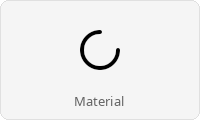
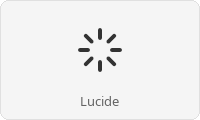

# native-theme

[%20AND%20Apache--2.0-blue.svg)](#license)

## What it does

Cross-platform theme data model with 24 semantic color roles, 26 per-widget
themes, and 17 bundled TOML presets. Reads OS themes from KDE Plasma, GNOME
(via `xdg-desktop-portal`), macOS, and Windows, and produces a fully populated
`ResolvedTheme` any GUI toolkit can consume.

## How it fits

Most apps don't depend on this crate directly — they use a framework connector like
[`native-theme-gpui`](../connectors/native-theme-gpui/),
[`native-theme-iced`](../connectors/native-theme-iced/) or
[`native-theme-egui`](../connectors/native-theme-egui/), which pull `native-theme` in
transitively and re-export it. Depend on `native-theme` directly to write a new connector,
or to use the theme data without one.

## Quick start

Add the dependency:

```sh
cargo add native-theme
```

Read the live OS theme:

```rust,no_run
use native_theme::SystemTheme;

let sys = SystemTheme::from_system()?;
let active = sys.pick(sys.mode);                 // &ResolvedTheme
let accent = active.defaults.accent_color;       // Rgba (fully populated)
let bg     = active.defaults.background_color;   // Rgba
# Ok::<(), native_theme::Error>(())
```

For OS readers, enable the `native` feature (or an individual `kde` / `portal`
/ `macos` / `windows`) — see [Feature flags](#feature-flags) below. No features
are needed to use bundled presets.

## Core concepts

- **`Theme`** — sparse, TOML-shaped definition (fields are `Option<T>`). Load via `Theme::preset(…)`, `Theme::from_toml(…)`, or `Theme::from_file(…)`.
- **`ResolvedTheme`** — one resolved variant, safe to hand to UI code. Every font and every size the model requires has a value, and so does every colour but 34 optional ones. A field the model treats as optional is `None` where the theme states none:
  - *Colours:* most of the 34 are state shades such as `checkbox.hover_background`, which a theme, a bundled preset included, may leave `None`.
  - *Sizes:* padding sides, menu and list row heights, the list header height, toolbar height and item gap, tab item gap and active-indicator width, combobox arrow width, expander arrow gap and content indent, the checkbox's radio indicator width, radio dot diameter and check-mark stroke width, the switch's unchecked thumb diameter. Where one is `None` the toolkit's own value applies.
  - *Behaviour:* `tooltip.show_delay`, `dialog.entrance`, `expander.arrow_side`, `expander.frame_enabled` and `tab.active_indicator_side`, where the toolkit's own value applies too; and `tab.active_outward_corner_radius`, where unstated the selected tab's feet are square.
  - *Switch outlines:* the track and thumb outlines' colours (five of the 34) and widths (`switch.track_border_line_width`, `switch.thumb_border_line_width`); where they are `None` no outline is drawn. A disabled track outline's colour (`switch.disabled_unchecked_track_border_color`, `switch.disabled_checked_track_border_color`) left `None` takes the enabled one.
- **`SystemTheme`** — the OS theme, from `SystemTheme::from_system()`: both resolved variants (`light`, `dark`), the OS's active `mode`, the `preset` the reader's values were merged over and its `version_match`, the icon set and theme, and the accessibility preferences. `pick(mode)` gives one variant; `with_overlay(…)` applies an application's changes.
- **`ColorMode`** — the `Light` / `Dark` choice passed when resolving.
- **Preset** — a named bundled theme. 17 ship today:
  - *Platform:* `kde-breeze`, `adwaita`, `windows-11`, `macos-monterey`, `macos-tahoe`, `material-3`, `ios-13`
  - *Community:* `catppuccin-latte`, `catppuccin-frappe`, `catppuccin-macchiato`, `catppuccin-mocha`, `nord`, `dracula`, `gruvbox`, `solarized`, `tokyo-night`, `one-dark`

  `material-3` and `ios-13` have no OS reader; an application chooses them as a look. `material-3` suits any platform, and its Material Symbols icons load with the `material-icons` feature. `ios-13` is a look for desktop apps on macOS: its SF Symbols load only on macOS, so on every other platform, iOS included, its icons are `None` and are never replaced by another set.

  Enumerate with `Theme::list_presets()` or `Theme::list_presets_for_platform()`.

## Platform readers

`SystemTheme::from_system()` reads the OS theme with the running platform's
reader and merges what it reads over that platform's preset; a field the reader
does not supply keeps the preset's value. Both variants are resolved.

| Platform | Feature | Reads | Preset |
|---|---|---|---|
| KDE Plasma | `kde` | `kdeglobals`, `kcmfonts`; with `portal`, the portal's accent colour | `kde-breeze` |
| GNOME, Budgie | `portal` | the XDG Desktop Portal settings and gsettings | `adwaita` |
| macOS 11 and later | `macos` | `NSColor` under both appearances, `NSFont`, the scroller style and the accessibility options | `macos-monterey` before 26 (it covers 12 to 15), `macos-tahoe` from 26 |
| Windows | `windows` | `UISettings`, the system metrics and fonts | `windows-11` |

The KDE, GNOME and Windows readers read the active variant only, and the other
variant is the preset's; the macOS reader reads both. On another Linux desktop,
or without the desktop's reader feature, `from_system()` returns the desktop's
preset (`kde-breeze` on KDE, `adwaita` elsewhere) with no live reading. On macOS
and Windows without the reader feature it returns `Error::FeatureDisabled`.

On macOS and Windows the preset is the one of the running OS version's visual
generation. `SystemTheme::version_match` tells how the running version relates
to it: macOS 27, which has no preset of its own yet, gets `macos-tahoe` as
`VersionMatch::PresetOlder`, and Windows 10 gets `windows-11` as
`VersionMatch::PresetNewer`. `SystemTheme::from_system_with_preset()` merges
over another generation of the running platform instead, under the OS's live
colours, fonts and accessibility settings. `pipeline::diagnose_platform_support()`
lists what detection can see, for debugging.

## Common recipes

### Load a bundled preset

```rust
use native_theme::{ColorMode, Theme};

let theme = Theme::preset("catppuccin-mocha")?;
let resolved = theme.resolve(ColorMode::Dark)?;
let accent = resolved.variant.defaults.accent_color;  // Rgba
# Ok::<(), native_theme::Error>(())
```

`theme.resolve(mode)` returns a `Resolved` wrapper containing `variant`
(the `ResolvedTheme`) plus the effective icon-set and icon-theme metadata.

### Layer user overrides on a preset

```rust
use native_theme::Theme;

let mut theme = Theme::preset("nord")?;
let overrides = Theme::from_toml(r##"
    [light.defaults]
    accent_color = "#ff6600"

    [dark.defaults]
    accent_color = "#ff6600"
"##)?;
theme.merge(&overrides);
# Ok::<(), native_theme::Error>(())
```

`merge` fills in only the fields present in the overlay; everything else stays
from the base preset. An overlay needs no `name`: the base keeps its own. It
changes only the variants it states, so the recipes state both: an overlay of
`[light.defaults]` alone leaves the dark variant as it was.

### Apply an overlay to the OS theme at runtime

```rust,no_run
use native_theme::{SystemTheme, Theme};

let sys = SystemTheme::from_system()?;
let overlay = Theme::from_toml(r##"
    [light.defaults]
    accent_color = "#ff6600"

    [dark.defaults]
    accent_color = "#ff6600"
"##)?;
let customised = sys.with_overlay(&overlay)?;
# Ok::<(), native_theme::Error>(())
```

### Cheap dark-mode check

```rust,no_run
use native_theme::detect::{detect_is_dark, system_is_dark};

// Cached: the first call reads the OS, later calls return its answer.
if system_is_dark() {
    // …
}

// Uncached: reads the OS on every call, for polling.
let dark_now = detect_is_dark();
```

Neither runs the full theme-reader pipeline. `system_is_dark()` keeps its
answer until `detect::invalidate_caches()`, so a poll of it never sees the
user switch modes; poll `detect_is_dark()`, or follow the changes as the next
recipe does.

### Watch for OS theme changes

With the `watch` feature:

```rust,no_run
# #[cfg(feature = "watch")] {
use native_theme::watch::on_theme_change;

let _subscription = on_theme_change(|_event| {
    // Runs on a background thread. The event carries no theme: tell the UI
    // thread to call `detect::invalidate_caches()`, then
    // `SystemTheme::from_system()` again.
})?;
# }
# Ok::<(), native_theme::Error>(())
```

Keep the subscription alive: dropping it stops watching.

## Icon sets




Semantic icon roles map to platform-appropriate glyphs via typed per-set
loaders. Each loader needs its set's feature and gives `None` without it:
`MaterialLoader` needs `material-icons` and `LucideLoader` `lucide-icons`;
the platform loaders need `system-icons` (which enables `material-icons` too)
and their platform: `FreedesktopLoader` Linux, `SfSymbolsLoader` macOS and
`SegoeFluentLoader` Windows.

```rust,no_run
use native_theme::icons::{FreedesktopLoader, IconRole, MaterialLoader};

// Bundled set (no system dependencies).
let copy = MaterialLoader::new(IconRole::ActionCopy).load();

// System icon theme on Linux: the one the desktop has active.
let sys = FreedesktopLoader::new(IconRole::ActionCopy).load();

// A named icon theme instead of the active one.
let breeze_dark = FreedesktopLoader::new(IconRole::ActionCopy)
    .theme("breeze-dark")
    .load();
```

Animated spinners respect the OS `prefers-reduced-motion` preference
(`MaterialLoader::load_indicator()` needs `material-icons` too):

```rust,no_run
use native_theme::icons::MaterialLoader;
use native_theme::detect::prefers_reduced_motion;

if let Some(anim) = MaterialLoader::load_indicator() {
    if prefers_reduced_motion() {
        let _static_fallback = anim.first_frame();
    } else {
        // Play the animation — AnimatedIcon has Frames and Transform variants.
    }
}
```

Connector crates provide toolkit playback helpers (see the `native-theme-gpui` and
`native-theme-iced` READMEs, and `native-theme-egui`'s `icons::animated_frame_index` and
`icons::spin_angle`).

## Feature flags

```toml
[dependencies]
native-theme = { version = "0.8", features = ["native"] }
```

`native` is a meta-feature enabling every OS reader for the current target
(`kde` + `portal` + `macos` + `windows`). Individual features:

| Feature | Role |
|---|---|
| `kde` / `portal` / `macos` / `windows` | Platform-specific theme readers |
| `linux-kde` / `linux-portal` | Aliases: `kde` and `portal` |
| `linux` | Meta-feature: `linux-kde` + `linux-portal` |
| `native` | Meta-feature: `linux` + `macos` + `windows` |
| `watch` | Runtime theme-change notifications (`watch::on_theme_change`), on the platforms whose reader feature is on |
| `system-icons` | Platform icon lookups: freedesktop icon themes (Linux), SF Symbols (macOS), Segoe Fluent Icons and stock icons (Windows), each platform's dependencies on that platform only; also enables `material-icons` |
| `material-icons` / `lucide-icons` | Bundle those icon sets |
| `svg-rasterize` | Rasterise SVG icons to RGBA via resvg |
| `system-fonts` | The platform's own typeface for a family: `fonts::system_face` over the system font database (fontdb), and on macOS the system UI font's file through Core Text |

OS-specific dependencies are target-gated — `native` on macOS only pulls in
macOS-related deps.

The `macos` reader and the SF Symbols icons need macOS 11 or later: the
reader reads each appearance's colours through
[`performAsCurrentDrawingAppearance(_:)`](https://developer.apple.com/documentation/appkit/nsappearance/performascurrentdrawingappearance(_:))
and the icons load through
[`NSImage(systemSymbolName:accessibilityDescription:)`](https://developer.apple.com/documentation/appkit/nsimage/init(systemsymbolname:accessibilitydescription:)),
both introduced in macOS 11.0.

The minimum supported Rust version is 1.88.0.

## Links

- [API reference on docs.rs](https://docs.rs/native-theme)
- Connectors: [`native-theme-gpui`](../connectors/native-theme-gpui/), [`native-theme-iced`](../connectors/native-theme-iced/), [`native-theme-egui`](../connectors/native-theme-egui/)
- [Showcase examples](../connectors/)
- [CHANGELOG](../CHANGELOG.md)

## License

Licensed under any of

- [Apache License, Version 2.0](http://www.apache.org/licenses/LICENSE-2.0)
- [MIT License](http://opensource.org/licenses/MIT)
- [0BSD License](https://opensource.org/license/0bsd)

at your option.

One file is not: `src/next/ripple.rs` ports the Android Open Source Project's
`RippleShader.java`, `RippleAnimationSession.java` and Compose's ripple and
colour code and stays under the
[Apache License, Version 2.0](http://www.apache.org/licenses/LICENSE-2.0) with
their copyright notices, whichever licence you pick for the rest. The crate's
licence is therefore `(MIT OR Apache-2.0 OR 0BSD) AND Apache-2.0`; the crate
ships the licence (`LICENSE-APACHE`) and the Android Open Source Project's
notice (`NOTICE`).

Unless you explicitly state otherwise, any contribution intentionally submitted
for inclusion in the work by you, as defined in the Apache-2.0 license, shall
be triple licensed as above, without any additional terms or conditions.
